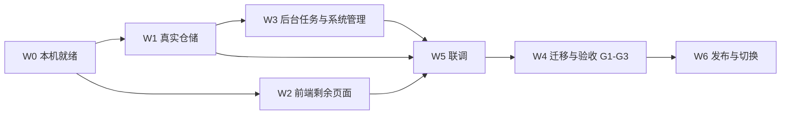

# 任务书：后续全部工作（2026-11-05）

给本地 Codex 用。每个任务有编号、依赖、输入、步骤、验收标准和提示词。**按编号顺序做，被依赖的任务没过验收，不开下一个。** 先读 `docs/handoff/README.md`（现状、规矩、怎么跑）。

## 0. 总览



W2（前端）只依赖已有的内存版后端，可以和 W0、W1 并行；W3 之后的都需要真实仓储。

| 编号 | 任务 | 谁 | 依赖 | 估时 |
| --- | --- | --- | --- | --- |
| W00 | 拉代码、环境自检 | Codex | — | 0.5 天 |
| W01 | 重置密钥、配置环境变量 | Leyinet + Codex | W00 | 0.5 天 |
| W02 | 执行建库 SQL、生成 schema | Codex（Leyinet 授权 lark-cli） | W01 | 0.5–1 天 |
| W03 | 建 8 个 streaming 同步任务 | Codex | W02 | 0.5 天 |
| W04 | 权限、云空间文件夹、测试账号 | Leyinet 提供，Codex 记录 | W01 | 并行 |
| W10 | 飞书与数据库的公共基础设施 | Codex | W02、W03 | 1–2 天 |
| W11 | 真实主数据仓储（云端已写完并测试，待真实库联调） | Codex | W10 | 1 天 |
| W12 | 真实航次仓储（云端已写完并测试，待真实库联调） | Codex | W11 | 2–3 天 |
| W13 | 真实导入仓储（靠船计划、库存） | Codex | W10 | 1–2 天 |
| W14 | 真实预测仓储 | Codex | W10 | 0.5 天 |
| W15 | 真实身份目录与权限联调 | Codex | W04、W12 | 1 天 |
| W16 | 补偿重放与同步防覆盖 | Codex | W12 | 1 天 |
| W17 | 适配器契约测试 | Codex | W11–W14 | 1 天（与上面穿插） |
| W20–W29 | 前端页面：**已完成**，剩真实平台验证与收口（见 W29） | Codex | W15 之后 | 1–2 天 |
| W30 | A18 云空间拉取靠船计划 | Codex | W13、W04 | 1–2 天 |
| W31 | 定时任务（自动化触发器） | Codex | W16、W30 | 1 天 |
| W32 | A26 兼容表 T09a/T09b 刷新 | Codex | W12 | 2 天 |
| W33 | A28 同步日志与连通性自检 | Codex | W10 | 0.5 天 |
| W34 | 后端遗漏项补齐（见 B 清单） | Codex | W12 | 1–2 天 |
| W40 | 迁移脚本 dry-run（A27） | Codex（本机读 Excel） | W12、W13 | 3–4 天 |
| W41 | 业务确认清单（港口别名等） | Leyinet | W40 | 等待 |
| W42 | 正式写入 + G1 对账 | Codex + Leyinet | W41 | 2 天 |
| W43 | G2：预测与德龙版对照 | Codex + Leyinet | W42 | 3 天 |
| W44 | G3：并行运行与切换 | Leyinet 主导 | W43 | 1–2 周 |
| W50 | 联调循环 | Codex + Leyinet | W12、W2x | 3–5 轮 |
| W51 | 发布与回滚 | Codex（Leyinet 授权） | W50 | 0.5 天/次 |
| W52 | 安全与权限审查 | Codex | W15 | 1 天 |
| W53 | 性能检查 | Codex | W12 | 1 天 |

## 1. 通用提示词前缀（每个任务都先发这一段）

```text
你在接手 SSPS（智慧发船预测系统）。先读 AGENTS.md、CLAUDE.md、docs/handoff/README.md，再读本任务。
规矩：
- 回复用中文；没有任何功能上线，汇报时严格区分「已上线」和「计划中」；
- 业务规则只以 CLAUDE.md「已锁定业务规则」和 docs/schema 为准，不自创字段、状态、口径；暂定值只改 app/server/config.ts；
- 发现规格冲突、需要业务判断的，停下来写进 docs/open-questions.md 并向我提问，不要自行假定；
- 密钥只用环境变量，绝不写进代码、提交、日志、回复；真实业务数据和 Excel 不提交，只回传统计数；
- 每个写接口都要有测试（含权限拒绝、校验拒绝、幂等）；提交前必须全绿：npm test、两个 tsc、eslint、npm run smoke；
- 改完更新 docs/development-workflow.md 的进度表；提交信息用中文；一批做完就提交并推送到 main；
- 做完用白话向我汇报：做了什么、验证了什么、没验证什么、需要我做什么。
```

## 2. 汇报模板（每批做完按这个格式回给 Leyinet）

1. 这一批完成了什么（一两句，业务语言）。
2. 怎么验证的（测试数、冒烟、截图、真实飞书里看到什么）。
3. **还没做 / 没验证的**（不要省略）。
4. 需要你（Leyinet）做的事，逐条编号。
5. 下一批打算做什么。

---

## W0 本机就绪

### W00 拉代码、环境自检

目标：本机能跑通现有全部检查和演示。

步骤：`git clone`（或 pull）`main`；装 Node 22；按 README 第 5 节装依赖；跑 `npm test`、两个类型检查、eslint、`npm run smoke`；`npm run build:server && npm run preview:build && node scripts/demo-server.cjs 3100`，浏览器打开 `/voyages`。

验收：91 个测试全绿；冒烟通过；`/voyages` 页面显示 58 条大宗航次，点页签能切换。任何一项失败先修，不要往下走。

提示词：

```text
执行 docs/handoff/task-book.md 的 W00。装依赖时不要并发 npm install；如果 package-lock 里有取不到的镜像地址，用 README 第 5 节的命令。把每项检查的结果列成表回给我。
```

### W01 重置密钥、配置环境变量

目标：拿到新的、只在本机的密钥。

Leyinet：在飞书开放平台重置应用 `cli_aa2584bb95f89bef` 的 App Secret（旧值已在对话里出现过，视为泄露），**不要把新值发给任何人或 AI 对话**。
Codex：按 `.env.example` 和 `docs/scaffold-integration.md` 在本机建 `.env`（脚手架的 `.gitignore` 不排除 `.env`，要手工确认：`git status` 里不能出现 `.env*`，必要时先在 `.gitignore` 加上），用 `lark-cli apps +env-set` 把变量注入应用环境。变量清单：App ID、App Secret、多维表格 Base 的 app token、11 张表的 table ID（来自 `docs/schema/base-build-report-2026-11-05.md`）、云空间文件夹 token（W04 提供）。

验收：`git status` 干净；用 `lark-cli` 能读 Base 的 T01 前 5 行（只回传行数，不回传内容）。

提示词：

```text
执行 W01。我已经重置了 App Secret，新值我会自己填进 .env，不要让我在对话里贴出来。你只负责：生成 .env 模板、确认 .env 不会被提交、把表 ID 从建表报告整理进配置、用 lark-cli 做一次只读连通性检查并回报行数。
```

### W02 执行建库 SQL、生成 schema

目标：应用库里有 D01–D12 十二张自有表，`server/database/schema.ts` 由工具生成。

步骤：

1. 读 `app/AGENTS.md` 的数据库章节；审阅 `app/db/001-ssps-core.sql`（由 `scripts/build-ddl.mjs` 生成，**不要手改 SQL，改生成脚本再重新生成**）：uuid 主键、单数 snake_case、审计列（`_created_at/_created_by/_updated_at/_updated_by`，`user_profile` 类型）、RLS 开启 + 4 条默认策略。
2. `lark-cli apps +db-execute` 执行。出错就按报错改 `build-ddl.mjs` 重新生成（已知风险：RLS 策略写法、`user_profile` 类型、`ROW(current_setting(...))` 默认值，都只依据 `app/AGENTS.md` 的文字，未在真实库验证；「查看全部数据」策略对匿名可读，要和 Leyinet 确认是否合适）。
3. `npm run gen:db-schema` 生成 `server/database/schema.ts`，提交。
4. 在库里手工插一行、查一行，确认 RLS 不拦自己。

验收：12 张表都在；`schema.ts` 已生成并提交；类型检查通过；记录执行日志（去掉密钥）到 `docs/schema/db-execute-report-<日期>.md`。

提示词：

```text
执行 W02。目标是把 app/db/001-ssps-core.sql 在真实应用库里跑通。先读 app/AGENTS.md 数据库章节和 SQL 文件。执行出错时不要手改 SQL，而是改 scripts/build-ddl.mjs 重新生成。RLS 策略如果和平台文档不一致，以平台文档为准，并告诉我差别。做完写执行报告。
```

### W03 建 8 个 streaming 同步任务

目标：T01–T08 同步到应用库镜像表 `m_port`、`m_berth`、`m_vessel`、`m_voyage`、`m_cargo`、`m_bulk_settle`、`m_sales_ext`、`m_route_rule`。

步骤：`lark-cli apps +db-sync-create`，每张 Base 表一个任务；每张镜像表必须有一列「Base 记录 ID」（见 `docs/schema/D-app-db.md` 第 5 节）；建好后 `gen:db-schema` 刷新；在飞书里改一条记录，确认镜像里 ≤ 数十秒内出现；把每张镜像表的**实际列名对照表**写进 `docs/schema/mirror-columns.md`（W11、W12 要用）。

验收：8 张镜像表有数据且行数与 Base 一致（回报行数）；改动同步延迟已测并记录；列名对照表已提交。

提示词：

```text
执行 W03。为 T01–T08 建 streaming 同步任务。每张镜像表要有 Base 记录 ID 列。建好后测一次「在飞书改一条，镜像多久更新」，把延迟和每张表的实际列名对照写进 docs/schema/mirror-columns.md。只回传行数和延迟，不回传业务明细。
```

### W04 权限、云空间、测试账号

Leyinet 提供，Codex 记录到 `docs/handoff/env-checklist.md`（只记状态和非密钥的 token，不记密钥）：

1. 开放平台应用权限：多维表格读写、云空间读取与下载；开通后**发布版本**。
2. 云空间新建「靠船计划」文件夹（可选「库存消耗模拟」文件夹），给出文件夹 token。
3. 靠船计划怎么进云空间：中间件 DX_DataTB_WS 上传，还是先手动上传（风险 R5：内网中间件能否访问飞书域名，要 IT 确认）。
4. 四个角色的测试账号：业务员、部门主管、物流管理员、系统管理员。
5. 业务员姓名 → 飞书账号映射（大宗约 33 人、商务海运约 9 人）。

验收：清单里每项有「已提供 / 待提供 / 不做」状态。

---

## W1 真实仓储

总原则：**服务层不改**，只新增适配器并改 `modules/ports/ports.module.ts` 的绑定。用环境变量开关（例如 `SSPS_STORE=memory|real`），内存实现保留作测试和演示。

### W10 飞书与数据库的公共基础设施

目标：把已有的 `lark/` 零件装配成可注入的服务，并落地写队列持久化。

步骤：

1. 新建 `LarkModule`：用环境变量创建 `createTokenProvider`、`createBitable`（带表 ID 配置）、`createWriteQueue`、`createOutbox`，注入 Nest。
2. 写队列持久化到 D10 `write_queue`（重启不丢）；运行日志写 D09 `sync_log`。
3. 用平台提供的 `DRIZZLE_DATABASE` 取库（**禁止自建连接**）；封装一个 `withTx` 小工具。
4. 限流：把 HTTP 429 和飞书限流错误码当作可重试，码值对照飞书文档核对并更新 `docs/open-questions.md` 里的待办。
5. 全部可注入假 `fetch` 测试（已有 `test/lark.spec.ts` 可参考）。

验收：新增测试覆盖「token 过期自动刷新」「分页读 >500 条」「批量写按 500 切分」「同一 Base 写入串行」「失败重试退避」「重启后队列续跑」；真实环境下用 T02 读 23 行、往一张测试用的临时表写 3 条再清理。

提示词：

```text
执行 W10。把 app/server/lark/ 里的 token、bitable、queue、outbox 装配成 Nest 的 LarkModule，用环境变量配置。写队列要持久化到 D10 write_queue，运行日志写 D09 sync_log。数据库只用平台注入的 DRIZZLE_DATABASE。补测试，再在真实环境做一次读 T02、写临时表的验证（验证后清理，不污染业务表）。
```

### W11 真实主数据仓储

实现 `MasterStorePort`（`ports/master-store.port.ts`）：读镜像 `m_port/m_berth/m_vessel/m_route_rule`；写飞书对应表，成功后立即回写镜像行；`saveRouteStats`（每日重算）只写统计列。

注意：港口别名在 T01 是文本，适配器负责与 `string[]` 互转（分隔符沿用已录入数据的写法，先看 T01 实际内容）；T08 的 `采用口径`、`生效航程` 是公式列，**只读，不写**；T08 的装/卸港是关联字段，要用港口记录 ID。

验收：`master-service.spec.ts` 的场景对真实适配器同样通过（见 W17）；在真实 Base 新增一个港口和一个泊位再停用，镜像同步一致；清理测试数据。

提示词：

```text
执行 W11：实现真实的 MasterStore（读镜像、写飞书、回写镜像）。T08 的公式列只读；装卸港是关联字段，需要港口记录 ID。港口别名与数组互转，先查看 T01 已录入数据的分隔写法。做完用 W17 的契约测试验证，并在真实 Base 上新增/停用一个港口和一个泊位验证后清理。
```

### W12 真实航次仓储

实现 `VoyageStorePort`：读 `m_voyage/m_cargo/m_bulk_settle/m_sales_ext`；写 T04–T07；D01 `eta_revision`、D02 `milestone_log`、D08 `data_issue`。

要点：

- 字段映射以 `docs/schema/T04..T07` 为准；T04 的公式列（状态、本港侧、总货量、拼船、逾期、航程天数、等泊、作业）和查找引用列（如 MMSI）**只读**，状态仍由 `domain/status.ts` 推导并作为展示值返回，不依赖飞书公式值（两者应一致，可在对账脚本里比对）。
- 航次编号由应用生成（`VY-YYYY-NNNN`，需要并发安全的序列，用应用库序列或 D10 队列保证）。
- 写链路严格按 README 第 4 节：鉴权 → 校验 → 经队列写飞书 → 回写镜像 → 日志 → 失败整体失败、镜像不动；幂等键落库（建议新增小表 `idempotency_key`，需要新的 DDL 迁移，走 W02 同样流程）。
- `list()` 目前在内存版里对每条航次单独取货物明细（N+1），真实实现用一条联表或预聚合查询，**必须**支持 `VoyageService.list` 现有的全部筛选、计数（`counts`）、分页，数据量按 2000 条航次设计。
- `issues()` 去重规则：同一对象同类问题只保留一条未关闭的（内存版已实现，照抄语义）。

验收：`voyage-service.spec.ts` 对真实适配器同样通过（W17）；真实环境走通「新建航次 → 录实际节点 → 修订 ETA → 打取消 → 货物增改删 → 结算 → 销售扩展」，逐步在飞书 Base 里核对；故意让飞书写失败（断网或临时无权限），确认应用返回失败且镜像未变。

提示词：

```text
执行 W12：实现真实的 VoyageStore。T04 的公式列和查找引用列只读，状态仍由 domain/status.ts 推导。写链路按 docs/handoff/README.md 第 4 节。航次编号要并发安全。list() 不要 N+1，要支持现有全部筛选、counts 和分页，按 2000 条航次设计。需要新表（如幂等键）就走和 W02 一样的 DDL 流程。做完用契约测试 + 真实环境全流程验证，并故意制造一次飞书写失败，确认镜像不变。
```

### W13 真实导入仓储（靠船计划、库存）（**已完成**：`DrizzleImportStore`，需先执行 `app/db/004-import-columns.sql`；T10 同步写飞书未做）

实现 `ImportStorePort`：D03/D04 靠船计划批次与全部原始行；有效行（active）同时写飞书 T10；D11/D12 库存批次与逐日行。

要点：整批写完、校验通过后才切「当前批次」指针（事务）；T10 只放当前批次有效行，新批次整体替换旧批次；D04 每年约 16 万行，写入要分批（≤500）并可续跑；`currentPlanRows()` 要快（预测每次都读）。

验收：用脱敏样例（仓库里的 `server/test` 样例）导入一次靠船计划和一次库存；在日历页看到占用；再导入第二批，旧批次保留可查、当前指针切换；中途杀进程，确认仍用上一批。

提示词：

```text
执行 W13：实现真实的 ImportStore（D03/D04/D11/D12 + 写 T10）。切当前批次必须在整批写完且校验通过之后、用事务完成。D04 写入分批可续跑。currentPlanRows 要快。验证包括中途杀进程后预测仍用上一批。
```

### W14 真实预测仓储（**已完成**：`DrizzlePredictionStore`，PGlite 契约测试通过；剩真实库联调）

实现 `PredictionStorePort`：D05 `prediction_run`、D06 `prediction_plan`（含 S1 溯源 JSON）、D07 `announcement`；`nextRunNo` 按日递增且并发安全（`PR-YYYYMMDD-NNNN`）；`adopt` 记录采纳到的航次编号。

验收：并发 20 个预测请求，运行编号不重复；详情接口能原样取回溯源；宣船文案只从已存溯源生成（`announceFromProvenance`），数值与方案一致。

### W15 真实身份目录与权限联调（2026-11-05 云端已写完并用假 SDK 测试：`adapters/platform/`，角色约定 ssps_salesman / ssps_manager / ssps_logistics / ssps_admin，可用 ROLE_MAP、DEPT_MAP 覆盖；未验证项在本机用提示词 9 核对；权限矩阵 docs/handoff/permission-matrix.md 已由代码生成并有测试核对；未做：4 个测试账号逐项验证）

实现 `DirectoryPort`：从平台 `req.userContext` + 平台角色（4 个应用内角色，用 `+role-*` 管理）+ 组织架构得到 `{角色, 部门}`；业务员姓名 ↔ 飞书账号映射表（W04）用于把迁移来的航次的「负责业务员」姓名关联到账号（`ownerId`）。

验收：用 W04 的四个测试账号分别登录，按 `docs/handoff/permission-matrix.md`（本任务产出，列出每个接口 × 角色 × 允许/拒绝，起点是 `server/test/permissions.spec.ts`）逐项验证；金额字段对非大宗采购部不可见；物流管理员不能改航次。

### W16 补偿重放与同步防覆盖（写队列持久化、补偿接口 `POST /api/admin/replay`（A29）已完成并测试；定时触发归 W31；「同步防覆盖」的核对任务待做——见下方说明）

目标：飞书写成功、回写镜像失败时能自愈；晚到的同步事件不覆盖更新的回写值。

步骤：用 `lark/outbox.ts`；回写镜像带 `updatedAt` 版本；`shouldApplySync` 用于同步事件落地（streaming 同步是平台做的，所以实际做法是：回写后在 D10 记「待核对」，核对任务比对飞书与镜像，不一致则以飞书为准重写镜像）；补偿任务每分钟扫描 D10 失败项重放。

说明（2026-11-05）：补偿已做——`DrizzleMasterStore/DrizzleVoyageStore.replayHandlers()` 提供各类写入的回写步骤，`AdminService.replay` 汇总重放；单条失败不影响其他条，留待下一轮；接口限系统管理员，返回重放条数与 pending/failed/written 积压；定时触发见 W31（每 5 分钟）。「同步防覆盖」后端无法拦截平台 streaming 同步，只能靠核对任务（飞书为准）兜底，尚未做。

验收：注入「回写失败」，补偿后镜像与飞书一致；注入「旧同步事件晚到」，不覆盖新值。

### W17 适配器契约测试

目标：同一套测试对内存适配器和真实适配器都跑。

步骤：把 `voyage-service.spec.ts`、`master-service.spec.ts`、`imports-service.spec.ts`、`prediction-service.spec.ts` 的构造函数抽成工厂 `makeStores(kind)`；`kind=memory` 恒跑；`kind=real` 仅在设置了 `SSPS_REAL_TEST=1` 且有环境变量时跑，并使用**独立的测试 Base 或带前缀的测试数据，跑完清理**，绝不碰业务数据。

验收：CI 默认只跑 memory；本机设置开关后 real 也全绿。

---

## W2 前端页面（状态：P01–P11 已于 2026-11-05 在云端全部完成，下面保留规格作验收依据；Codex 的工作是在真实平台里验证、修正和收口）

通用做法（README 第 6 节第 4 条）：对照 `prototype/Pxx-*.html`，用 `scripts/extract-page-css.cjs` 抽样式，页面根节点加 `pg-pxx`；用 `client/src/ssps/` 里的 api/format/ui；路由在 `client/src/app.tsx` 注册（当前只注册了 `/` 和 `/voyages`；导航在 `components/Layout.tsx`，路径已预留 `/ask /predict /predictions /calendar /voyages /voyage /berth-plans /master /data-quality /admin`，P04 里跳转用 `/voyages/:id`，实现 P05 时在路由里加 `voyages/:id`）。

每页完成后：用云端同样的办法验证——`build:server`、`preview:build`、`demo-server`、Playwright 截图 1920 宽（P01、P04、P05 还要 390 宽手机），存到 `prototype/screenshots/react-<页面>.png` 并提交；再拿原型截图对照，列出有意差异。

必须体现（CLAUDE.md 第 5 条）：无数据灰色斜线（绝不显示 0%）、CMR 口径与色阶、≤15 天与＞15 天两条路径的不同显示、Plan A/B 卡片、S1 溯源区块、航程「经验值 / 统计值」标签、「低可信」标签。任何界面不得使用 CMR 以外的容量口径。

页面接口调用要点：读用 `useQuery`，写用 `useWrite`（失败自动弹后端中文原因）；不要在前端复制业务规则（状态推导、时序校验、权限都以后端为准，前端只做体验性的预校验）。

### W20 P05 航次详情/编辑（先做，P04 已经跳转到它）

原型：`prototype/P05-voyage-detail.html`。样式已抽出到 `client/src/pages/Voyages/p05.css`（页面根节点用 `pg-p05`）。路由 `voyages/:id`，支持查询参数 `?tab=base|cargo|ext|eta|log&focus=<字段键>&act=node|eta|gauge`（P01、P09 会用它们直达）。

内容：顶部航次卡（船名、状态、船位链接、异常标记、重点关注星标、四个操作按钮：登记节点 / 修订 ETA / 编辑基本信息 / 异常标记）；三种横幅（历史只读、缺实际离装港、ETA 过期）；时间轴（成品多一个「受载期」节点；大宗「装港靠泊」显示「大宗不记录」；成品「卸港离港」显示「成品无此列」；实际晚于计划标红）；5 个页签（基本信息、货物明细、卸船结算 / 销售扩展——物资备件船没有这一页签、ETA 修订历史、变更日志）。

接口：`GET /api/voyages/:id`（带 `can` 权限位，按它决定按钮可用和提示）、`PATCH /api/voyages/:id`（只发改动的字段）、`POST …/milestones`、`POST …/eta`、`POST …/flags`（一次一个标记，开/关）、货物增改删、`PATCH …/bulk-settlement`（作业数据与费用分开提交，各自 403）、`PATCH …/sales-ext`。船舶下拉取 `GET /api/vessels`，MMSI 从船舶主数据取（缺 MMSI 显示红色提示）；泊位输入只允许 23 个泊位。

与原型的有意差异（不要还原）：去掉右上角「模拟身份」切换（真实身份来自登录）；「查看船位」按钮复制 MMSI 并打开船讯网（深链格式待确认，先打开首页）。

验收：用 W15 之前的演示服务，分别用 `x-demo-user` 林海川（本人）、陈砚秋（同部门他人）、周晓棠（主管）、顾明远（物流管理员）、韩墨（商务海运部）走一遍：按钮可用性与 403 提示正确；金额对无权限者显示「无权限查看」；保存后状态按节点自动推导；时序倒置被后端拒绝并把原因展示给用户；删除最后一行货物被拒绝。

提示词：

```text
执行 W20：按 prototype/P05-voyage-detail.html 用 React 实现航次详情页，路由 voyages/:id，样式已抽到 client/src/pages/Voyages/p05.css。内容、接口、有意差异见 docs/handoff/task-book.md 的 W20。完成后用 npm run build:server && npm run preview:build && node scripts/demo-server.cjs 3100 起演示，用 Playwright 对 1920 和 390 宽截图，分别用 x-demo-user 林海川/陈砚秋/周晓棠/顾明远/韩墨验证权限表现，截图存 prototype/screenshots/react-P05.png。
```

### W21 P01 工作台

原型 `P01-workbench.html`。待办四块：待补节点（`missingDeparture`）、ETA 超 3 天未更新（`etaStale`）、本周到港、数据质量问题（`GET /api/data-issues?owner=…&status=待处理`）。数据来自 `GET /api/voyages?mine=1` 与 `/api/me`（用其 `today` 判断「本周」，不要用浏览器时间）。点待办用 `?act=node`/`?act=eta`/`?focus=` 跳到 P05。手机可用。

### W22 P11 智能提问

原型 `P11-ask.html`（UI 已按效果图重构，4 阶段状态机）。接口：`POST /api/predictions/parse`（只解析，不产生数值）→ 展示识别出的船型、物料、货量、航线、截止日，允许手工改（`overrides`）→ `GET /api/inventory` 展示库存可用天数与断料日（显示原表可用天数，注明口径；库存模拟覆盖期外不要说「不断料」）→ `POST /api/predictions`。结果跳 P02/P03 同一套展示（复用 W23 的组件）。语音输入原型是否有、是否保留，先看原型再定，不要新增。

### W23 P02 智能发船预测

原型 `P02-prediction.html`（第一版，已优化；`P02-prediction-v2.html` 是备选草图，**不做**）。内容：输入区（业务类型、货量、装卸港、受载期或期望窗口、物料、缓冲天数）→ Plan A/B 卡片（推荐 + 备选，含「低可信」、路径标签「≤15 天 / ＞15 天」、CMR_min 或同期最多船数、库存状态）→ 30 天容量日历 → 23 泊位一览 → 采纳弹窗（选已有待宣船航次或新建，对接 `POST …/adopt`）→ 宣船文案弹窗（`POST …/announcement`，一键复制）。`status` 为 `no_rule` 时提示先补经验航程并给出去 P08 的入口，不编默认值；`no_candidate` 时如实提示。**引擎返回的数值原样展示，不在前端重算。**

### W24 P03 预测详情

原型 `P03-prediction-detail.html`。`GET /api/predictions/:runNo`。S1 溯源区块（每个数字来自哪张表、哪个批次、哪条航程规则，航程标「经验值 / 统计值」）、可用泊位视图、侧栏宣船文案 + 一键复制。

### W25 P06 港口容量日历

原型 `P06-capacity-calendar.html`（已按整体业务逻辑重排）。吨级档切换（默认 5 万吨）；≤15 天显示 CMR 色阶，＞15 天显示重叠船数；点某日看当日在港船（`GET /api/capacity/day`）；无数据灰色斜线。

### W26 P07 靠船计划

原型 `P07-berth-plan.html`。批次列表（来源、行数、校验结果、当前批次标记）、批次明细（按 active/history/anomaly 筛选）、手动上传 .xlsx（`POST /api/berth-plans/import-file`，可选计划日期）、未匹配泊位 / 船舶告警。「是否德信」列和筛选项保留（按从属单位判断，写法清单待 Leyinet 提供，先用现有规则）。仅物流管理员、系统管理员可见上传按钮。

### W27 P08 主数据

原型 `P08-master-data.html`。页签：港口（含别名）、泊位、船舶、航程规则（经验值编辑、样本数、当前口径「经验值 / 统计值」标签、手动重算入口仅系统管理员）。权限：港口/泊位仅物流管理员和系统管理员；船舶新增业务员也可；航程规则仅部门主管和系统管理员。表单错误展示后端的中文原因。

### W28 P09 数据质量

原型 `P09-data-quality.html`。清单按责任人、问题类型筛选；点击直达 P05 对应字段（`?focus=`）；关闭按钮仅责任人或系统管理员（后端已校验）。

### W29 收口（Codex 待做）

已完成：全部 11 页、路由、导航、示例页清理。待做：在真实妙搭平台（AppContainer、真实登录）里逐页走一遍；按 `/api/me` 角色隐藏无权入口（目前导航对所有角色显示，靠页面内的禁用和后端 403 兜底）；手机适配复核（P01、P04、P05）；P05 的「查看船位」船讯网深链格式；P07 的云空间拉取按钮在 W30 完成后启用；P10 兼容表与迁移页签在 W32、W40 完成后接真实数据。

原清单：

导航分组与权限显隐（按 `/api/me` 的角色隐藏无权入口，后端仍是最终裁判）；统一加载、空、错误态；404；手机适配（P01、P04、P05）；去掉无用的示例页（`ExamplePage`、`Home`、`hooks/use-example.ts`）；首页路由 `/` 改为 P01；全部页面截图基线提交。

### W2A P10 系统管理（依赖 W31、W33）

原型 `P10-admin.html`。同步日志、兼容表手动刷新、迁移 dry-run 报告、连通性自检。仅系统管理员。

---

## W3 后台任务与系统管理

### W30 A18 云空间拉取靠船计划（**代码已完成**：客户端、拉取逻辑、接口、假 fetch 测试；待用真实云空间验证）

实现飞书云空间客户端（列文件夹、下载文件，需「云空间读取与下载」权限）；`POST /api/berth-plans/pull`：列出指定文件夹新文件，按文件 token 去重（`ImportStore.hasFileToken`，已实现语义），逐个下载 → `readXlsx`（`server/lib/xlsx.ts`）→ `ImportsService.importBerthPlan({ source:'飞书云空间', fileToken })`；一个文件失败不影响其他，失败写 D09 并进数据质量。内网中间件上传的链路（K05、风险 R5）未打通前，手动上传是兜底。

验收：往文件夹手工放 2 个文件，拉取后出现 2 个批次；重复拉取不重复；放一个坏文件，其余照常。

### W31 定时任务（妙搭自动化触发器）（2026-11-05 云端已写完：`modules/admin/jobs.automation.ts` 用 @Automation/@BindTrigger 声明 6 个触发器，清单见 docs/handoff/scheduled-jobs.md；待办：真实环境确认触发器已注册、cron 时区、每个手动触发一次——提示词 8）

（原方案「建触发器 + 内部令牌调 HTTP」已废弃：控制器有 @NeedLogin，无登录态的调用进不来；改用代码里声明触发器。）原要求如下：拉云空间（建议每 30 分钟）、航程重算（每日一次，建议凌晨）、兼容表刷新（每日 15:50）、补偿重放（每分钟或 5 分钟）、库存文件拉取（如启用）。接口要幂等、可重入、带运行日志（D09）。

验收：每个触发器在真实环境至少成功跑一次，D09 有记录；手动重复触发不产生重复数据。

### W32 A26 兼容表 T09a/T09b 刷新（2026-11-05 云端已写完并测试：`POST /api/admin/compat/refresh`、`CompatService`、`domain/compat.ts`，列对应见 docs/schema/compat-mapping.md；待办：Leyinet 核对列口径、本机真实 Base 联调、15:50 定时触发归 W31、对照企微原表抽样 50 行）

规格：`docs/schema/T09-T10-compat-and-berth-plan.md`。T09a 保留商务海运表原 33 列，T09b 保留大宗到船计划表原 87 列，列名和顺序不变，每行对应 T05 一行货物明细，由后端**全量重写**（每日 15:50 + 航次保存后增量刷新，保存时只打「待刷新」标记）。全量重写要分批 ≤500 且不中断下游读取（先写新再切换，或按 Base 能力选择最小干扰方案，并在文档里说明）。

验收：对照企微原表抽样 50 行逐列一致（迁移验收 G1 的一部分）。

### W33 A28 同步日志与连通性自检

`GET /api/admin/sync-logs`（D09 分页）、`GET /api/health`（飞书 token 有效期、Base 连通与表可读写、云空间文件夹可读、应用库可连）。仅系统管理员；健康检查不得返回密钥或原始报错里的敏感信息。

### W34 后端遗漏项补齐（B 清单）

这些在规格里有、但内存版**没做**，联调前补齐（每项都要测试）：

1. **【已做，云端测试通过】数据质量问题的自动生成**（2026-11-05：`IssueScanService` + `POST /api/data-issues/scan`，系统管理员手动触发；缺 MMSI、ETA 超期未更新两类定时扫描生成、条件消失自动关闭（关闭人「系统」）；靠船计划导入时生成「泊位未匹配」；「港口未匹配」留给 W40 迁移时生成；定时挂载归 W31）。原文：目前只生成「缺离装港时间」「节点时序倒置」「靠船计划日期异常」；还缺：「缺 MMSI」（航次关联的船舶无 MMSI）、「港口未匹配」（导入/迁移时港口别名对不上）、「泊位未匹配」、「ETA 超期未更新」（定时扫描，`etaStale`）。问题修复后自动关闭（例如修订 ETA 即关闭对应的「ETA 超期未更新」，原型里有此行为）。
2. **【已做，云端测试通过】库存表过期提醒**（2026-11-05：`GET /api/inventory` 返回 `stale {stale, since, changes[]}`；导入之后相关未结束航次的 ETA 修订或计划抵卸港窗口被改就提醒；P02/P11 页面顶部黄色提示；物料↔货物暂按品名互相包含匹配，正式映射待确认）。原文：规格「库存与预测补充规则 ④」——库存表导入之后，如果该物料相关的在途航次改了到港时间，预测页提醒「库存表可能已过时，请重新导入」。需要在预测接口返回里带 `inventoryStale` 标志并写清判定。
3. **ETA 修订与航次 `etaUpdated` 的一致性**：新建航次带 ETA 时已记 `etaUpdated`，但没有写一条 ETA 修订历史，确认是否需要（规格 K13）。
4. **负责人转移**：目前不能改负责业务员（白名单里没有）。规格没有写转移规则，先问 Leyinet，不要自行实现。
5. **航次导出**：前端目前分页拉全量导出 CSV；数据量大时改为后端流式导出。
6. **【已做】去掉构建产物里的测试**（`build:server` 构建后删除 `dist/server/test`）。原文：`nest build` 会把 `server/test` 也编进 `dist`，在 `tsconfig` 里排除。
7. **`MemoryDirectory` 的兜底身份**（未登记用户按「业务员 · 大宗采购部」）只能留在内存适配器里，真实适配器对未知用户必须拒绝。

---

## W4 迁移与验收（阶段 E）

### W40 迁移脚本 dry-run（A27）（2026-11-05 云端已写完并用虚构样本测试：`server/importers/migrate-plan.ts`、`scripts/migrate-dryrun.ts`；待办：Leyinet 本机用真实 Excel 跑（提示词 7，docs/local-tasks-prompts.md），按真实结果调规则；未覆盖：港口信息表→T01、靠船计划表→首个批次、人员映射、正式写入）

规则：`docs/schema/migration-rules.md`；清洗代码已有：`server/importers/migrate.ts`（港口归一 295 种写法、船名拆分、拼船归并、去重、数值化）；Excel 读取：`server/lib/xlsx.ts`。数据源是 Leyinet 提供的企微导出 Excel（**忽略 Base 里已有的 17 张历史表**，2026-11-05 已确认）；原始 Excel 只在本机读，**不提交**。

步骤：写 CLI（`app/scripts/migrate.ts` 或经 A27 接口）：读 Excel → 清洗 → 输出 dry-run 报告：各业务类型航次数与货量合计、清洗前后差异、被剔除/归并的行及原因、待确认清单（港口别名、7 天拼船归并、船名拆分异常、占位时间疑似项）。**报告只含统计和 ID，不含业务明细**，供 Leyinet 确认；确认结果落成配置文件（别名表等），不要改代码常量。M1 只迁在途 + 近 30 天，全量历史在 M2 结束前补齐；迁入记录标 `readonly=true` 的规则以迁移规则文档为准。

验收：dry-run 可重复运行、结果一致（幂等）；报告能回答「每个差异来自哪条已确认规则」。

提示词：

```text
执行 W40。读 docs/schema/migration-rules.md 和 app/server/importers/migrate.ts。写一个本机迁移 CLI：读我提供的企微 Excel（路径通过参数传入，不要提交），清洗，输出 dry-run 报告。报告只含统计、ID 和规则编号，不含业务明细。待确认清单（港口别名、拼船归并、船名拆分异常、占位时间）单独输出成文件给我确认；我确认后的结果以配置文件形式落库，不要写进代码。
```

### W41 业务确认清单（Leyinet）

1. 港口别名确认（295 种写法归到标准港口，W40 之后给清单）。
2. 业务员姓名 → 飞书账号映射（同 W04）。
3. 库存品名 ↔ 货物物资类别映射（37 个品名，库存表来自企微，需业务方确认）。
4. 德龙版 20 个预测用例的输入和结果快照（G2 对照要用，在德龙版里导出冻结）。
5. 「是否德信」的从属单位写法清单（P07 显示用）。
6. `docs/open-questions.md` 里所有未勾选项（吨级档、业务属性枚举、成品船结束状态、时区、ETA 超期阈值、P50/P80 算法、靠船计划覆盖口径等）。**每答一项，就让 Codex 只改 `config.ts` 或对应一处。**

### W42 正式写入 + G1 对账

步骤：Leyinet 确认清单 → 迁移 CLI 正式写入（写飞书 T04–T07，经写队列、可续跑、可回滚到「迁移前」标记批次）→ 对账：按业务类型、月份对比新旧航次数和货量合计，差异只允许来自清单中已确认的归并/剔除；T09a/T09b 抽样 50 行逐列比对。

验收（G1）：对账报告差异为 0（或全部可追溯到已确认规则），Leyinet 签字。

### W43 G2：预测与德龙版对照

M2：用 W41 第 4 项的 20 个用例 + 5 个补充用例，在新系统里跑预测，与德龙版结果逐项对照（推荐发船日、到港窗口、路径、CMR/船数、Plan B 是否出）。不一致的逐条分析：是规则差异、数据差异还是 bug；规则差异走 `open-questions.md` 由 Leyinet 拍板。

验收（G2）：25 个用例全部一致，或差异全部有书面结论。

### W44 G3：并行运行与切换

业务员并行使用两周以上（新旧同时录入或新系统录入、旧系统对照）；兼容表 T09a/T09b 给综合物流平台读取，核对其无感；每日记录差异与问题；达标后德龙版下线。**这一步由 Leyinet 主导，Codex 负责每日修 bug 和出对账数据。**

---

## W5 联调与发布

### W50 联调循环

在本机 `npm run dev` 连真实飞书，按下面的主线手动走：**建航次 → 录节点 → 预测 → 采纳 → 宣船文案**，再走：导入靠船计划 → 日历出数 → 导入库存 → 带物料预测 → 断料约束生效。每轮：Leyinet 或 Codex 走一遍 → 记录问题（去掉密钥和业务数据）→ 修 → 回归（测试 + 冒烟 + 真实环境重走失败的那步）→ 更新 `docs/handoff/joint-debug-log.md`（日期、问题、根因、修复提交、验证方式）。

验收：主线两条连续三轮无新问题；四个角色的权限表现与 `permission-matrix.md` 一致。

### W51 发布与回滚

```bash
git add <本次文件> && git commit -m "..." && git push origin <分支>
lark-cli apps +release-create --as user --app-id <app_id> --branch <分支> --apply-reason "<发布说明>"
lark-cli apps +release-get --as user --app-id <app_id> --release-id <release_id>
```

发布前检查清单：全绿；DDL 已在目标环境执行；环境变量齐全；`git status` 无 `.env*`；发布说明写清影响面。**发布必须 Leyinet 明确授权**，每次都问，不要复用上一次的授权。回滚：用平台的发布回退，并在 `docs/handoff/release-log.md` 记录；数据迁移类变更必须先有回滚方案（迁移批次标记）再发布。

### W52（云端部分已完成，见 docs/handoff/security-review.md；剩真实环境验证） 安全与权限审查

核对：RLS 策略对四个角色的实际效果；金额字段在列表、详情、变更日志、导出、错误信息里都不泄露（变更日志对金额只记「已修改」不记值，已实现，真实适配器不能破坏）；所有 `/api/*` 带 `@NeedLogin()`；内部接口（拉取、重算、刷新）的系统内部鉴权；前端构建产物里搜不到 App ID / Secret；日志里没有密钥和业务明细；上传文件大小与类型限制（已有 10MB、仅 .xlsx）。产出 `docs/handoff/security-review.md`。

### W53 性能检查

数据量按 2000 航次、16 万行靠船计划快照、库存 37 品名逐日行估：航次列表、日历、预测的 P95 响应时间（目标：列表 < 1 秒，预测 < 3 秒，具体由 Leyinet 定）；找出慢查询并加索引（DDL 走 W02 流程）。

---

## 3. 给 Leyinet 的待办（汇总）

| 时机 | 事项 |
| --- | --- |
| 立刻 | 重置 App Secret（W01）；授权 lark-cli 执行建库 SQL（W02） |
| 联调前 | 开放平台权限并发布版本；云空间「靠船计划」文件夹 token；四个角色测试账号；业务员姓名 → 飞书账号映射；确认中间件上传 vs 手动上传（W04） |
| 迁移前 | 港口别名清单确认；库存品名映射；「是否德信」写法清单；德龙版 20 个用例快照；清掉 `open-questions.md` 里未勾选项（W41） |
| 持续 | 大宗采购部校对并补全经验航程（现 10 条估算，目标 30–50 条）；每次发布的授权；G1/G2/G3 签字 |

## 4. 已知的开放问题（不阻塞开工，改口径只改一处）

见 `docs/open-questions.md` 未勾选项。当前最影响实现的几条：P50/P80 分位数算法（后端按线性插值）、靠船计划「覆盖到哪天」口径（后端取最后一条预计靠泊日）、航程样本上限（90 天）、物流管理员能否改航次、采纳方案写回字段、泊位类别（海船/驳船）。
