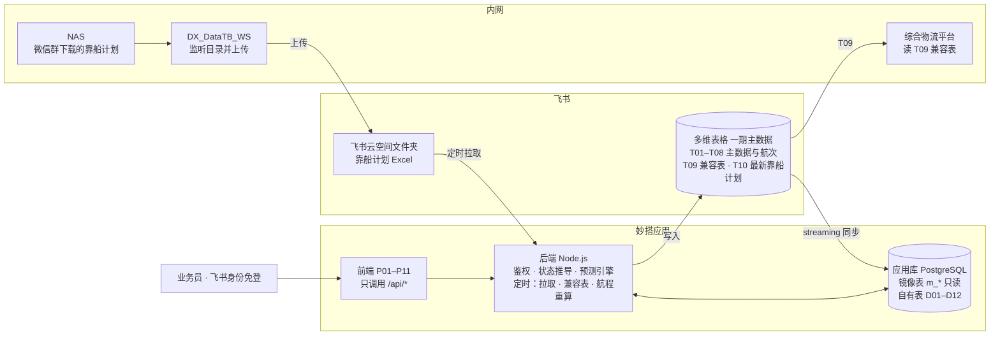

# 智慧发船预测系统 · 妙搭版实施计划书 V1.0

2026-11-04 · Leyinet · 在线版：https://claude.ai/artifact/VM4TLGJqdbd2FJvQAibNfJ（以在线版为准，本文件为导出快照）

妙搭版是「智慧发船预测」的新主系统：一期飞书多维表格为主数据、应用为唯一录入入口，约 8 周分三个里程碑上线，与德龙版并行验收后替换。

本计划依据 2026-11-04 的企微导出（17 张表，以 docs/data-profile 摘要为准）和 13 轮 grill-me 访谈写成。下表是访谈锁定的决策，后续章节都以它为前提；已在德龙版锁定的业务规则（CMR 口径、23 泊位池、吨级匹配、≤15 天/＞15 天分流、Plan A/B、无数据灰色斜线、详情页 S1 溯源）全部沿用，不重新讨论。

| 编号 | 决策点 | 锁定结论 |
| --- | --- | --- |
| K01 | 数据主权 | 两阶段：一期多维表格为主、应用读写；二期应用库为主，多维表格降为只读镜像后下线 |
| K02 | 航次建模 | 航次主表 + 大宗卸船结算扩展表 + 成品销售扩展表，用航次 ID 关联 |
| K03 | 记录粒度 | 一条船一次挂靠一行；合同/货物拆到「航次货物明细」，拼船靠明细表达 |
| K04 | IMIP 靠船计划存储 | 按导入批次全量存妙搭库，保留历史快照；多维表格只放最新一期 |
| K05 | 靠船计划接入 | DX\_DataTB\_WS 监听 NAS → 上传到飞书云空间指定文件夹 → 应用定时拉取；保留手动上传兜底 |
| K06 | 航程规则冷启动 | 业务员先填常用航线经验值；同航线实际样本 ≥5 条后自动切换统计值（P50/P80） |
| K07 | 系统定位 | 新主系统，与德龙版并行对照验收，通过后德龙版发船预测功能下线 |
| K08 | 下游兼容 | 只重建 APS 相关表；报表类表原样迁移；为综合物流平台生成旧结构兼容表 |
| K09 | 写入边界 | 航次事实字段只在应用录入、写回多维表格；表格端对这些字段只读 |
| K10 | 船舶状态 | 由时间节点自动推导，8 个状态互斥；人工只打「异常标记」 |
| K11 | 用户与权限 | 飞书身份免登录；业务员 / 部门主管 / 物流管理员 / 系统管理员 4 个角色；全员可看全部航次，金额字段按部门隔离 |
| K12 | 历史数据 | 历史副本全量迁入，标记只读，重叠段以现表为准去重 |
| K13 | ETA 来源 | 一期手工更新、每次修订留痕；MMSI 改为必填；船讯网接口放二期 |
| K14 | 库存断料 | 2026-11-04 补：库存消耗模拟表导入后，断料日作为预测的硬约束（到港窗口不晚于断料日 − 缓冲天数），一期纳入；库存只导入，不做填报 |

## 1. 一期目标与范围

一期要做到：业务员只在应用里维护航次、更新 ETA、跑发船预测、生成宣船文案，飞书多维表格作为主数据自动保持一致，综合物流平台大屏不断。

**纳入一期的 7 个模块**

1. 主数据：港口、泊位（泊位容量表 23 泊位）、船舶、航程规则。
2. 航次管理：三类船（大宗采购船 / 成品销售船 / 物资备件船）的录入、列表、详情、时间节点、货物明细、ETA 修订。
3. IMIP 靠船计划导入：飞书云空间定时拉取 + 手动上传，按批次快照入库。
4. 智能发船预测：Plan A/B、≤15 天走靠船计划做泊位级 CMR、＞15 天走航次表做重叠船数密度、详情页 S1 溯源。
5. 宣船文案：由航次或已采纳方案一键生成、一键复制。
6. 兼容表同步：为综合物流平台生成旧字段名、一合同一行的表。
7. 库存断料保障（K14）：导入库存消耗模拟表，展示各物料可用天数与断料日，预测保证不断料；入口是 P11 智能提问。

**一期不做**

- 装船明细、装船统计、大宗卸船明细/统计、仓储生产快报、大宗原料库存填报等报表类表：按原结构迁飞书，不重建（库存消耗模拟表的导入与断料约束属于一期，见 K14，只导入不填报）。
- 船讯网 / AIS 自动取 ETA、历史航迹回补。
- Plan C/D、DWRS 六维评分、风险标记体系、成本决策、AI 开放问答（沿用已锁定的第一版范围裁剪）。
- 二期切换（应用库变主、多维表格下线）只在本计划里留好接口，不在 8 周内执行。

## 2. 平台事实核实与对原技术栈要求的校正

原技术栈要求里有 4 处和飞书官方 lark-cli 妙搭文档不一致，开工前必须按下表校正；另有 2 项平台能力会直接简化架构。依据是 larksuite/cli 仓库中 lark-apps 技能文档（见文末 Sources）。

| # | 原要求 | 实际情况 | 本计划的处理 |
| --- | --- | --- | --- |
| C1 | 本地调试用 `lark-cli dev` | 官方流程没有这个命令：`lark-cli apps +create --app-type full_stack` → `+init` 拉脚手架 → `npm run dev` | 按官方流程，见第 10 节 |
| C2 | 发布用 `lark-cli apps +release-create --apply-reason` | 命令存在，但发布的是远端 `sprint/default` 分支上已 push 的代码；发布可能进入审批，需用 `+release-get` 查结果 | 发布 = git push + release-create + release-get |
| C3 | 项目根目录含 `app.json`、`src/server/index.js`、`src/client/index.html` | 工程结构由 `+init` 生成的脚手架决定，文档提到 Controller / Module 结构和仓库内 `.agents/skills/` 领域规范；运行时代码必须用脚手架规定的 SDK | 第 10 节给的是「逻辑模块」，M1 第 1 天按实际脚手架落位；如脚手架非纯 JS，以脚手架为准 |
| C4 | 自建应用权限 `bitable:app`、`base:record:retrieve` | `retrieve` 只能读；新增/更新记录还要开通记录写入权限；从云空间拉靠船计划还要云文档读取/下载权限；应用还需被添加为该 Base 的协作者 | M1 第 1 周在开放平台补齐，权限名以开放平台控制台为准 |
| C5 | 后端自己轮询多维表格 | 妙搭自带「Base 到应用数据库」同步（`+db-sync-create`，streaming 模式持续同步，一张表一个任务）；应用库是 PostgreSQL，带 RLS 和审计列 | 用它做「飞书表 → 应用库」镜像，预测查询只读应用库 |
| C6 | 定时任务自己实现 | 妙搭自带自动化触发器：定时、记录变更、Webhook、飞书审批（`+automation-create`）；环境变量用 `+env-set` 管理 | 云空间拉取、兼容表刷新、航程规则重算都用定时触发器 |

多维表格接口限制（官方「使用限制」页，该页已标为不再维护，旗舰版实际值需在 M1 第 1 周核实）：单表 20,000 条记录、150 个字段；批量增删改每次 ≤500 条且整批成功或失败；列表每页 ≤500 条；同一 Base 不建议并发写。按本计划估算，航次表迁移后约 3,600 行、每年新增约 1,500 行，在上限内；靠船计划每年约 16 万行，故只进应用库（D04）。

## 3. 总体架构与数据流

一期只有一个写入口：业务员在应用里保存，后端写飞书多维表格，再由妙搭同步任务镜像到应用库，预测和列表只读应用库。



靠船计划走左侧链路：NAS → DX\_DataTB\_WS → 飞书云空间 → 后端定时拉取入应用库；综合物流平台只把数据源换成 T09 兼容表。

**二期切换**：停掉 streaming 同步任务，镜像表转为主表，后端的写入步骤由「写飞书」改为「写应用库」；T09 兼容表继续由后端生成，直到综合物流平台改为调用应用接口。业务员的页面和接口不变。

## 4. 多维表格结构重建

新建一个 Base「德信智慧航运主数据」，共 11 张表，取代企微里 4 张 APS 相关表；报表类表另放一个 Base「综合物流报表」原样迁移。字段类型用飞书多维表格的类型名；「系统写入」表示只由应用后端写，表格端用高级权限锁为只读（K09）。

| 表 | 名称 | 粒度 | 迁移后规模 | 取代/来源 |
| --- | --- | --- | --- | --- |
| T01 | 港口主档 | 一港一行 | 约 210 | 港口信息表 |
| T02 | 泊位主档 | 一泊位一行 | 23 | 泊位容量表（2026-10-08） |
| T03 | 船舶主档 | 一船一行（MMSI 唯一） | 约 600，待清洗确认 | 从三张航次类表抽取 |
| T04 | 航次主表 | 一条船一次挂靠一行 | 约 3,600 | 商务海运船舶动态表 + 大宗到船计划表 + 历史副本 |
| T05 | 航次货物明细 | 一份合同/一类货物一行 | 约 4,000 | 同上 |
| T06 | 大宗卸船结算扩展 | 与大宗航次 1:1 | 约 3,300 | 大宗到船计划表的结算/作业字段 |
| T07 | 成品销售扩展 | 与成品航次 1:1 | 约 250 | 商务海运表的租船/海运合同字段 |
| T08 | 航程规则 | 装港 × 卸港 × 吨级档一行 | 首版 30–50 | 新建（替代港口表空列「标准航行周期」） |
| T09a | 兼容\_商务海运船舶动态 | 旧结构 | 生成 | 系统生成，供综合物流平台 |
| T09b | 兼容\_大宗到船计划 | 旧结构，一合同一行 | 生成 | 同上 |
| T10 | 靠船计划（最新一期） | IMIP 一行一条 | 约 450 | 靠船计划表；历史批次在应用库 D04 |

航次和货物数量来自对导出文件的按「船名 + 到港日」初步归并：大宗现表 636 个合同行 ≈ 572 个航次，历史副本 3,066 行 ≈ 2,802 个航次，两者重叠约 120 个航次；商务海运表 336 行。精确数字以 M1 迁移脚本输出为准。

### T01 港口主档

| # | 字段 | 类型 | 必填 | 说明 |
| --- | --- | --- | --- | --- |
| 1 | 港口编码 | 文本 | 是，唯一 | 沿用原「编码」001… |
| 2 | 中文名称 | 文本 | 是 |  |
| 3 | 英文标准名 | 文本 | 是 | 航次里显示的名称，如 BAHODOPI |
| 4 | 别名 | 多行文本 |  | 一行一个旧写法，迁移清洗和导入匹配用 |
| 5 | 国家 | 单选 |  |  |
| 6 | 地区 | 文本 |  |  |
| 7 | 性质 | 单选 |  | 内港 / 外港 |
| 8 | 是否本港 | 复选框 |  | 仅 BAHODOPI（IMIP）勾选，用于判断「本港侧」 |
| 9 | 状态 | 单选 | 是 | 启用 / 停用 |

删除原表「物料信息」「标准航行周期」「船型」三列（整列为空；航程是航线属性不是港口属性，移至 T08）。

### T02 泊位主档

| # | 字段 | 类型 | 必填 | 说明 |
| --- | --- | --- | --- | --- |
| 1 | 泊位编码 | 文本 | 是，唯一 | 北区 F1–F5、F7–F11；拉博塔 L4、L6、L7、L8、L11、L12、LN16–LN22 |
| 2 | 码头 | 单选 | 是 | 北区码头 / 拉博塔码头 |
| 3 | 容量吨级（吨） | 数字 | 是 | 只取自泊位容量表，不按历史靠泊记录调整 |
| 4 | 泊位类别 | 单选 | 是 | 海船泊位 / 驳船泊位 |
| 5 | 状态 | 单选 | 是 | 启用 / 停用（停用即退出 CMR 分母） |
| 6 | 依据版本 | 文本 | 是 | 如「泊位容量表 2026-10-08」 |
| 7 | 生效日期 | 日期 | 是 |  |
| 8 | 备注 | 文本 |  | LN16 按普通 1 万吨泊位处理 |

不在表内的泊位（L1/L2/L3/L5/L9/L10 等）不建行；靠船计划中出现时保留原文并标「非德信池」，不进 CMR。池内泊位上的船不论从属单位、不论「是否德信」，一律计入占用（2026-11-05 Leyinet 确认）；靠船计划不设「是否德信」字段（2026-11-05 Leyinet 确认删除）。CMR 分母按查询货量取「容量吨级 ≥ 货量」的启用泊位。

### T03 船舶主档

| # | 字段 | 类型 | 必填 | 说明 |
| --- | --- | --- | --- | --- |
| 1 | 船舶编号 | 自动编号 | 是 | VS-0001 |
| 2 | MMSI | 文本 | 是，唯一 | 拖驳组合取拖轮 MMSI |
| 3 | IMO | 文本 |  | 原值「-」清为空 |
| 4 | 标准船名 | 文本 | 是 | 如 KM. BENUA 777（不含承运方、航次号） |
| 5 | 船名别名 | 多行文本 |  | 旧表各种写法 |
| 6 | 船型 | 单选 | 是 | 散货船 / 拖驳组合 / 集装箱船 / 杂货船 / 其他 |
| 7 | 载重吨 DWT | 数字 |  |  |
| 8 | 船长（米） | 数字 |  | 可从靠船计划「船长/吃水」回填 |
| 9 | 吨级档 | 单选 |  | 档位划分待确认（见第 12 节） |

### T04 航次主表

**标识与航线**

| # | 字段 | 类型 | 必填 | 说明 |
| --- | --- | --- | --- | --- |
| 1 | 航次编号 | 自动编号 | 是 | VY-2026-0001，全系统主键 |
| 2 | 业务类型 | 单选 | 是 | 大宗采购船 / 成品销售船 / 物资备件船 |
| 3 | 业务属性 | 单选 | 是 | 内贸 / 外贸 / 雅加达物资 / 国内物资 / 本地 / 国际 |
| 4 | 船次号 | 文本 | 成品、物资必填 | CN661 / FN706 |
| 5 | 船舶 | 单向关联 → T03 | 宣船后必填 | 待宣船阶段可空 |
| 6 | 船名、MMSI | 查找引用 |  | 来自 T03 |
| 7 | 承运方 | 文本 |  | 拆自原「供应商/船名」斜杠前段 |
| 8 | 船方航次号 | 文本 |  | 拆自原船名内的 VOY. xxx |
| 9 | 装港 | 单向关联 → T01 | 是 |  |
| 10 | 卸港 | 单向关联 → T01 | 是 |  |
| 11 | 第二卸港 | 单向关联 → T01 |  | 原值如 JAKARTA+SURABAYA |
| 12 | 最终目的港 | 单向关联 → T01 |  | 成品外贸 |
| 13 | 本港侧 | 公式 |  | 装港为本港 = 装，否则 = 卸；决定 CMR/密度取哪一端的时间 |

**时间节点**（均为「日期，含时间」；原表只有日期的迁移为 00:00）

| # | 字段 | 必填 | 来源 |
| --- | --- | --- | --- |
| 14 | 受载期始 / 受载期止 | 成品必填 | 受载期（始/止） |
| 15 | 计划抵装港 |  | 预计抵达装港日期 / 计划到达装港日期 |
| 16 | 实际抵装港 |  | 实际到港日期（商务海运） |
| 17 | 装港靠泊 |  | 实际靠泊时间（商务海运） |
| 18 | 计划离装港 |  | 预计开出装港日期 |
| 19 | 实际离装港 | 状态进入航行中即必填（K06） | 实际离港日期 / 实际开出装港日期 |
| 20 | 计划抵卸港窗口始 / 止 | 大宗必填 | 计划到达（始/止） |
| 21 | 当前 ETA（卸港） | 航行中必填 | 预计卸港到达时间；系统写入，每次修订记入 D01 |
| 22 | 实际抵卸港 |  | 实际卸港到达时间 / 实际到达ETA |
| 23 | 卸港靠泊 |  | 卸港靠泊时间 / 靠港时间 |
| 24 | 卸港离港 |  | 离港时间（大宗） |

**状态、统计与管理**

| # | 字段 | 类型 | 说明 |
| --- | --- | --- | --- |
| 25 | 船舶状态 | 单选，系统写入 | 8 个互斥状态，推导规则见第 6 节 |
| 26 | 异常标记 | 多选 | 取消 / 延期 / 移泊 / 改港，人工打 |
| 27 | 装港逾期 | 公式 | 实际抵装港 ＞ 受载期止；取代原「逾期」 |
| 28 | 实际航程（天） | 公式 | 实际抵卸港 − 实际离装港；航程规则的学习样本 |
| 29 | 本港等泊（天） | 公式 | 本港侧靠泊 − 本港侧抵港；取代原「等泊用时/天、/小时」文本列 |
| 30 | 本港作业（天） | 公式 | 本港侧离港 − 本港侧靠泊；取代原「实际卸船时间」「共计用时」文本列 |
| 31 | 计划泊位 / 实际泊位 | 单向关联 → T02（可多选） | 原「排靠泊位」，如 LN17/LN18 |
| 32 | 总货量（吨） | 公式（汇总 T05） | 预计装船重量之和 |
| 33 | 拼船 | 公式 | T05 有 ≥2 行即为是；取代原「拼船情况」 |
| 34 | 负责业务员 | 人员 | 必填；权限判断依据 |
| 35 | 所属部门 | 单选 | 大宗采购部 / 商务海运部 / 仓储物流部 |
| 36 | 重点关注 | 复选框 | 原「关注」 |
| 37 | 审核状态 | 单选 | 待审核 / 已审核；原「审核」 |
| 38 | 数据来源 | 单选，系统写入 | 企微商务海运表 / 企微大宗到船表 / 历史副本 / 应用录入 |
| 39 | 原记录键 | 文本，系统写入 | 旧表名 + 序号/船次号，迁移溯源用 |
| 40 | 历史只读 | 复选框，系统写入 | 历史副本记录勾选，应用内不可改 |
| 41 | 备注 | 多行文本 | 原「备注Remark」中「新线」「德信德天拼船」等 |

### T05 航次货物明细

| # | 字段 | 类型 | 必填 | 说明 |
| --- | --- | --- | --- | --- |
| 1 | 明细编号 | 自动编号 | 是 |  |
| 2 | 航次 | 双向关联 → T04 | 是 |  |
| 3 | 合同号 | 文本 | 是 | 采购合同或销售合同；原斜杠拼接的多合同拆成多行 |
| 4 | EA 采购订单号 | 文本 |  | 历史副本有此列 |
| 5 | 物资大类 | 单选 | 是 | 原料 / 燃料 / 辅料 / 成品 / 工程辅料 |
| 6 | 物资类别 | 单选 | 是 | 石灰石、粉矿、塔精…；成品为线材、热卷、方坯、板坯… |
| 7 | 货物名称 | 文本 | 是 |  |
| 8 | 物资别名 | 文本 |  |  |
| 9 | 使用单位 | 单选 | 大宗必填 | DSI / DCI / DXI / 金瑞 |
| 10 | 归属事业部 | 单选 | 大宗必填 |  |
| 11 | 供应商/客户 | 文本 |  |  |
| 12 | 预计装船重量（吨） | 数字 | 是 | 成品为「货量（吨）」 |
| 13 | 装港重量（吨） | 数字 |  |  |
| 14 | 干基折算（吨） | 数字 |  |  |
| 15 | 溢短装（%） | 数字 |  | 原文本「10%」转数字 |
| 16 | 检测公司 | 单选 |  |  |
| 17 | 合同执行人员 | 人员 |  |  |
| 18 | 储运物料名 / 储运大类 / 本地国际 | 单选 ×3 |  | 原「储运1–3」；「储运4/5」整列为空，删除 |

### T06 大宗卸船结算扩展（作业数据与费用结算分权限；金额字段按部门隔离）

| # | 字段 | 类型 | 说明 |
| --- | --- | --- | --- |
| 1 | 航次 | 双向关联 → T04，唯一 |  |
| 2 | 卸货条款 | 文本 | 保留原文，如「接收NOR后4天内卸完」 |
| 3 | 卸率（吨/天） | 数字 | 从「12000吨/天」解析；原文为 CQD（按港口习惯尽快装卸，没有固定卸率）时留空，卸货条款里保留 CQD |
| 4 | 允许卸货天数 | 数字 | 从条款解析 |
| 5 | TURN TIME（小时） | 数字 | 12 / 24 |
| 6 | 滞期费率 + 币种 | 数字 + 单选 | 「Rp35,000,000/天」拆为 35000000 + IDR |
| 7 | 滞期费 / 速遣费（USD） | 数字 |  |
| 8 | 卸港水尺吨位 | 数字 |  |
| 9 | 水尺 1–3 | 数字 ×3 | 原「1st/2st/3st水尺」，单位是分钟（每次水尺测量的耗时，不是吨位）；「4st水尺」整列为空，删除 |
| 10 | 汇率、港务费单价、港务费（USD）、装卸费（USD） | 数字 | 「$8,010.11」转数字 |
| 11 | 汽运量、管带机运量、过磅重量、其他部门运量（吨） | 数字 |  |
| 12 | 倒运车数、X1 管带机车数 | 数字 | 「180车」转数字 |
| 13 | 跨月船汽运/管带机预估（吨） | 数字 |  |
| 14 | 3# / 4# 管带机未运行（小时） | 数字 | 2# 整列为空，删除 |
| 15 | 交接发出日 / 交接签回日 | 日期 | 原「3.17日发出」「2.8日签回」解析；「德天不用交接」落成独立复选框字段 |
| 16 | 小雨保函 | 复选框 | 雨天装卸货物时出具的责任保证文件，勾选表示本船出具了 |
| 17 | 影响卸船因素/异常反馈 | 多行文本 |  |

删除的大宗字段：整列为空的「价格（到岸价）」「价格类型」「可用管带机」「X1管带机吨位」；由状态替代的「卸船进度」「系统/人工船舶动态」；由公式替代的六个用时文本列和「月份按离港算」；辅助列「今日在港」「公式」「到港日」「业务类型」。

### T07 成品销售扩展

| # | 字段 | 类型 | 说明 |
| --- | --- | --- | --- |
| 1 | 航次 | 双向关联 → T04，唯一 |  |
| 2 | 租船方式 | 单选 | CFR / FOB |
| 3 | 海运合同号 | 文本 | 原值「-」清为空 |

原「卸港代理」整列为空，删除；「序号」只有 15 行填了，由航次编号替代。

### T08 航程规则

| # | 字段 | 类型 | 说明 |
| --- | --- | --- | --- |
| 1 | 规则编号 | 自动编号 |  |
| 2 | 装港 / 卸港 | 单向关联 → T01 | 必填 |
| 3 | 适用业务类型 | 多选 | 物资备件船借用大宗航线样本（已锁定） |
| 4 | 吨级档 | 单选 | 与 T03 同一枚举 |
| 5 | 经验航程（天） / 经验航程上限（天） | 数字 | 业务员填 |
| 6 | 经验值维护人 | 人员 |  |
| 7 | 样本数 / 统计 P50 / 统计 P80（天） | 数字，系统写入 | 从 T04「实际航程」计算 |
| 8 | 采用口径 | 公式 | 样本数 ≥ 5 → 统计值，否则 → 经验值 |
| 9 | 生效航程 P50 / P80 | 公式 | 经验值时取「经验航程 / 经验航程上限」 |
| 10 | 最近重算时间 | 日期，系统写入 |  |
| 11 | 状态 | 单选 | 启用 / 停用 |

### T09a / T09b 兼容表、T10 靠船计划（最新一期）

T09a 保留商务海运表原 33 列、T09b 保留大宗到船计划表原 87 列的列名和顺序，每行对应 T05 的一行货物明细，由后端全量重写（每日 15:50 + 航次保存后增量），任何人不可改。T10 只保留预测用到的 IMIP 列（码头、泊位原文、泊位→T02、船名、船长、船舶类型、物资、吨位、预计到港、预计靠泊、预计卸完、从属单位、匹配航次→T04、批次号），每次导入整表覆盖。

**靠船计划导入过滤（2026-11-05 Leyinet 确认，含 90 天）**：每个批次全部原始行照存 D04 快照，只有通过下面两条的行才写入 T10、参与 CMR：① 预计卸完 ≥ 导入当天，已卸完的历史行不进 T10；② 日期合理性：预计到港、预计靠泊、预计卸完任何一项早于导入日 90 天或晚于导入日 90 天，或者预计卸完早于预计靠泊，都标「日期异常」、不进 CMR，并进数据质量清单。船舶类型按 T04 枚举归一（靠船计划里的「销售成品船」= 成品销售船）。

## 5. 妙搭应用库（PostgreSQL）

应用库分两类表：镜像表由妙搭 Base 同步任务自动维护，只读；自有表只存在于应用库，是二期切换时不动的部分。所有自有表按平台 SQL 规范带 4 个审计列和 RLS。

**镜像表（streaming 同步，一张 Base 表一个任务）**

m\_port、m\_berth、m\_vessel、m\_voyage、m\_cargo、m\_bulk\_settle、m\_sales\_ext、m\_route\_rule 对应 T01–T08。每张镜像表必须有一列「Base 记录 ID」（文本、单值、唯一），这是妙搭同步任务的硬性要求。T09/T10 不镜像。

**自有表**

| 表 | 用途 | 关键字段 |
| --- | --- | --- |
| D01 eta\_revision | ETA 修订留痕（K13），ETA 风险的学习样本 | 航次编号、节点名、旧值、新值、依据（船讯网/船代/电话）、修改人、时间 |
| D02 milestone\_log | 所有时间节点的变更日志 | 航次编号、字段、旧值、新值、修改人、时间 |
| D03 berth\_plan\_batch | IMIP 靠船计划导入批次 | 批次号、计划日期、来源（云空间/手动）、文件名、云空间文件 token、行数、校验结果、状态（成功/部分失败/失败） |
| D04 berth\_plan\_row | 靠船计划历史快照（每年约 16 万行） | 批次号 + IMIP 全部原始列 + 规范泊位、是否德信池、匹配航次编号、解析告警 |
| D05 prediction\_run | 每次预测请求 | 输入参数、走的路径（≤15 天 / ＞15 天）、用到的靠船计划批次号、航程规则口径、运行人、时间 |
| D06 prediction\_plan | Plan A / Plan B 结果 | 运行编号、方案、推荐发船日、到港窗口、CMR\_min 或重叠船数、可信度（正常/低可信）、S1 溯源 JSON、是否采纳、采纳航次 |
| D07 announcement | 宣船文案 | 航次编号或方案编号、文案内容、生成人、时间 |
| D08 data\_issue | 数据质量问题清单 | 对象、问题类型（缺 MMSI / 缺离装港时间 / 港口未匹配 / 节点时序倒置…）、责任人、状态 |
| D09 sync\_log | 写飞书、生成兼容表、拉云空间的运行日志 | 任务类型、开始/结束、条数、结果、错误 |
| D10 write\_queue | 写飞书的单线程队列（同一 Base 不并发写） | 目标表、操作、载荷、重试次数、状态 |

角色不建表：用妙搭应用内角色（`+role-*`）建 4 个角色，后端按当前用户角色 + 航次「负责业务员/所属部门」做修改鉴权。

## 6. 船舶状态推导规则

状态 = 已填的最靠后一个时间节点所对应的阶段；后端在每次保存航次时从上往下判定，命中即止，三类船共用一套口径。

| 判定顺序 | 条件 | 状态 |
| --- | --- | --- |
| 1 | 异常标记含「取消」 | 已结束（取消），不进密度和 CMR |
| 2 | 有卸港离港；或成品销售船有卸港靠泊 | 已结束 |
| 3 | 有卸港靠泊 | 卸港卸货 |
| 4 | 有实际抵卸港 | 卸港等泊 |
| 5 | 有实际离装港 | 航行中 |
| 6 | 有装港靠泊；或有实际抵装港但本航次不记录装港靠泊（大宗常见） | 装港装货 |
| 7 | 有实际抵装港 | 装港等泊 |
| 8 | 已关联船舶 | 未到装港 |
| 9 | 其他 | 待宣船 |

配套校验（保存时拦截，写入 D08）：后一节点时间早于前一节点即拒绝保存，但只校验本次改动的节点和它前后相邻的节点，历史数据里已有的倒置只进 D08、不拦截无关的保存；纯日期（迁移来的时刻为 00:00）与带时刻的节点在同一天时不算倒置（2026-11-05 外部评审后补充）。「实际抵卸港」有值而「实际离装港」为空时，保存后列入待补清单并提醒负责业务员（这是航程学习的关键样本）。在港判断只比较日期、不比较时刻（已锁定）。第 2 行「成品销售船卸港靠泊即结束」是本计划的假设，因为商务海运表没有卸港离港列，待确认。

## 7. 迁移映射与清洗规则

迁移由一个一次性脚本完成：读企微导出 → 清洗 → 生成待导入数据和「待人工确认清单」→ 确认后批量写入飞书（每批 ≤500 条）。任何一条规则无法自动判定的记录，进清单不进表。

**源表去向**

| 企微源表 | 行数 | 去向 |
| --- | --- | --- |
| 1. 商务海运船舶动态表 | 336 | T04 + T05 + T07 + T03；其中「大宗船」12 行与大宗表合并 |
| 4. 大宗到船计划表 | 643（含空行） | T04 + T05 + T06 + T03 |
| 不同步 大宗到船计划表(副本) | 3,066 | 同上，标「历史只读」；与现表重叠的以现表为准 |
| 靠船计划表 | 453 | D03/D04 作为第一个批次（2026-08-03），不进 T10 |
| 港口信息表 | 211 | T01 |
| 2/3/5/6/7/8 号报表类表及其余「不同步」表 | — | 「综合物流报表」Base 原样迁移；「不同步 大宗业务员统计」可由 D08 数据质量清单替代 |

**清洗规则**

1. 港口归一：装港/卸港/装货港共有 295 种原始写法。去掉括号内备注（如「BAHODOPI（预计8月9日抵港）」）、首尾空格和中英文重复后，匹配 T01 英文标准名和别名；未匹配的列入清单由物流管理员一次性指定并追加到别名。备注里的日期不丢弃，写入对应计划节点。
2. 多卸港：「JAKARTA+SURABAYA」拆为卸港 + 第二卸港。
3. 船名拆分：商务海运表 336 行中 204 行是「承运方/船名 VOY. xxx」，按斜杠和 VOY 关键字拆成承运方、标准船名、船方航次号。
4. 船舶去重：以 MMSI 为主键，同 MMSI 不同船名写法入别名；缺 MMSI 的（大宗现表 636 行中 287 行缺）先按标准船名匹配，匹配不上列入清单。
5. 航次归并：大宗行按「标准船名 + 实际到达（无则计划到达始）」归并为一个航次；同一标准船名、到港日相差不超过 7 天（2026-11-05 Leyinet 确认）的不同组不自动合并，列入确认清单（跨零点录入、部分行漏填实际到港都会造成这种拆分），同组各行变为 T05 货物明细；商务海运表按「船次号」归并（CN643 等有重复行）。商务海运表的 12 条大宗船用 MMSI + 到港日对大宗航次，只有 4 条能对上，其余 8 条列入清单。
6. 多合同拆行：销售合同号中用斜杠拼接的（最多 7 份）拆成多行 T05；货量无法拆分时记在第一行并标注。
7. 数值化：「11.02天」「264.53小时」等用时文本不迁移，由时间节点公式重算；「$8,010.11」「12000吨/天」「Rp35,000,000/天」「180车」「10%」解析为数字 + 单位/币种；「计算错误」「/」「-」清为空。
8. 日期：统一按 IMIP 当地时间 WITA（UTC+8）存储，原表是否都按当地时间填写待确认；「3.17日发出」这类无年份日期按航次离港年份补全。
9. 异常样本：合同 GYYL25080 对应 62 行，其中 54 行实际到达、靠港、离港时间完全相同（2026-05-19 08:54 到港），疑似批量复制的占位时间。这 54 行迁移但不进统计样本，待确认。
10. 泊位：「排靠泊位」有 81 种写法（如「LabotaT 4号码头」「LN17/LN18」「F13」），匹配 T02 后写入实际泊位；不在 23 泊位内的只保留在备注。
11. 人员：业务员、合同执行人员、创建人等姓名文本映射为飞书用户；映射表由你提供一次（大宗约 33 人、商务海运约 9 人）。
12. 去重：历史副本与现表重叠约 120 个航次，按「合同号 + 标准船名」判重（不含到港日：副本拍快照时可能还是计划日期），合同号为空时按「标准船名 + 到港日相差 ≤7 天」列入确认清单，保留现表。

**迁移验收**：按业务类型、月份对比新旧航次数和货量合计，差异只允许来自清单中已确认的归并/剔除；兼容表 T09a/T09b 逐列与企微原表抽样比对 50 行。

## 8. 后端 API 接口清单

前端只调 `/api/*`，不接触任何飞书密钥；读接口查应用库镜像表，写接口先写飞书、成功后立即回写镜像行（不等同步任务），保证业务员保存后马上看到自己的修改。权限列中：业 = 业务员（仅本人航次），主 = 部门主管（本部门），物 = 物流管理员，系 = 系统管理员，全 = 登录即可。

| # | 方法 | 路径 | 用途 | 权限 |
| --- | --- | --- | --- | --- |
| A01 | GET | /api/me | 当前飞书用户、角色、部门 | 全 |
| A02 | GET | /api/ports, /api/berths, /api/vessels | 主数据查询（带别名模糊匹配） | 全 |
| A03 | POST / PATCH | /api/ports, /api/berths, /api/vessels | 主数据维护 | 物、系；船舶新增业务员可用 |
| A04 | GET | /api/route-rules | 航程规则及当前采用口径 | 全 |
| A05 | POST / PATCH | /api/route-rules | 维护经验航程 | 主、系 |
| A06 | POST | /api/route-rules/recompute | 重算 P50/P80 与样本数（定时触发器每日调用） | 系 |
| A07 | GET | /api/voyages | 航次列表：业务类型、状态、本港日期区间、业务员、关键字、分页 | 全（金额字段按部门裁剪） |
| A08 | GET | /api/voyages/:id | 详情：主表 + 货物明细 + 扩展表 + ETA 修订历史 + 变更日志 | 全 |
| A09 | POST | /api/voyages | 新建航次（可同时带货物明细） | 业、主 |
| A10 | PATCH | /api/voyages/:id | 改航次基础字段；重新推导状态，做时序校验 | 业、主 |
| A11 | POST | /api/voyages/:id/milestones | 记录一个实际时间节点（如「已离装港」），写 D02 | 业、主 |
| A12 | POST | /api/voyages/:id/eta | 修订当前 ETA，必填依据，写 D01 | 业、主 |
| A13 | POST / PATCH / DELETE | /api/voyages/:id/cargo-lines | 货物明细增改删 | 业、主 |
| A14 | PATCH | /api/voyages/:id/bulk-settlement | 大宗卸船结算扩展：作业数据（大宗采购部业、主 + 仓储物流部）；费用结算（仅大宗采购部业、主） | 分组鉴权 |
| A15 | PATCH | /api/voyages/:id/sales-ext | 成品销售扩展 | 商务海运部业、主 |
| A16 | POST | /api/voyages/:id/flags | 打或取消异常标记 | 业、主 |
| A17 | POST | /api/berth-plans/import | 手动上传 IMIP Excel，返回校验报告 | 物、系 |
| A18 | POST | /api/berth-plans/pull | 从飞书云空间指定文件夹拉取新文件（定时触发器调用，按文件 token 去重） | 系统内部 |
| A19 | GET | /api/berth-plans/batches, /api/berth-plans/batches/:id/rows | 批次列表与批次明细 | 全 |
| A20 | GET | /api/capacity/calendar?from&to&tonnage | 港口容量日历：≤15 天为每日 CMR，＞15 天为重叠船数；无数据返回 no\_data 而非 0 | 全 |
| A21 | POST | /api/predictions | 输入业务类型、货量、装卸港、受载期或期望到港窗口，返回 Plan A/B | 全 |
| A22 | GET | /api/predictions/:id | 预测详情，含 S1 参数匹配溯源和可用泊位视图 | 全 |
| A23 | POST | /api/predictions/:id/adopt | 采纳方案：写回航次计划窗口，或新建待宣船航次 | 业、主 |
| A24 | POST | /api/announcements | 生成宣船文案（由航次或方案） | 全 |
| A25 | GET / PATCH | /api/data-issues | 数据质量清单查询与关闭 | 全；关闭需责任人 |
| A26 | POST | /api/admin/compat/refresh | 重写兼容表 T09a/T09b（定时触发器每日 15:50） | 系 |
| A27 | POST | /api/admin/migrate | 一次性迁移：dry-run 出报告，确认后正式写入 | 系 |
| A28 | GET | /api/admin/sync-logs, /api/health | 运行日志、飞书 token 与 Base 连通性自检 | 系 |
| A29 | POST | /api/predictions/parse | 自然语言提问解析：关键词识别船型、物料、货量、航线、到港截止日（只解析，不生成数值） | 全 |
| A30 | GET / POST | /api/inventory, /api/inventory/import | 库存消耗模拟表：查询各物料可用天数与断料日；导入新一期（Excel） | 全 / 物、系 |

**库存断料约束（2026-11-04 新增，K14 已确认纳入一期）**：预测请求可带「物料」。库存消耗模拟表的序列已包含已排定到货，断料日 = 模拟库存首次降到 0 的日期；到港窗口最后一天必须不晚于「断料日 − 缓冲天数」（暂定 3 天）。物料层级：提问里说出具体品名（如烧结石灰石）就按该品名的序列判断断料，只说物料类型（铁矿 / 焦煤）就按该类型的总库存判断（2026-11-05 Leyinet 同意）。这是候选过滤的硬约束，不是评分；赶不上时改为「最快到港」并如实提示断料天数。库存提问时候选日期各按自己距今天数分流（≤15 天用靠船计划、＞15 天用航次表），两条路径各自排序，不跨路径比较数值。

**库存与预测补充规则（2026-11-05 Leyinet 确认）**：① 短缺口回弹：首次降到 0 的缺口按该航线最快航程（缓冲 + P80）已赶不上、且之后被已排定到货补回时，只提示这个短缺口，断料日取补回后的下一次降到 0 的日期。② 库存提问的推荐方案：先在两条路径里找余量达标（≤15 天 CMR_min ≥30%，＞15 天重叠船数 ≤ 分母 × 70%）的候选，15 天内都不达标而 15 天后有达标的，推荐取 15 天后的。③ 从数据不全的候选里选备选方案时，同样要求有数据的天达到上述门槛，达不到就不出备选。④ 库存表导入之后，如果该物料相关的在途航次改了到港时间，预测页提醒「库存表可能已过时，请重新导入」。⑤ 当前库存的可用天数显示原表「可用天数」；方案到港后的可用天数由系统按「到港日模拟库存 + 本船货量」÷ 到港日日耗计算，并注明口径。

**预测接口的硬门禁**（沿用德龙版根因教训）：路径只按日期分流（目标到港日距今 ≤15 天 / ＞15 天），不按数据有无分流；规则引擎输出的数值不允许被任何生成式模型改写，宣船文案只能引用引擎结果；容量指标只用 CMR；Plan B 要求 CMR 余量 ≥30%，无完整数据候选时从稀疏候选中取并标「低可信」。

## 9. 前端页面结构

全系统 10 个页面，一级导航按业务员的工作顺序排：先看待办，再预测，再维护航次。视觉沿用已校正的线上基线：1920px 密集 ERP 布局，导航 #26394f（渐变到 #203348），主色 #1677ff，卡片圆角 8–12px、轻阴影。

| # | 页面 | 主要用户 | 核心内容与交互 | 调用接口 |
| --- | --- | --- | --- | --- |
| P01 | 工作台 | 业务员 | 我的待办：待补节点、ETA 超过 3 天未更新、本周到港、数据质量问题；一键进入航次或预测 | A01 A07 A25 |
| P02 | 智能发船预测 | 业务员 | 左侧输入（业务类型、货量、装卸港、受载期/期望窗口）；右侧 Plan A / Plan B 卡片（推荐发船日、到港窗口、CMR\_min 或重叠船数、航程口径经验值/统计值、可信度）；下方 30 天容量日历；采纳、生成宣船文案 | A20 A21 A23 A24 |
| P03 | 预测详情 | 业务员 | S1 参数匹配溯源（每个数字来自哪张表、哪个批次、哪条航程规则）；可用泊位视图；侧栏宣船文案 + 一键复制 | A22 A24 |
| P04 | 航次列表 | 全员 | 页签：大宗 / 成品 / 物资 / 全部；状态、本港日期、业务员筛选；状态色标；导出 Excel | A07 |
| P05 | 航次详情/编辑 | 业务员 | 顶部时间轴（受载期 → 抵装港 → 离装港 → 抵卸港 → 靠泊 → 离港，计划 vs 实际）；页签：基本信息、货物明细、卸船结算 / 销售扩展、ETA 修订历史、变更日志；船名旁跳转船讯网 | A08–A16 |
| P06 | 港口容量日历 | 全员 | 按吨级档切换（默认 5 万吨），≤15 天显示 CMR，＞15 天显示重叠船数，无数据为灰色斜线；点击某日看当日在港船 | A20 |
| P07 | 靠船计划 | 物流管理员 | 批次列表（来源、行数、校验结果）、最新一期明细、手动上传、未匹配泊位/船舶告警 | A17 A19 |
| P08 | 主数据 | 物流管理员、部门主管 | 页签：港口（含别名）、泊位、船舶、航程规则（经验值编辑、样本数、当前口径） | A02–A06 |
| P09 | 数据质量 | 全员 | 问题清单按责任人、问题类型筛选，点击直达对应航次字段 | A25 |
| P10 | 系统管理 | 系统管理员 | 同步日志、兼容表手动刷新、迁移 dry-run 报告、连通性自检 | A26–A28 |
| P11 | 智能提问（预测入口，导航里排在 P02 前面） | 业务员 | 文字或语音说出需求，系统判断大宗 / 成品 / 物资备件船并识别物料、货量、航线、截止日；右侧展示库存可用天数分析与断料日；一键进入 P02 生成不断料的预测 | A29 A30 |

移动端：一期只保证 P01、P04、P05 的 ETA 修订和节点登记在飞书手机端可用，其余页面只做桌面端。

## 10. 项目结构与关键代码骨架

下面是逻辑模块划分，实际目录以 `lark-cli apps +init` 生成的 full\_stack 脚手架为准（C3）；M1 第 1 天把这张表映射到脚手架目录后再开工。如果脚手架提供了多维表格插件或官方 SDK（见仓库 `.agents/skills/plugin-guide`），优先用它，下方自写的 token 缓存和 Bitable 封装只作兜底。

```text
<脚手架根目录>
├─ server/
│  ├─ lark/        token.js（tenant_access_token 缓存）、bitable.js（分页读、批量写、单线程写队列）、drive.js（云空间列目录/下载）
│  ├─ repo/        voyages、cargo、master、berthPlan、predictions：读镜像表，写飞书后回写镜像
│  ├─ domain/      status.js（第 6 节）、validate.js（时序校验）、routeRules.js（P50/P80 学习）
│  ├─ engine/      capacity.js（≤15 天 CMR、＞15 天密度）、recommend.js（Plan A/B）、provenance.js（S1）
│  ├─ importers/   imipPlan.js（靠船计划 Excel 解析）、migrate.js（一次性迁移）
│  ├─ jobs/        pullBerthPlan、refreshCompat、recomputeRouteRules（供定时触发器调用）
│  └─ routes/      第 8 节 A01–A30
└─ client/        P01–P11 页面、api.js（只调 /api/*）
```

**环境变量**（`lark-cli apps +env-set` 注入，不进代码仓库）：原 4 个变量保留，`BITABLE_TABLE_ID` 改指 T04 航次主表；因为新 Base 有 11 张表，另加 `BITABLE_TABLE_IDS`（JSON，键为 T01…T10）和 `DRIVE_FOLDER_TOKEN_BERTH_PLAN`（靠船计划云空间文件夹）。

**骨架 1：tenant\_access\_token 缓存**（提前 5 分钟刷新，并发请求共用同一次刷新）

```javascript
const BASE = 'https://open.feishu.cn/open-apis';
let cache = { token: null, expiresAt: 0 }, inflight = null;

export async function getTenantToken() {
  if (cache.token && Date.now() < cache.expiresAt - 5 * 60 * 1000) return cache.token;
  if (!inflight) inflight = (async () => {
    const res = await fetch(`${BASE}/auth/v3/tenant_access_token/internal`, {
      method: 'POST', headers: { 'Content-Type': 'application/json; charset=utf-8' },
      body: JSON.stringify({ app_id: process.env.LARK_APP_ID, app_secret: process.env.LARK_APP_SECRET }),
    }).then(r => r.json());
    if (res.code !== 0) throw new Error(`token: ${res.code} ${res.msg}`);
    cache = { token: res.tenant_access_token, expiresAt: Date.now() + res.expire * 1000 };
    return cache.token;
  })().finally(() => { inflight = null; });
  return inflight;
}
```

**骨架 2：Bitable 封装**（读按 500 条分页；写按 500 条切批，经单线程队列串行）

```javascript
const app = () => process.env.BITABLE_APP_TOKEN;
const tbl = key => JSON.parse(process.env.BITABLE_TABLE_IDS)[key];

async function call(path, body) {
  const token = await getTenantToken();
  const res = await fetch(`${BASE}/bitable/v1/apps/${app()}${path}`, {
    method: 'POST', headers: { Authorization: `Bearer ${token}`, 'Content-Type': 'application/json' },
    body: JSON.stringify(body),
  }).then(r => r.json());
  if (res.code !== 0) throw new Error(`bitable ${path}: ${res.code} ${res.msg}`);
  return res.data;
}

export async function searchAll(key, filter) {            // 仅用于迁移和自检；日常读镜像表
  const out = []; let page_token;
  do {
    const q = `?page_size=500${page_token ? `&page_token=${page_token}` : ''}`;
    const d = await call(`/tables/${tbl(key)}/records/search${q}`, filter ? { filter } : {});
    out.push(...(d.items || [])); page_token = d.has_more ? d.page_token : undefined;
  } while (page_token);
  return out;
}

let queue = Promise.resolve();                             // 同一 Base 不并发写
const serial = job => (queue = queue.then(job, job));

export const batchCreate = (key, rows) => serial(async () => {
  const ids = [];
  for (let i = 0; i < rows.length; i += 500) {
    const d = await call(`/tables/${tbl(key)}/records/batch_create`, { records: rows.slice(i, i + 500).map(fields => ({ fields })) });
    ids.push(...d.records.map(r => r.record_id));
  }
  return ids;
});

export const batchUpdate = (key, rows) => serial(async () => {   // rows: [{ record_id, fields }]
  for (let i = 0; i < rows.length; i += 500)
    await call(`/tables/${tbl(key)}/records/batch_update`, { records: rows.slice(i, i + 500) });
});
```

**骨架 3：航次保存链路**（A10 的顺序）

1. 鉴权：当前用户是该航次负责业务员或本部门主管；历史只读记录拒绝。
2. 合并旧值与修改 → 时序校验 → 按第 6 节推导状态。
3. 经队列写飞书 T04（及 T05–T07）。
4. 飞书成功后回写镜像行，写 D02 变更日志，按需写 D08 数据质量问题。
5. 标记兼容表待增量刷新。飞书写失败则整体返回失败，镜像不动。

写入一致性（2026-11-05 外部评审后补充）：每个写请求带前端生成的幂等键，同一键重复提交只执行一次；第 3 步成功、第 4 步失败时记待补偿任务，由后台重放回写和日志；回写镜像时记录版本，晚到的同步事件不得覆盖更新的回写值。靠船计划和库存表导入按批次写入：新批次完整写完、校验通过后，再把「当前批次」指针切过去，中途失败时预测继续用上一批。

**本地调试与发布**

```bash
lark-cli apps +create --as user --name "智慧发船预测系统" --app-type full_stack --description "德信智慧航运 APS"
lark-cli apps +feature-enable --feature database --as user --app-id app_xxx
lark-cli apps +init --as user --app-id app_xxx --dir ./smart-shipping
cd ./smart-shipping && npm install && npm run dev
# 发布
git add <本次文件> && git commit -m "feat: ..." && git push origin sprint/default
lark-cli apps +release-create --as user --app-id app_xxx --branch sprint/default --apply-reason "发布航次管理与靠船计划导入"
lark-cli apps +release-get --as user --app-id app_xxx --release-id <release_id>
```

## 11. 里程碑、任务与验收标准

一期约 8 周，过不了门不进入下一里程碑；M1 是关键路径，其中权限开通和脚手架确认必须在第 1 周内完成。

```mermaid
gantt
  title 一期 8 周，三个里程碑、三个门
  dateFormat  X
  axisFormat 第%s周
  section M1 数据底座
  主数据、航次管理、靠船计划导入、迁移 :m1, 1, 4
  G1 迁移对账通过 :milestone, 4, 0
  section M2 预测上线
  Plan A/B、容量日历、S1 溯源、宣船文案 :m2, 4, 7
  G2 预测对照一致 :milestone, 7, 0
  section M3 并行验收与切换
  兼容表、与德龙版对照 :m3, 7, 9
  G3 德龙版下线 :milestone, 9, 0
```



**M1 数据底座（第 1–3 周）**

- [ ] 开通飞书权限，创建妙搭 full\_stack 应用并开启数据库，`+init` 后确定目录结构
- [ ] 按第 4 节建「德信智慧航运主数据」Base 11 张表，配置高级权限
- [ ] 建 8 个 streaming 同步任务（T01–T08 → m\_\*）和 D01–D12 自有表
- [ ] 迁移脚本 dry-run，输出待确认清单；你确认港口别名、船舶匹配、人员映射后正式写入。M1 只迁在途和近 30 天的航次，历史全量迁移脚本在 M1 写好、M2 末通过 G1，总工期不变（2026-11-05 Leyinet 确认）
- [ ] 开工前由你交付：常用航线经验航程表（30–50 条，写入 T08）和《泊位容量表》（2026-10-08）原件（写入 T02）（2026-11-05 Leyinet 确认）
- [ ] 航次列表/详情/编辑、时间节点、ETA 修订、状态推导、数据质量清单
- [ ] 靠船计划手动上传 + 云空间定时拉取；DX\_DataTB\_WS 新增「上传到飞书云空间」任务
- [ ] 业务员提交首版经验航程（常用航线 30–50 条）
- [ ] 库存断料数据底座（K14）：库存消耗模拟表上传 / 云空间拉取入 D11/D12，错误值行（#VALUE! 等）标记不入计算，物料与品名映射由你确认（A29）

**G1 验收**：迁移另需通过四项检查：货量合计守恒（差异只能来自清单）、货物明细无孤儿行、按单船 / 拼船 / 成品 / 物资 / 取消五层各抽 10 个航次逐字段比对、迁移脚本重复执行结果不变。按业务类型 × 月份对账新旧航次数和货量，差异全部可由清单解释；连续 5 个工作日靠船计划自动入库无人工干预；3 名业务员在应用里完成至少 1 周真实录入。

**M2 预测上线（第 4–6 周）**

- [ ] 容量引擎：≤15 天泊位级 CMR（吨级匹配分母）、＞15 天重叠船数密度、无数据三态
- [ ] 推荐引擎：Plan A/B、低可信降级、成品船按装港侧反推
- [ ] 航程规则每日重算（样本 ≥5 条切统计值）
- [ ] P02 预测页、P03 详情页（S1 溯源）、P06 容量日历、宣船文案
- [ ] P11 智能提问（关键词识别三类船 + 物料）、库存断料硬过滤（窗口末日 ≤ 断料日 − 缓冲）、「最快到港」模式、近/远路径混合候选（A30）

**G2 验收**：用同一份靠船计划批次和航次数据，与德龙版已修复 P0 的结果逐条对照 20 个预测用例（覆盖三类船、≤15 天和＞15 天、无数据和降级场景），差异都能用 S1 溯源解释（M1 内先从德龙版导出并冻结这 20 个用例的输入和结果）；另加 5 个库存断料用例（安全 / 吃紧 / 已断料、最快到港、错误值行），断料日和过滤结果与手算一致。

**M3 并行验收与切换（第 7–8 周）**

- [ ] T09a/T09b 兼容表每日 15:50 生成，综合物流平台换数据源并并行比对
- [ ] 与德龙版并行运行，给付筱涵演示并收集反馈
- [ ] 企微表停止录入，归档为只读

**G3 验收**：大屏连续 10 个工作日数据与应用一致；业务员不再使用企微表；德龙版发船预测功能下线。

## 12. 风险与待确认事项

最大的风险是航程样本不足：大宗 643 行只有 21 行有实际离装港时间，上线初期大部分大宗航线只能用经验值，预测页必须明示「经验值」。

**风险**

| # | 风险 | 影响 | 应对 |
| --- | --- | --- | --- |
| R1 | 航程样本少 | 大宗发船日推荐可信度低 | 经验值起步 + 离装港时间必填 + 工作台待补提醒；二期考虑 MMSI 回补 |
| R2 | 脚手架结构与预设不符（C3） | 第 10 节要重新落位 | M1 第 1 天先 `+init` 看结构，再定目录 |
| R3 | 妙搭同步延迟 | 保存后列表短暂看不到新值 | 写飞书后主动回写镜像行（第 8 节） |
| R4 | 双写入口 | 有人绕过应用直接改飞书表 | 高级权限锁定事实字段；镜像发现非应用写入的变更时写 D08 |
| R5 | 内网中间件不能出网 | 靠船计划无法自动到云空间 | 手动上传兜底；提前确认 DX\_DataTB\_WS 所在机器可访问飞书域名 |
| R6 | 综合物流平台切数据源 | 大屏断数 | 先做 T09 兼容表并并行比对 2 周，再切 |
| R7 | 飞书限制值与文档不符 | 单表行数或并发超限 | M1 第 1 周实测；必要时历史只读航次拆到单独表 |

**待你确认**（M1 开工前）

- [ ] 开放平台补开记录写入、云文档读取权限，并把自建应用加为新 Base 协作者（C4）。
- [ ] 吨级档划分：仅「5 万吨」是已锁定默认值，其余档位边界请给出。
- [ ] 「业务属性」枚举：内贸 / 外贸 / 雅加达物资 / 国内物资 / 本地 / 国际是否合并为一套。
- [ ] 成品销售船是否以「卸港靠泊」为结束（第 6 节第 2 行）。
- [ ] GYYL25080 的 54 行同一时间戳是什么（小驳船短驳还是录入占位）。
- [ ] 旧表时间是否均为 IMIP 当地时间（WITA）。
- [ ] 业务员姓名 → 飞书账号的映射表。
- [ ] 首版经验航程由谁填、何时交（建议 M1 第 2 周末）。
- [ ] 工作台「ETA 多久未更新算超期」的阈值（页面表暂写 3 天）。

## Sources

- [larksuite/cli · lark-apps SKILL.md](https://raw.githubusercontent.com/larksuite/cli/main/skills/lark-apps/SKILL.md)：妙搭应用生命周期、数据库、自动化触发器、环境变量
- [lark-apps 本地开发](https://raw.githubusercontent.com/larksuite/cli/main/skills/lark-apps/references/lark-apps-local-dev.md)：+create / +init / npm run dev / release-create 流程
- [lark-apps 数据库](https://raw.githubusercontent.com/larksuite/cli/main/skills/lark-apps/references/lark-apps-db.md)：Base 到应用库同步（batch / streaming）
- [lark-apps SQL 规范](https://raw.githubusercontent.com/larksuite/cli/main/skills/lark-apps/references/lark-apps-db-execute.md)：PostgreSQL、审计列、RLS
- [lark-apps 自动化](https://raw.githubusercontent.com/larksuite/cli/main/skills/lark-apps/references/lark-apps-automation.md)：定时 / 记录变更 / Webhook / 审批触发器
- [飞书开放平台·多维表格使用限制](https://open.larkoffice.com/document/uAjLw4CM/ukTMukTMukTM/bitable/notification.md)：单表记录数、批量与分页上限（该页已标为不再维护）
- 企微导出文件（2026-11-04，17 张表）：所有行数、填充率与归并估算
