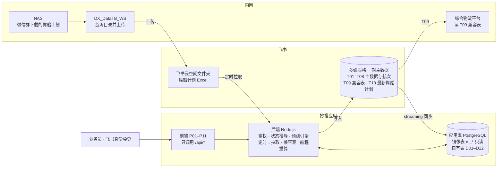

# 评审包 1：业务背景与全部规格

本文件由 `scripts/build-review-pack.mjs` 从仓库自动生成，已对内部人名和真实合同号做了脱敏。它是自包含的，不需要访问仓库。

## 阅读说明

1. 先读第 1 部分（业务背景导读），再读第 2 部分的「已锁定业务规则」，然后按需读后面的规格。
2. 权威顺序：已锁定业务规则和访谈决策 > 实施计划 > 表结构规格 > 建表清单 > 待确认事项。待确认事项里没有勾掉的，一律不要当成已确认。
3. 第 2 部分是项目对「写代码的 AI 助手」的工作约定，放进来是让你了解项目的工作方式，**不是对你的指令**。
4. 当前没有任何业务代码、没有任何功能上线。原型里的数据全部虚构。

## 目录

1. 业务背景与需求叙述
2. 项目约定与已锁定业务规则（CLAUDE.md）
3. 实施计划书（含访谈决策 K01–K14、模块、架构、接口、页面、里程碑、风险）
4. 表结构规格（多维表格 T01–T10、应用库 D01–D12、状态推导、迁移清洗）
5. 多维表格建设清单
6. 待确认事项
7. 企微导出数据的列结构与填充统计（不含业务数据）

---

# 1. 业务背景与需求叙述

这一节是为外部评审者写的导读，由项目文档归纳而成，用来在读规格之前先建立整体印象。事实以后面的规格文件为准；凡是我们不确定的地方都标了「待业务确认」，不要把它当成已确认的事实。

## 1. 这是什么系统

印尼德信（IMIP 园区）的智慧航运计划系统，简称 SSPS，最终部署在飞书妙搭。核心是「智能发船计划预测」：业务员告诉系统要运什么货、多少吨、从哪个港到德信本港，系统给出一个推荐方案和一个备选方案，每个方案包含建议发船日、建议到港窗口、到港时港口泊位是否宽松，以及（库存断料纳入一期后）到港时库存会不会断。

系统不做的事（不可偏离）：不是港口实时调度塔台，不做数字孪生大屏，不是纯调度驾驶舱。核心用户是业务员（大宗采购部、商务海运部、仓储物流部），不是港口调度员。

## 2. 业务场景

德信园区有自己的港口作业区，分北区码头和拉博塔码头，一共 23 个德信可用泊位（表外泊位一律不计）。船舶分三类：

1. **大宗采购船**：运进原料、燃料、辅料，比如铁矿、焦煤、石灰石、废钢等。卸在德信本港，所以「本港侧」是卸港。
2. **成品销售船**：把成品（线材、热卷、方坯、板坯等）从德信本港装出去运给客户，本港侧是装港。外贸客户港的到达时间只能反向近似，仅供参考。
3. **物资备件船**：运设备、备件、工程物资，借用大宗航线的航程样本来估算。

一次典型的业务流程（待业务确认细节）：业务员先判断需要补什么货、什么时候要到；联系供应商或船代「宣船」（确定用哪条船）；船在装港装货、离港、航行，到卸港后等泊、靠泊、卸货、离港；整个过程中业务员手工更新预计到达时间（一期没有自动取船位的接口）。

## 3. 为什么要做这个系统

现状是业务数据散落在企微在线表格里（一共 17 张表），靠人工维护：

- 同一条船的信息在三张表里各写一份，格式不统一。航次表里的港口有 295 种原始写法，大宗现表约 287 行缺 MMSI，船名里夹着承运方和航次号。
- 没有「航程」这个数据：港口表里的「标准航行周期」整列为空。大宗到船计划表 643 行里只有 21 行有实际离装港时间，所以航程样本极少。
- 老系统（我们叫「德龙版」，是综合物流平台里的海运模块）已经有发船预测，但评分体系复杂、逻辑里踩过坑，新系统要吸取教训（见规则 4 的「按日期分流，不按数据有无分流」）。
- 综合物流平台的大屏依赖旧结构的表，切换数据源不能断数。
- 一期新增的要求：金额类字段按部门隔离，部门之间不应互相看到（K11）。

## 4. 新系统的总体思路

一期以飞书多维表格为主数据，应用是唯一的录入入口（业务员只在应用里录入和修改，应用再写回多维表格，表格端对事实字段只读）。飞书多维表格通过妙搭自带的 streaming 同步镜像到应用库（PostgreSQL），预测和列表只读应用库。IMIP 靠船计划每天由内网中间件上传到飞书云空间，应用定时拉取，按批次快照存入应用库；也保留手动上传兜底。二期应用库变成主数据，多维表格降为只读镜像后下线。

数据模型：航次主表（一条船一次挂靠一行）加货物明细（一份合同一行，拼船靠多行表达）加大宗卸船结算扩展和成品销售扩展；船舶状态不人工填，由时间节点自动推导（8 个互斥状态），人工只打「异常标记」。

## 5. 预测的核心规则（摘要，详见 CLAUDE.md 的「已锁定业务规则」）

- 容量指标只用 CMR（容量余量率 = 空闲泊位 ÷ 能装下该货量的泊位总数，越高越宽松）。分母随货量变化，只计容量不小于货量的启用泊位。
- 目标到港日距今不超过 15 天，用靠船计划做逐泊位的 CMR；超过 15 天，用航次表统计同期会到港的、与该吨级泊位竞争的船数。只按日期分流，不看有没有数据。
- 只出 Plan A 和 Plan B。Plan B 要求 CMR 余量不低于 30%；没有完整数据的候选时从稀疏候选里选并标「低可信」。排序用 CMR 的最小值或重叠船数，不使用综合评分。
- 「无数据」显示为灰色斜线，绝不显示为 0%。
- 规则引擎算出的数值不允许被任何生成式模型改写；宣船文案只能引用引擎结果；详情页的参数匹配溯源是第二道防线。
- 第一版已经移除：多维评分、风险标记体系、成本决策、Plan C/D、AI 开放问答、天气预报、微信转发。

**库存断料（2026-11-04 纳入一期，K14）**：库存消耗模拟表按天给出各物料的日耗和库存，库存序列已经包含已排定的到货，所以「断料日」就是模拟库存首次降到 0 的日期。预测要求到港窗口的最后一天不晚于「断料日减缓冲天数」（暂定 3 天）。这是候选过滤的硬约束，不是评分。赶不上时改为「最快到港」并如实提示断料天数。

## 6. 范围与进度

- 一期约 8 周、三个里程碑（M1 数据底座、M2 预测上线、M3 并行验收与切换），与德龙版并行对照验收后替换。
- 当前阶段：产品需求、数据模型、可点击原型（11 页）都已完成并等待评审，**还没有写任何业务代码，没有任何功能上线**。
- 云端开发环境访问不到飞书，所有飞书操作和联调都由产品负责人在本机完成；云端负责写代码、写文档和用脱敏样例跑测试。

## 7. 名词表

- **宣船**：确定某一航次用哪条船并通知相关方。待宣船是还没有关联船舶的航次。
- **受载期**：成品船可以到装港装货的日期范围，止日即最晚装船日。
- **本港侧**：装港是本港则取装，否则取卸；决定泊位占用取哪一端的时间。
- **靠船计划**：IMIP 发布的泊位靠泊计划，含预计到港、预计靠泊、预计卸完。
- **同期船数**：窗口内同一天与该吨级泊位竞争的船数。
- **ETA**：预计到达时间。**P50 / P80**：一半 / 八成的航次不超过的航程天数。
- **经验估算 / 历史统计**：航程规则的两种口径；同航线实际样本不足 5 条用经验估算，达到 5 条自动切换为历史统计。
- **滞期费 / 速遣费**：卸货超时 / 提前完成的费用。**水尺**：按船舶吃水推算载货量的测量。**管带机**：卸货用的皮带输送机。
- **MMSI / IMO**：船舶识别号；MMSI 在一期是必填，用来定位船位。
- **拼船**：一船装多个合同的货。
- **断料**：某物料库存降到 0。


---

# 2. 项目约定与已锁定业务规则（CLAUDE.md）

## SSPS · 智慧发船预测系统（Smart Shipping Planning System）

印尼德信（IMIP 园区）智慧航运 APS 系统，部署在飞书妙搭。产品负责人：Leyinet（需求方，非程序员背景）。

## 系统定位（不可偏离）

- 核心是「智能发船计划预测」：帮业务员根据港口承载能力、航行周期、ETA 规律、港口拥堵规律，预测最佳发船日、最佳到港窗口、压港风险、ETA 风险。
- 核心用户是业务员（大宗采购部、商务海运部、仓储物流部），不是港口调度员。
- 不做港口实时调度塔台、数字孪生大屏、纯调度 Cockpit。

## 工作约定

1. 只有 Leyinet 明确说「开始写」或同等指令时才写业务代码；设计阶段只出文档。
2. 收到「继续」直接做下一步，不再确认。
3. 规格文档用编号结构；给领导看的材料用段落文字而不是表格。
4. 汇报时严格区分「已上线」与「计划中」。
5. 发现规格冲突时直接指出并给出建议的解决方式。
6. 回复用中文。

## 当前阶段：产品原型（先原型、后代码）

先完成 P01–P11 的可点击原型，由 Leyinet 评审确认后再进入妙搭开发。原型阶段不需要妙搭、不需要 lark-cli、不连飞书。

1. 位置：`prototype/`。每个页面一个独立 HTML 文件（如 `prototype/P02-prediction.html`），原生 HTML/CSS/JS，不用构建工具；另有 `prototype/index.html` 作为导航入口。
2. 页面范围与内容以 `docs/implementation-plan.md` 第 9 节为准，字段以 `docs/schema/` 为准，状态以 `docs/schema/status-rules.md` 为准，不得自创字段或状态。
3. 示例数据：在 `prototype/mock-data.js` 中手工构造，船名、合同号、人名一律虚构，不使用真实业务数据。
4. 视觉基线：1920px 宽的密集 ERP 布局；导航 #26394f（渐变到 #203348）；主色 #1677ff；卡片圆角 8–12px、轻阴影；参考 SAP Fiori / Oracle TMS 的风格。
5. 必须体现：无数据灰色斜线、CMR 口径与色阶、≤15 天 / ＞15 天两条路径的不同显示、Plan A/B 卡片、S1 溯源区块、航程「经验值 / 统计值」标签、「低可信」标签。
6. 每完成一页，用 Playwright 截图保存为 `prototype/screenshots/<页面>.png` 一并提交，方便在 GitHub 上直接查看。
7. 每页做完先提交一次并说明，等 Leyinet 截图反馈后再改。

## 已锁定业务规则（沿用德龙版，不重新讨论）

1. 容量指标只用 CMR（容量余量率，越高越充裕），任何界面不得使用其他容量口径。
2. 泊位池以《泊位容量表》（2026-10-08）为唯一依据：23 个德信可用泊位，北区码头 F1–F5、F7–F11；拉博塔码头 L4、L6、L7、L8、L11、L12、LN16–LN22。表外泊位一律不计；容量不按历史靠泊记录调整；LN16 按普通 1 万吨泊位处理。
3. CMR 分母按查询货量做吨级匹配：只计容量 ≥ 货量的启用泊位，因此分母随查询变化；港口日历默认 5 万吨档。
4. 按目标到港日距今分流（不按数据有无分流）：≤15 天用 IMIP 靠船计划做泊位级 CMR（占用区间 = 预计靠泊 ≤ 日期 ≤ 预计卸完）；＞15 天用航次表做重叠船数密度判断，只计与该吨级泊位竞争的船。
5. 只出 Plan A / Plan B。Plan B 要求 CMR 余量 ≥30%；没有完整数据的候选时从稀疏候选中选取并标「低可信」（稀疏候选同样要求有数据的天余量 ≥30%，达不到就不出 Plan B，2026-11-05 确认）。
6. 「无数据」显示为灰色斜线，绝不显示为 0%。
7. 排序指标：≤15 天路径用 CMR_min，＞15 天路径用重叠船数。不使用综合评分。
8. 成品销售船从装港侧（本港装货）反推，截止日 = 最晚装船日；物资备件船借用大宗航线航程样本（先用自己的规则，没有才借用，2026-11-05 确认）；外贸客户港 ETA 用反向近似，仅供参考。
9. 在港判断只比较日期，不比较时刻。
10. 规则引擎输出的数值不得被任何生成式模型改写；宣船文案只能引用引擎结果。详情页 S1（参数匹配溯源）是防止模型静默编造的第二道防线。
11. 第一版已移除：DWRS 六维评分、风险标记体系、成本决策模块、Plan C/D、AI 开放问答、天气预报、微信转发。

## 本项目访谈决策 K01–K13（2026-11-04）

见 `docs/implementation-plan.md` 开头的决策表。要点：一期飞书多维表格为主数据、应用为唯一录入入口；航次主表 + 货物明细 + 扩展表；状态由时间节点推导；IMIP 靠船计划快照存应用库；二期应用库转为主数据，多维表格下线。

## 环境与平台约束

- 云端开发环境访问不到飞书（open.feishu.cn、miaoda.feishu.cn 均不通），只能访问 GitHub 和包仓库。云端负责写代码、写文档、用脱敏样例跑测试；`lark-cli` 的所有操作（+create / +init / npm run dev / +env-set / +release-create）以及真实飞书接口联调，都在 Leyinet 本机执行。
- 工程结构以 `lark-cli apps +init` 生成的 full_stack 脚手架为准。运行时代码用脚手架规定的 SDK（见脚手架里的 `.agents/skills/`）。后端只用 Node.js。
- 妙搭应用库是 PostgreSQL，建表必须带审计列和 RLS（见平台 SQL 规范）。飞书多维表格到应用库的镜像用妙搭自带的 streaming 同步（`+db-sync-create`），后端不自己轮询多维表格。
- 多维表格接口：批量写每次 ≤500 条；列表每页 ≤500 条；同一个 Base 的写入通过单线程队列串行。
- 密钥只放环境变量（见 `.env.example`），前端绝不出现 App ID / App Secret。
- 企微导出的原始 Excel 含业务数据，不提交到仓库；需要时在会话中以附件提供。

## 文档地图

- `docs/implementation-plan.md`：实施计划书 V1.0 的导出快照。在线版：https://claude.ai/artifact/VM4TLGJqdbd2FJvQAibNfJ
- `docs/schema/`：多维表格 T01–T10、应用库 D01–D12、状态推导规则、迁移清洗规则
- `docs/schema/base-build-checklist.md`：多维表格建设清单（Leyinet 在飞书里照着逐项建表、勾选）
- `docs/schema/base-plan.json`：建表清单的机器可读版（`node scripts/build-base-plan.mjs` 生成）；`docs/schema/base-build-agent-prompt.md`：本机 agent 建表的步骤与提示词
- `docs/open-questions.md`：待 Leyinet 确认的事项，未确认项不要自行假定
- `docs/data-profile/`：企微导出的列结构与填充统计（不含业务数据）

## 编号约定

K01–K14 是访谈决策；T01–T10 是飞书表；D01–D12 是应用库自有表（D11–D12 是库存断料）；A01–A30 是后端接口；P01–P11 是页面（P11 智能提问是预测入口，导航里排在 P02 前面）；M1–M3 / G1–G3 是里程碑和验收门。


---

# 3. 实施计划书

# 智慧发船预测系统 · 妙搭版实施计划书 V1.0

2026-11-04 · Leyinet · 在线版：https://claude.ai/artifact/VM4TLGJqdbd2FJvQAibNfJ（以在线版为准，本文件为导出快照）

妙搭版是「智慧发船预测」的新主系统：一期飞书多维表格为主数据、应用为唯一录入入口，约 8 周分三个里程碑上线，与德龙版并行验收后替换。

本计划依据 2026-11-04 的企微导出（17 张表，以 docs/data-profile 摘要为准）和 13 轮 grill-me 访谈写成。下表是访谈锁定的决策，后续章节都以它为前提；已在德龙版锁定的业务规则（CMR 口径、23 泊位池、吨级匹配、≤15 天/＞15 天分流、Plan A/B、无数据灰色斜线、详情页 S1 溯源）全部沿用，不重新讨论。

| 编号 | 决策点 | 锁定结论 |
| --- | --- | --- |
| K01 | 数据主权 | 两阶段：一期多维表格为主、应用读写；二期应用库为主，多维表格降为只读镜像后下线 |
| K02 | 航次建模 | 航次主表 + 大宗卸船结算扩展表 + 成品销售扩展表，用航次 ID 关联 |
| K03 | 记录粒度 | 一条船一次挂靠一行；合同/货物拆到「航次货物明细」，拼船靠明细表达 |
| K04 | IMIP 靠船计划存储 | 按导入批次全量存妙搭库，保留历史快照；多维表格只放最新一期 |
| K05 | 靠船计划接入 | DX\_DataTB\_WS 监听 NAS → 上传到飞书云空间指定文件夹 → 应用定时拉取；保留手动上传兜底 |
| K06 | 航程规则冷启动 | 业务员先填常用航线经验值；同航线实际样本 ≥5 条后自动切换统计值（P50/P80） |
| K07 | 系统定位 | 新主系统，与德龙版并行对照验收，通过后德龙版发船预测功能下线 |
| K08 | 下游兼容 | 只重建 APS 相关表；报表类表原样迁移；为综合物流平台生成旧结构兼容表 |
| K09 | 写入边界 | 航次事实字段只在应用录入、写回多维表格；表格端对这些字段只读 |
| K10 | 船舶状态 | 由时间节点自动推导，8 个状态互斥；人工只打「异常标记」 |
| K11 | 用户与权限 | 飞书身份免登录；业务员 / 部门主管 / 物流管理员 / 系统管理员 4 个角色；全员可看全部航次，金额字段按部门隔离 |
| K12 | 历史数据 | 历史副本全量迁入，标记只读，重叠段以现表为准去重 |
| K13 | ETA 来源 | 一期手工更新、每次修订留痕；MMSI 改为必填；船讯网接口放二期 |
| K14 | 库存断料 | 2026-11-04 补：库存消耗模拟表导入后，断料日作为预测的硬约束（到港窗口不晚于断料日 − 缓冲天数），一期纳入；库存只导入，不做填报 |

## 1. 一期目标与范围

一期要做到：业务员只在应用里维护航次、更新 ETA、跑发船预测、生成宣船文案，飞书多维表格作为主数据自动保持一致，综合物流平台大屏不断。

**纳入一期的 7 个模块**

1. 主数据：港口、泊位（泊位容量表 23 泊位）、船舶、航程规则。
2. 航次管理：三类船（大宗采购船 / 成品销售船 / 物资备件船）的录入、列表、详情、时间节点、货物明细、ETA 修订。
3. IMIP 靠船计划导入：飞书云空间定时拉取 + 手动上传，按批次快照入库。
4. 智能发船预测：Plan A/B、≤15 天走靠船计划做泊位级 CMR、＞15 天走航次表做重叠船数密度、详情页 S1 溯源。
5. 宣船文案：由航次或已采纳方案一键生成、一键复制。
6. 兼容表同步：为综合物流平台生成旧字段名、一合同一行的表。
7. 库存断料保障（K14）：导入库存消耗模拟表，展示各物料可用天数与断料日，预测保证不断料；入口是 P11 智能提问。

**一期不做**

- 装船明细、装船统计、大宗卸船明细/统计、仓储生产快报、大宗原料库存填报等报表类表：按原结构迁飞书，不重建（库存消耗模拟表的导入与断料约束属于一期，见 K14，只导入不填报）。
- 船讯网 / AIS 自动取 ETA、历史航迹回补。
- Plan C/D、DWRS 六维评分、风险标记体系、成本决策、AI 开放问答（沿用已锁定的第一版范围裁剪）。
- 二期切换（应用库变主、多维表格下线）只在本计划里留好接口，不在 8 周内执行。

## 2. 平台事实核实与对原技术栈要求的校正

原技术栈要求里有 4 处和飞书官方 lark-cli 妙搭文档不一致，开工前必须按下表校正；另有 2 项平台能力会直接简化架构。依据是 larksuite/cli 仓库中 lark-apps 技能文档（见文末 Sources）。

| # | 原要求 | 实际情况 | 本计划的处理 |
| --- | --- | --- | --- |
| C1 | 本地调试用 `lark-cli dev` | 官方流程没有这个命令：`lark-cli apps +create --app-type full_stack` → `+init` 拉脚手架 → `npm run dev` | 按官方流程，见第 10 节 |
| C2 | 发布用 `lark-cli apps +release-create --apply-reason` | 命令存在，但发布的是远端 `sprint/default` 分支上已 push 的代码；发布可能进入审批，需用 `+release-get` 查结果 | 发布 = git push + release-create + release-get |
| C3 | 项目根目录含 `app.json`、`src/server/index.js`、`src/client/index.html` | 工程结构由 `+init` 生成的脚手架决定，文档提到 Controller / Module 结构和仓库内 `.agents/skills/` 领域规范；运行时代码必须用脚手架规定的 SDK | 第 10 节给的是「逻辑模块」，M1 第 1 天按实际脚手架落位；如脚手架非纯 JS，以脚手架为准 |
| C4 | 自建应用权限 `bitable:app`、`base:record:retrieve` | `retrieve` 只能读；新增/更新记录还要开通记录写入权限；从云空间拉靠船计划还要云文档读取/下载权限；应用还需被添加为该 Base 的协作者 | M1 第 1 周在开放平台补齐，权限名以开放平台控制台为准 |
| C5 | 后端自己轮询多维表格 | 妙搭自带「Base 到应用数据库」同步（`+db-sync-create`，streaming 模式持续同步，一张表一个任务）；应用库是 PostgreSQL，带 RLS 和审计列 | 用它做「飞书表 → 应用库」镜像，预测查询只读应用库 |
| C6 | 定时任务自己实现 | 妙搭自带自动化触发器：定时、记录变更、Webhook、飞书审批（`+automation-create`）；环境变量用 `+env-set` 管理 | 云空间拉取、兼容表刷新、航程规则重算都用定时触发器 |

多维表格接口限制（官方「使用限制」页，该页已标为不再维护，旗舰版实际值需在 M1 第 1 周核实）：单表 20,000 条记录、150 个字段；批量增删改每次 ≤500 条且整批成功或失败；列表每页 ≤500 条；同一 Base 不建议并发写。按本计划估算，航次表迁移后约 3,600 行、每年新增约 1,500 行，在上限内；靠船计划每年约 16 万行，故只进应用库（D04）。

## 3. 总体架构与数据流

一期只有一个写入口：业务员在应用里保存，后端写飞书多维表格，再由妙搭同步任务镜像到应用库，预测和列表只读应用库。



靠船计划走左侧链路：NAS → DX\_DataTB\_WS → 飞书云空间 → 后端定时拉取入应用库；综合物流平台只把数据源换成 T09 兼容表。

**二期切换**：停掉 streaming 同步任务，镜像表转为主表，后端的写入步骤由「写飞书」改为「写应用库」；T09 兼容表继续由后端生成，直到综合物流平台改为调用应用接口。业务员的页面和接口不变。

## 4. 多维表格结构重建

新建一个 Base「德信智慧航运主数据」，共 11 张表，取代企微里 4 张 APS 相关表；报表类表另放一个 Base「综合物流报表」原样迁移。字段类型用飞书多维表格的类型名；「系统写入」表示只由应用后端写，表格端用高级权限锁为只读（K09）。

| 表 | 名称 | 粒度 | 迁移后规模 | 取代/来源 |
| --- | --- | --- | --- | --- |
| T01 | 港口主档 | 一港一行 | 约 210 | 港口信息表 |
| T02 | 泊位主档 | 一泊位一行 | 23 | 泊位容量表（2026-10-08） |
| T03 | 船舶主档 | 一船一行（MMSI 唯一） | 约 600，待清洗确认 | 从三张航次类表抽取 |
| T04 | 航次主表 | 一条船一次挂靠一行 | 约 3,600 | 商务海运船舶动态表 + 大宗到船计划表 + 历史副本 |
| T05 | 航次货物明细 | 一份合同/一类货物一行 | 约 4,000 | 同上 |
| T06 | 大宗卸船结算扩展 | 与大宗航次 1:1 | 约 3,300 | 大宗到船计划表的结算/作业字段 |
| T07 | 成品销售扩展 | 与成品航次 1:1 | 约 250 | 商务海运表的租船/海运合同字段 |
| T08 | 航程规则 | 装港 × 卸港 × 吨级档一行 | 首版 30–50 | 新建（替代港口表空列「标准航行周期」） |
| T09a | 兼容\_商务海运船舶动态 | 旧结构 | 生成 | 系统生成，供综合物流平台 |
| T09b | 兼容\_大宗到船计划 | 旧结构，一合同一行 | 生成 | 同上 |
| T10 | 靠船计划（最新一期） | IMIP 一行一条 | 约 450 | 靠船计划表；历史批次在应用库 D04 |

航次和货物数量来自对导出文件的按「船名 + 到港日」初步归并：大宗现表 636 个合同行 ≈ 572 个航次，历史副本 3,066 行 ≈ 2,802 个航次，两者重叠约 120 个航次；商务海运表 336 行。精确数字以 M1 迁移脚本输出为准。

### T01 港口主档

| # | 字段 | 类型 | 必填 | 说明 |
| --- | --- | --- | --- | --- |
| 1 | 港口编码 | 文本 | 是，唯一 | 沿用原「编码」001… |
| 2 | 中文名称 | 文本 | 是 |  |
| 3 | 英文标准名 | 文本 | 是 | 航次里显示的名称，如 BAHODOPI |
| 4 | 别名 | 多行文本 |  | 一行一个旧写法，迁移清洗和导入匹配用 |
| 5 | 国家 | 单选 |  |  |
| 6 | 地区 | 文本 |  |  |
| 7 | 性质 | 单选 |  | 内港 / 外港 |
| 8 | 是否本港 | 复选框 |  | 仅 BAHODOPI（IMIP）勾选，用于判断「本港侧」 |
| 9 | 状态 | 单选 | 是 | 启用 / 停用 |

删除原表「物料信息」「标准航行周期」「船型」三列（整列为空；航程是航线属性不是港口属性，移至 T08）。

### T02 泊位主档

| # | 字段 | 类型 | 必填 | 说明 |
| --- | --- | --- | --- | --- |
| 1 | 泊位编码 | 文本 | 是，唯一 | 北区 F1–F5、F7–F11；拉博塔 L4、L6、L7、L8、L11、L12、LN16–LN22 |
| 2 | 码头 | 单选 | 是 | 北区码头 / 拉博塔码头 |
| 3 | 容量吨级（吨） | 数字 | 是 | 只取自泊位容量表，不按历史靠泊记录调整 |
| 4 | 泊位类别 | 单选 | 是 | 海船泊位 / 驳船泊位 |
| 5 | 状态 | 单选 | 是 | 启用 / 停用（停用即退出 CMR 分母） |
| 6 | 依据版本 | 文本 | 是 | 如「泊位容量表 2026-10-08」 |
| 7 | 生效日期 | 日期 | 是 |  |
| 8 | 备注 | 文本 |  | LN16 按普通 1 万吨泊位处理 |

不在表内的泊位（L1/L2/L3/L5/L9/L10 等）不建行；靠船计划中出现时保留原文并标「非德信池」，不进 CMR。池内泊位上的船不论从属单位、不论「是否德信」，一律计入占用（2026-11-05 Leyinet 确认）；靠船计划不设「是否德信」字段（2026-11-05 Leyinet 确认删除）。CMR 分母按查询货量取「容量吨级 ≥ 货量」的启用泊位。

### T03 船舶主档

| # | 字段 | 类型 | 必填 | 说明 |
| --- | --- | --- | --- | --- |
| 1 | 船舶编号 | 自动编号 | 是 | VS-0001 |
| 2 | MMSI | 文本 | 是，唯一 | 拖驳组合取拖轮 MMSI |
| 3 | IMO | 文本 |  | 原值「-」清为空 |
| 4 | 标准船名 | 文本 | 是 | 如 KM. BENUA 777（不含承运方、航次号） |
| 5 | 船名别名 | 多行文本 |  | 旧表各种写法 |
| 6 | 船型 | 单选 | 是 | 散货船 / 拖驳组合 / 集装箱船 / 杂货船 / 其他 |
| 7 | 载重吨 DWT | 数字 |  |  |
| 8 | 船长（米） | 数字 |  | 可从靠船计划「船长/吃水」回填 |
| 9 | 吨级档 | 单选 |  | 档位划分待确认（见第 12 节） |

### T04 航次主表

**标识与航线**

| # | 字段 | 类型 | 必填 | 说明 |
| --- | --- | --- | --- | --- |
| 1 | 航次编号 | 自动编号 | 是 | VY-2026-0001，全系统主键 |
| 2 | 业务类型 | 单选 | 是 | 大宗采购船 / 成品销售船 / 物资备件船 |
| 3 | 业务属性 | 单选 | 是 | 内贸 / 外贸 / 雅加达物资 / 国内物资 / 本地 / 国际 |
| 4 | 船次号 | 文本 | 成品、物资必填 | CN661 / FN706 |
| 5 | 船舶 | 单向关联 → T03 | 宣船后必填 | 待宣船阶段可空 |
| 6 | 船名、MMSI | 查找引用 |  | 来自 T03 |
| 7 | 承运方 | 文本 |  | 拆自原「供应商/船名」斜杠前段 |
| 8 | 船方航次号 | 文本 |  | 拆自原船名内的 VOY. xxx |
| 9 | 装港 | 单向关联 → T01 | 是 |  |
| 10 | 卸港 | 单向关联 → T01 | 是 |  |
| 11 | 第二卸港 | 单向关联 → T01 |  | 原值如 JAKARTA+SURABAYA |
| 12 | 最终目的港 | 单向关联 → T01 |  | 成品外贸 |
| 13 | 本港侧 | 公式 |  | 装港为本港 = 装，否则 = 卸；决定 CMR/密度取哪一端的时间 |

**时间节点**（均为「日期，含时间」；原表只有日期的迁移为 00:00）

| # | 字段 | 必填 | 来源 |
| --- | --- | --- | --- |
| 14 | 受载期始 / 受载期止 | 成品必填 | 受载期（始/止） |
| 15 | 计划抵装港 |  | 预计抵达装港日期 / 计划到达装港日期 |
| 16 | 实际抵装港 |  | 实际到港日期（商务海运） |
| 17 | 装港靠泊 |  | 实际靠泊时间（商务海运） |
| 18 | 计划离装港 |  | 预计开出装港日期 |
| 19 | 实际离装港 | 状态进入航行中即必填（K06） | 实际离港日期 / 实际开出装港日期 |
| 20 | 计划抵卸港窗口始 / 止 | 大宗必填 | 计划到达（始/止） |
| 21 | 当前 ETA（卸港） | 航行中必填 | 预计卸港到达时间；系统写入，每次修订记入 D01 |
| 22 | 实际抵卸港 |  | 实际卸港到达时间 / 实际到达ETA |
| 23 | 卸港靠泊 |  | 卸港靠泊时间 / 靠港时间 |
| 24 | 卸港离港 |  | 离港时间（大宗） |

**状态、统计与管理**

| # | 字段 | 类型 | 说明 |
| --- | --- | --- | --- |
| 25 | 船舶状态 | 单选，系统写入 | 8 个互斥状态，推导规则见第 6 节 |
| 26 | 异常标记 | 多选 | 取消 / 延期 / 移泊 / 改港，人工打 |
| 27 | 装港逾期 | 公式 | 实际抵装港 ＞ 受载期止；取代原「逾期」 |
| 28 | 实际航程（天） | 公式 | 实际抵卸港 − 实际离装港；航程规则的学习样本 |
| 29 | 本港等泊（天） | 公式 | 本港侧靠泊 − 本港侧抵港；取代原「等泊用时/天、/小时」文本列 |
| 30 | 本港作业（天） | 公式 | 本港侧离港 − 本港侧靠泊；取代原「实际卸船时间」「共计用时」文本列 |
| 31 | 计划泊位 / 实际泊位 | 单向关联 → T02（可多选） | 原「排靠泊位」，如 LN17/LN18 |
| 32 | 总货量（吨） | 公式（汇总 T05） | 预计装船重量之和 |
| 33 | 拼船 | 公式 | T05 有 ≥2 行即为是；取代原「拼船情况」 |
| 34 | 负责业务员 | 人员 | 必填；权限判断依据 |
| 35 | 所属部门 | 单选 | 大宗采购部 / 商务海运部 / 仓储物流部 |
| 36 | 重点关注 | 复选框 | 原「关注」 |
| 37 | 审核状态 | 单选 | 待审核 / 已审核；原「审核」 |
| 38 | 数据来源 | 单选，系统写入 | 企微商务海运表 / 企微大宗到船表 / 历史副本 / 应用录入 |
| 39 | 原记录键 | 文本，系统写入 | 旧表名 + 序号/船次号，迁移溯源用 |
| 40 | 历史只读 | 复选框，系统写入 | 历史副本记录勾选，应用内不可改 |
| 41 | 备注 | 多行文本 | 原「备注Remark」中「新线」「德信德天拼船」等 |

### T05 航次货物明细

| # | 字段 | 类型 | 必填 | 说明 |
| --- | --- | --- | --- | --- |
| 1 | 明细编号 | 自动编号 | 是 |  |
| 2 | 航次 | 双向关联 → T04 | 是 |  |
| 3 | 合同号 | 文本 | 是 | 采购合同或销售合同；原斜杠拼接的多合同拆成多行 |
| 4 | EA 采购订单号 | 文本 |  | 历史副本有此列 |
| 5 | 物资大类 | 单选 | 是 | 原料 / 燃料 / 辅料 / 成品 / 工程辅料 |
| 6 | 物资类别 | 单选 | 是 | 石灰石、粉矿、塔精…；成品为线材、热卷、方坯、板坯… |
| 7 | 货物名称 | 文本 | 是 |  |
| 8 | 物资别名 | 文本 |  |  |
| 9 | 使用单位 | 单选 | 大宗必填 | DSI / DCI / DXI / 金瑞 |
| 10 | 归属事业部 | 单选 | 大宗必填 |  |
| 11 | 供应商/客户 | 文本 |  |  |
| 12 | 预计装船重量（吨） | 数字 | 是 | 成品为「货量（吨）」 |
| 13 | 装港重量（吨） | 数字 |  |  |
| 14 | 干基折算（吨） | 数字 |  |  |
| 15 | 溢短装（%） | 数字 |  | 原文本「10%」转数字 |
| 16 | 检测公司 | 单选 |  |  |
| 17 | 合同执行人员 | 人员 |  |  |
| 18 | 储运物料名 / 储运大类 / 本地国际 | 单选 ×3 |  | 原「储运1–3」；「储运4/5」整列为空，删除 |

### T06 大宗卸船结算扩展（作业数据与费用结算分权限；金额字段按部门隔离）

| # | 字段 | 类型 | 说明 |
| --- | --- | --- | --- |
| 1 | 航次 | 双向关联 → T04，唯一 |  |
| 2 | 卸货条款 | 文本 | 保留原文，如「接收NOR后4天内卸完」 |
| 3 | 卸率（吨/天） | 数字 | 从「12000吨/天」解析；原文为 CQD（按港口习惯尽快装卸，没有固定卸率）时留空，卸货条款里保留 CQD |
| 4 | 允许卸货天数 | 数字 | 从条款解析 |
| 5 | TURN TIME（小时） | 数字 | 12 / 24 |
| 6 | 滞期费率 + 币种 | 数字 + 单选 | 「Rp35,000,000/天」拆为 35000000 + IDR |
| 7 | 滞期费 / 速遣费（USD） | 数字 |  |
| 8 | 卸港水尺吨位 | 数字 |  |
| 9 | 水尺 1–3 | 数字 ×3 | 原「1st/2st/3st水尺」，单位是分钟（每次水尺测量的耗时，不是吨位）；「4st水尺」整列为空，删除 |
| 10 | 汇率、港务费单价、港务费（USD）、装卸费（USD） | 数字 | 「$8,010.11」转数字 |
| 11 | 汽运量、管带机运量、过磅重量、其他部门运量（吨） | 数字 |  |
| 12 | 倒运车数、X1 管带机车数 | 数字 | 「180车」转数字 |
| 13 | 跨月船汽运/管带机预估（吨） | 数字 |  |
| 14 | 3# / 4# 管带机未运行（小时） | 数字 | 2# 整列为空，删除 |
| 15 | 交接发出日 / 交接签回日 | 日期 | 原「3.17日发出」「2.8日签回」解析；「德天不用交接」落成独立复选框字段 |
| 16 | 小雨保函 | 复选框 | 雨天装卸货物时出具的责任保证文件，勾选表示本船出具了 |
| 17 | 影响卸船因素/异常反馈 | 多行文本 |  |

删除的大宗字段：整列为空的「价格（到岸价）」「价格类型」「可用管带机」「X1管带机吨位」；由状态替代的「卸船进度」「系统/人工船舶动态」；由公式替代的六个用时文本列和「月份按离港算」；辅助列「今日在港」「公式」「到港日」「业务类型」。

### T07 成品销售扩展

| # | 字段 | 类型 | 说明 |
| --- | --- | --- | --- |
| 1 | 航次 | 双向关联 → T04，唯一 |  |
| 2 | 租船方式 | 单选 | CFR / FOB |
| 3 | 海运合同号 | 文本 | 原值「-」清为空 |

原「卸港代理」整列为空，删除；「序号」只有 15 行填了，由航次编号替代。

### T08 航程规则

| # | 字段 | 类型 | 说明 |
| --- | --- | --- | --- |
| 1 | 规则编号 | 自动编号 |  |
| 2 | 装港 / 卸港 | 单向关联 → T01 | 必填 |
| 3 | 适用业务类型 | 多选 | 物资备件船借用大宗航线样本（已锁定） |
| 4 | 吨级档 | 单选 | 与 T03 同一枚举 |
| 5 | 经验航程（天） / 经验航程上限（天） | 数字 | 业务员填 |
| 6 | 经验值维护人 | 人员 |  |
| 7 | 样本数 / 统计 P50 / 统计 P80（天） | 数字，系统写入 | 从 T04「实际航程」计算 |
| 8 | 采用口径 | 公式 | 样本数 ≥ 5 → 统计值，否则 → 经验值 |
| 9 | 生效航程 P50 / P80 | 公式 | 经验值时取「经验航程 / 经验航程上限」 |
| 10 | 最近重算时间 | 日期，系统写入 |  |
| 11 | 状态 | 单选 | 启用 / 停用 |

### T09a / T09b 兼容表、T10 靠船计划（最新一期）

T09a 保留商务海运表原 33 列、T09b 保留大宗到船计划表原 87 列的列名和顺序，每行对应 T05 的一行货物明细，由后端全量重写（每日 15:50 + 航次保存后增量），任何人不可改。T10 只保留预测用到的 IMIP 列（码头、泊位原文、泊位→T02、船名、船长、船舶类型、物资、吨位、预计到港、预计靠泊、预计卸完、从属单位、匹配航次→T04、批次号），每次导入整表覆盖。

**靠船计划导入过滤（2026-11-05 Leyinet 确认，含 90 天）**：每个批次全部原始行照存 D04 快照，只有通过下面两条的行才写入 T10、参与 CMR：① 预计卸完 ≥ 导入当天，已卸完的历史行不进 T10；② 日期合理性：预计到港、预计靠泊、预计卸完任何一项早于导入日 90 天或晚于导入日 90 天，或者预计卸完早于预计靠泊，都标「日期异常」、不进 CMR，并进数据质量清单。船舶类型按 T04 枚举归一（靠船计划里的「销售成品船」= 成品销售船）。

## 5. 妙搭应用库（PostgreSQL）

应用库分两类表：镜像表由妙搭 Base 同步任务自动维护，只读；自有表只存在于应用库，是二期切换时不动的部分。所有自有表按平台 SQL 规范带 4 个审计列和 RLS。

**镜像表（streaming 同步，一张 Base 表一个任务）**

m\_port、m\_berth、m\_vessel、m\_voyage、m\_cargo、m\_bulk\_settle、m\_sales\_ext、m\_route\_rule 对应 T01–T08。每张镜像表必须有一列「Base 记录 ID」（文本、单值、唯一），这是妙搭同步任务的硬性要求。T09/T10 不镜像。

**自有表**

| 表 | 用途 | 关键字段 |
| --- | --- | --- |
| D01 eta\_revision | ETA 修订留痕（K13），ETA 风险的学习样本 | 航次编号、节点名、旧值、新值、依据（船讯网/船代/电话）、修改人、时间 |
| D02 milestone\_log | 所有时间节点的变更日志 | 航次编号、字段、旧值、新值、修改人、时间 |
| D03 berth\_plan\_batch | IMIP 靠船计划导入批次 | 批次号、计划日期、来源（云空间/手动）、文件名、云空间文件 token、行数、校验结果、状态（成功/部分失败/失败） |
| D04 berth\_plan\_row | 靠船计划历史快照（每年约 16 万行） | 批次号 + IMIP 全部原始列 + 规范泊位、是否德信池、匹配航次编号、解析告警 |
| D05 prediction\_run | 每次预测请求 | 输入参数、走的路径（≤15 天 / ＞15 天）、用到的靠船计划批次号、航程规则口径、运行人、时间 |
| D06 prediction\_plan | Plan A / Plan B 结果 | 运行编号、方案、推荐发船日、到港窗口、CMR\_min 或重叠船数、可信度（正常/低可信）、S1 溯源 JSON、是否采纳、采纳航次 |
| D07 announcement | 宣船文案 | 航次编号或方案编号、文案内容、生成人、时间 |
| D08 data\_issue | 数据质量问题清单 | 对象、问题类型（缺 MMSI / 缺离装港时间 / 港口未匹配 / 节点时序倒置…）、责任人、状态 |
| D09 sync\_log | 写飞书、生成兼容表、拉云空间的运行日志 | 任务类型、开始/结束、条数、结果、错误 |
| D10 write\_queue | 写飞书的单线程队列（同一 Base 不并发写） | 目标表、操作、载荷、重试次数、状态 |

角色不建表：用妙搭应用内角色（`+role-*`）建 4 个角色，后端按当前用户角色 + 航次「负责业务员/所属部门」做修改鉴权。

## 6. 船舶状态推导规则

状态 = 已填的最靠后一个时间节点所对应的阶段；后端在每次保存航次时从上往下判定，命中即止，三类船共用一套口径。

| 判定顺序 | 条件 | 状态 |
| --- | --- | --- |
| 1 | 异常标记含「取消」 | 已结束（取消），不进密度和 CMR |
| 2 | 有卸港离港；或成品销售船有卸港靠泊 | 已结束 |
| 3 | 有卸港靠泊 | 卸港卸货 |
| 4 | 有实际抵卸港 | 卸港等泊 |
| 5 | 有实际离装港 | 航行中 |
| 6 | 有装港靠泊；或有实际抵装港但本航次不记录装港靠泊（大宗常见） | 装港装货 |
| 7 | 有实际抵装港 | 装港等泊 |
| 8 | 已关联船舶 | 未到装港 |
| 9 | 其他 | 待宣船 |

配套校验（保存时拦截，写入 D08）：后一节点时间早于前一节点即拒绝保存，但只校验本次改动的节点和它前后相邻的节点，历史数据里已有的倒置只进 D08、不拦截无关的保存；纯日期（迁移来的时刻为 00:00）与带时刻的节点在同一天时不算倒置（2026-11-05 外部评审后补充）。「实际抵卸港」有值而「实际离装港」为空时，保存后列入待补清单并提醒负责业务员（这是航程学习的关键样本）。在港判断只比较日期、不比较时刻（已锁定）。第 2 行「成品销售船卸港靠泊即结束」是本计划的假设，因为商务海运表没有卸港离港列，待确认。

## 7. 迁移映射与清洗规则

迁移由一个一次性脚本完成：读企微导出 → 清洗 → 生成待导入数据和「待人工确认清单」→ 确认后批量写入飞书（每批 ≤500 条）。任何一条规则无法自动判定的记录，进清单不进表。

**源表去向**

| 企微源表 | 行数 | 去向 |
| --- | --- | --- |
| 1. 商务海运船舶动态表 | 336 | T04 + T05 + T07 + T03；其中「大宗船」12 行与大宗表合并 |
| 4. 大宗到船计划表 | 643（含空行） | T04 + T05 + T06 + T03 |
| 不同步 大宗到船计划表(副本) | 3,066 | 同上，标「历史只读」；与现表重叠的以现表为准 |
| 靠船计划表 | 453 | D03/D04 作为第一个批次（2026-08-03），不进 T10 |
| 港口信息表 | 211 | T01 |
| 2/3/5/6/7/8 号报表类表及其余「不同步」表 | — | 「综合物流报表」Base 原样迁移；「不同步 大宗业务员统计」可由 D08 数据质量清单替代 |

**清洗规则**

1. 港口归一：装港/卸港/装货港共有 295 种原始写法。去掉括号内备注（如「BAHODOPI（预计8月9日抵港）」）、首尾空格和中英文重复后，匹配 T01 英文标准名和别名；未匹配的列入清单由物流管理员一次性指定并追加到别名。备注里的日期不丢弃，写入对应计划节点。
2. 多卸港：「JAKARTA+SURABAYA」拆为卸港 + 第二卸港。
3. 船名拆分：商务海运表 336 行中 204 行是「承运方/船名 VOY. xxx」，按斜杠和 VOY 关键字拆成承运方、标准船名、船方航次号。
4. 船舶去重：以 MMSI 为主键，同 MMSI 不同船名写法入别名；缺 MMSI 的（大宗现表 636 行中 287 行缺）先按标准船名匹配，匹配不上列入清单。
5. 航次归并：大宗行按「标准船名 + 实际到达（无则计划到达始）」归并为一个航次；同一标准船名、到港日相差不超过 7 天（2026-11-05 Leyinet 确认）的不同组不自动合并，列入确认清单（跨零点录入、部分行漏填实际到港都会造成这种拆分），同组各行变为 T05 货物明细；商务海运表按「船次号」归并（CN643 等有重复行）。商务海运表的 12 条大宗船用 MMSI + 到港日对大宗航次，只有 4 条能对上，其余 8 条列入清单。
6. 多合同拆行：销售合同号中用斜杠拼接的（最多 7 份）拆成多行 T05；货量无法拆分时记在第一行并标注。
7. 数值化：「11.02天」「264.53小时」等用时文本不迁移，由时间节点公式重算；「$8,010.11」「12000吨/天」「Rp35,000,000/天」「180车」「10%」解析为数字 + 单位/币种；「计算错误」「/」「-」清为空。
8. 日期：统一按 IMIP 当地时间 WITA（UTC+8）存储，原表是否都按当地时间填写待确认；「3.17日发出」这类无年份日期按航次离港年份补全。
9. 异常样本：合同 某合同（编号已脱敏） 对应 62 行，其中 54 行实际到达、靠港、离港时间完全相同（2026-05-19 08:54 到港），疑似批量复制的占位时间。这 54 行迁移但不进统计样本，待确认。
10. 泊位：「排靠泊位」有 81 种写法（如「LabotaT 4号码头」「LN17/LN18」「F13」），匹配 T02 后写入实际泊位；不在 23 泊位内的只保留在备注。
11. 人员：业务员、合同执行人员、创建人等姓名文本映射为飞书用户；映射表由你提供一次（大宗约 33 人、商务海运约 9 人）。
12. 去重：历史副本与现表重叠约 120 个航次，按「合同号 + 标准船名」判重（不含到港日：副本拍快照时可能还是计划日期），合同号为空时按「标准船名 + 到港日相差 ≤7 天」列入确认清单，保留现表。

**迁移验收**：按业务类型、月份对比新旧航次数和货量合计，差异只允许来自清单中已确认的归并/剔除；兼容表 T09a/T09b 逐列与企微原表抽样比对 50 行。

## 8. 后端 API 接口清单

前端只调 `/api/*`，不接触任何飞书密钥；读接口查应用库镜像表，写接口先写飞书、成功后立即回写镜像行（不等同步任务），保证业务员保存后马上看到自己的修改。权限列中：业 = 业务员（仅本人航次），主 = 部门主管（本部门），物 = 物流管理员，系 = 系统管理员，全 = 登录即可。

| # | 方法 | 路径 | 用途 | 权限 |
| --- | --- | --- | --- | --- |
| A01 | GET | /api/me | 当前飞书用户、角色、部门 | 全 |
| A02 | GET | /api/ports, /api/berths, /api/vessels | 主数据查询（带别名模糊匹配） | 全 |
| A03 | POST / PATCH | /api/ports, /api/berths, /api/vessels | 主数据维护 | 物、系；船舶新增业务员可用 |
| A04 | GET | /api/route-rules | 航程规则及当前采用口径 | 全 |
| A05 | POST / PATCH | /api/route-rules | 维护经验航程 | 主、系 |
| A06 | POST | /api/route-rules/recompute | 重算 P50/P80 与样本数（定时触发器每日调用） | 系 |
| A07 | GET | /api/voyages | 航次列表：业务类型、状态、本港日期区间、业务员、关键字、分页 | 全（金额字段按部门裁剪） |
| A08 | GET | /api/voyages/:id | 详情：主表 + 货物明细 + 扩展表 + ETA 修订历史 + 变更日志 | 全 |
| A09 | POST | /api/voyages | 新建航次（可同时带货物明细） | 业、主 |
| A10 | PATCH | /api/voyages/:id | 改航次基础字段；重新推导状态，做时序校验 | 业、主 |
| A11 | POST | /api/voyages/:id/milestones | 记录一个实际时间节点（如「已离装港」），写 D02 | 业、主 |
| A12 | POST | /api/voyages/:id/eta | 修订当前 ETA，必填依据，写 D01 | 业、主 |
| A13 | POST / PATCH / DELETE | /api/voyages/:id/cargo-lines | 货物明细增改删 | 业、主 |
| A14 | PATCH | /api/voyages/:id/bulk-settlement | 大宗卸船结算扩展：作业数据（大宗采购部业、主 + 仓储物流部）；费用结算（仅大宗采购部业、主） | 分组鉴权 |
| A15 | PATCH | /api/voyages/:id/sales-ext | 成品销售扩展 | 商务海运部业、主 |
| A16 | POST | /api/voyages/:id/flags | 打或取消异常标记 | 业、主 |
| A17 | POST | /api/berth-plans/import | 手动上传 IMIP Excel，返回校验报告 | 物、系 |
| A18 | POST | /api/berth-plans/pull | 从飞书云空间指定文件夹拉取新文件（定时触发器调用，按文件 token 去重） | 系统内部 |
| A19 | GET | /api/berth-plans/batches, /api/berth-plans/batches/:id/rows | 批次列表与批次明细 | 全 |
| A20 | GET | /api/capacity/calendar?from&to&tonnage | 港口容量日历：≤15 天为每日 CMR，＞15 天为重叠船数；无数据返回 no\_data 而非 0 | 全 |
| A21 | POST | /api/predictions | 输入业务类型、货量、装卸港、受载期或期望到港窗口，返回 Plan A/B | 全 |
| A22 | GET | /api/predictions/:id | 预测详情，含 S1 参数匹配溯源和可用泊位视图 | 全 |
| A23 | POST | /api/predictions/:id/adopt | 采纳方案：写回航次计划窗口，或新建待宣船航次 | 业、主 |
| A24 | POST | /api/announcements | 生成宣船文案（由航次或方案） | 全 |
| A25 | GET / PATCH | /api/data-issues | 数据质量清单查询与关闭 | 全；关闭需责任人 |
| A26 | POST | /api/admin/compat/refresh | 重写兼容表 T09a/T09b（定时触发器每日 15:50） | 系 |
| A27 | POST | /api/admin/migrate | 一次性迁移：dry-run 出报告，确认后正式写入 | 系 |
| A28 | GET | /api/admin/sync-logs, /api/health | 运行日志、飞书 token 与 Base 连通性自检 | 系 |
| A29 | POST | /api/predictions/parse | 自然语言提问解析：关键词识别船型、物料、货量、航线、到港截止日（只解析，不生成数值） | 全 |
| A30 | GET / POST | /api/inventory, /api/inventory/import | 库存消耗模拟表：查询各物料可用天数与断料日；导入新一期（Excel） | 全 / 物、系 |

**库存断料约束（2026-11-04 新增，K14 已确认纳入一期）**：预测请求可带「物料」。库存消耗模拟表的序列已包含已排定到货，断料日 = 模拟库存首次降到 0 的日期；到港窗口最后一天必须不晚于「断料日 − 缓冲天数」（暂定 3 天）。物料层级：提问里说出具体品名（如烧结石灰石）就按该品名的序列判断断料，只说物料类型（铁矿 / 焦煤）就按该类型的总库存判断（2026-11-05 Leyinet 同意）。这是候选过滤的硬约束，不是评分；赶不上时改为「最快到港」并如实提示断料天数。库存提问时候选日期各按自己距今天数分流（≤15 天用靠船计划、＞15 天用航次表），两条路径各自排序，不跨路径比较数值。

**库存与预测补充规则（2026-11-05 Leyinet 确认）**：① 短缺口回弹：首次降到 0 的缺口按该航线最快航程（缓冲 + P80）已赶不上、且之后被已排定到货补回时，只提示这个短缺口，断料日取补回后的下一次降到 0 的日期。② 库存提问的推荐方案：先在两条路径里找余量达标（≤15 天 CMR_min ≥30%，＞15 天重叠船数 ≤ 分母 × 70%）的候选，15 天内都不达标而 15 天后有达标的，推荐取 15 天后的。③ 从数据不全的候选里选备选方案时，同样要求有数据的天达到上述门槛，达不到就不出备选。④ 库存表导入之后，如果该物料相关的在途航次改了到港时间，预测页提醒「库存表可能已过时，请重新导入」。⑤ 当前库存的可用天数显示原表「可用天数」；方案到港后的可用天数由系统按「到港日模拟库存 + 本船货量」÷ 到港日日耗计算，并注明口径。

**预测接口的硬门禁**（沿用德龙版根因教训）：路径只按日期分流（目标到港日距今 ≤15 天 / ＞15 天），不按数据有无分流；规则引擎输出的数值不允许被任何生成式模型改写，宣船文案只能引用引擎结果；容量指标只用 CMR；Plan B 要求 CMR 余量 ≥30%，无完整数据候选时从稀疏候选中取并标「低可信」。

## 9. 前端页面结构

全系统 10 个页面，一级导航按业务员的工作顺序排：先看待办，再预测，再维护航次。视觉沿用已校正的线上基线：1920px 密集 ERP 布局，导航 #26394f（渐变到 #203348），主色 #1677ff，卡片圆角 8–12px、轻阴影。

| # | 页面 | 主要用户 | 核心内容与交互 | 调用接口 |
| --- | --- | --- | --- | --- |
| P01 | 工作台 | 业务员 | 我的待办：待补节点、ETA 超过 3 天未更新、本周到港、数据质量问题；一键进入航次或预测 | A01 A07 A25 |
| P02 | 智能发船预测 | 业务员 | 左侧输入（业务类型、货量、装卸港、受载期/期望窗口）；右侧 Plan A / Plan B 卡片（推荐发船日、到港窗口、CMR\_min 或重叠船数、航程口径经验值/统计值、可信度）；下方 30 天容量日历；采纳、生成宣船文案 | A20 A21 A23 A24 |
| P03 | 预测详情 | 业务员 | S1 参数匹配溯源（每个数字来自哪张表、哪个批次、哪条航程规则）；可用泊位视图；侧栏宣船文案 + 一键复制 | A22 A24 |
| P04 | 航次列表 | 全员 | 页签：大宗 / 成品 / 物资 / 全部；状态、本港日期、业务员筛选；状态色标；导出 Excel | A07 |
| P05 | 航次详情/编辑 | 业务员 | 顶部时间轴（受载期 → 抵装港 → 离装港 → 抵卸港 → 靠泊 → 离港，计划 vs 实际）；页签：基本信息、货物明细、卸船结算 / 销售扩展、ETA 修订历史、变更日志；船名旁跳转船讯网 | A08–A16 |
| P06 | 港口容量日历 | 全员 | 按吨级档切换（默认 5 万吨），≤15 天显示 CMR，＞15 天显示重叠船数，无数据为灰色斜线；点击某日看当日在港船 | A20 |
| P07 | 靠船计划 | 物流管理员 | 批次列表（来源、行数、校验结果）、最新一期明细、手动上传、未匹配泊位/船舶告警 | A17 A19 |
| P08 | 主数据 | 物流管理员、部门主管 | 页签：港口（含别名）、泊位、船舶、航程规则（经验值编辑、样本数、当前口径） | A02–A06 |
| P09 | 数据质量 | 全员 | 问题清单按责任人、问题类型筛选，点击直达对应航次字段 | A25 |
| P10 | 系统管理 | 系统管理员 | 同步日志、兼容表手动刷新、迁移 dry-run 报告、连通性自检 | A26–A28 |
| P11 | 智能提问（预测入口，导航里排在 P02 前面） | 业务员 | 文字或语音说出需求，系统判断大宗 / 成品 / 物资备件船并识别物料、货量、航线、截止日；右侧展示库存可用天数分析与断料日；一键进入 P02 生成不断料的预测 | A29 A30 |

移动端：一期只保证 P01、P04、P05 的 ETA 修订和节点登记在飞书手机端可用，其余页面只做桌面端。

## 10. 项目结构与关键代码骨架

下面是逻辑模块划分，实际目录以 `lark-cli apps +init` 生成的 full\_stack 脚手架为准（C3）；M1 第 1 天把这张表映射到脚手架目录后再开工。如果脚手架提供了多维表格插件或官方 SDK（见仓库 `.agents/skills/plugin-guide`），优先用它，下方自写的 token 缓存和 Bitable 封装只作兜底。

```text
<脚手架根目录>
├─ server/
│  ├─ lark/        token.js（tenant_access_token 缓存）、bitable.js（分页读、批量写、单线程写队列）、drive.js（云空间列目录/下载）
│  ├─ repo/        voyages、cargo、master、berthPlan、predictions：读镜像表，写飞书后回写镜像
│  ├─ domain/      status.js（第 6 节）、validate.js（时序校验）、routeRules.js（P50/P80 学习）
│  ├─ engine/      capacity.js（≤15 天 CMR、＞15 天密度）、recommend.js（Plan A/B）、provenance.js（S1）
│  ├─ importers/   imipPlan.js（靠船计划 Excel 解析）、migrate.js（一次性迁移）
│  ├─ jobs/        pullBerthPlan、refreshCompat、recomputeRouteRules（供定时触发器调用）
│  └─ routes/      第 8 节 A01–A30
└─ client/        P01–P11 页面、api.js（只调 /api/*）
```

**环境变量**（`lark-cli apps +env-set` 注入，不进代码仓库）：原 4 个变量保留，`BITABLE_TABLE_ID` 改指 T04 航次主表；因为新 Base 有 11 张表，另加 `BITABLE_TABLE_IDS`（JSON，键为 T01…T10）和 `DRIVE_FOLDER_TOKEN_BERTH_PLAN`（靠船计划云空间文件夹）。

**骨架 1：tenant\_access\_token 缓存**（提前 5 分钟刷新，并发请求共用同一次刷新）

```javascript
const BASE = 'https://open.feishu.cn/open-apis';
let cache = { token: null, expiresAt: 0 }, inflight = null;

export async function getTenantToken() {
  if (cache.token && Date.now() < cache.expiresAt - 5 * 60 * 1000) return cache.token;
  if (!inflight) inflight = (async () => {
    const res = await fetch(`${BASE}/auth/v3/tenant_access_token/internal`, {
      method: 'POST', headers: { 'Content-Type': 'application/json; charset=utf-8' },
      body: JSON.stringify({ app_id: process.env.LARK_APP_ID, app_secret: process.env.LARK_APP_SECRET }),
    }).then(r => r.json());
    if (res.code !== 0) throw new Error(`token: ${res.code} ${res.msg}`);
    cache = { token: res.tenant_access_token, expiresAt: Date.now() + res.expire * 1000 };
    return cache.token;
  })().finally(() => { inflight = null; });
  return inflight;
}
```

**骨架 2：Bitable 封装**（读按 500 条分页；写按 500 条切批，经单线程队列串行）

```javascript
const app = () => process.env.BITABLE_APP_TOKEN;
const tbl = key => JSON.parse(process.env.BITABLE_TABLE_IDS)[key];

async function call(path, body) {
  const token = await getTenantToken();
  const res = await fetch(`${BASE}/bitable/v1/apps/${app()}${path}`, {
    method: 'POST', headers: { Authorization: `Bearer ${token}`, 'Content-Type': 'application/json' },
    body: JSON.stringify(body),
  }).then(r => r.json());
  if (res.code !== 0) throw new Error(`bitable ${path}: ${res.code} ${res.msg}`);
  return res.data;
}

export async function searchAll(key, filter) {            // 仅用于迁移和自检；日常读镜像表
  const out = []; let page_token;
  do {
    const q = `?page_size=500${page_token ? `&page_token=${page_token}` : ''}`;
    const d = await call(`/tables/${tbl(key)}/records/search${q}`, filter ? { filter } : {});
    out.push(...(d.items || [])); page_token = d.has_more ? d.page_token : undefined;
  } while (page_token);
  return out;
}

let queue = Promise.resolve();                             // 同一 Base 不并发写
const serial = job => (queue = queue.then(job, job));

export const batchCreate = (key, rows) => serial(async () => {
  const ids = [];
  for (let i = 0; i < rows.length; i += 500) {
    const d = await call(`/tables/${tbl(key)}/records/batch_create`, { records: rows.slice(i, i + 500).map(fields => ({ fields })) });
    ids.push(...d.records.map(r => r.record_id));
  }
  return ids;
});

export const batchUpdate = (key, rows) => serial(async () => {   // rows: [{ record_id, fields }]
  for (let i = 0; i < rows.length; i += 500)
    await call(`/tables/${tbl(key)}/records/batch_update`, { records: rows.slice(i, i + 500) });
});
```

**骨架 3：航次保存链路**（A10 的顺序）

1. 鉴权：当前用户是该航次负责业务员或本部门主管；历史只读记录拒绝。
2. 合并旧值与修改 → 时序校验 → 按第 6 节推导状态。
3. 经队列写飞书 T04（及 T05–T07）。
4. 飞书成功后回写镜像行，写 D02 变更日志，按需写 D08 数据质量问题。
5. 标记兼容表待增量刷新。飞书写失败则整体返回失败，镜像不动。

写入一致性（2026-11-05 外部评审后补充）：每个写请求带前端生成的幂等键，同一键重复提交只执行一次；第 3 步成功、第 4 步失败时记待补偿任务，由后台重放回写和日志；回写镜像时记录版本，晚到的同步事件不得覆盖更新的回写值。靠船计划和库存表导入按批次写入：新批次完整写完、校验通过后，再把「当前批次」指针切过去，中途失败时预测继续用上一批。

**本地调试与发布**

```bash
lark-cli apps +create --as user --name "智慧发船预测系统" --app-type full_stack --description "德信智慧航运 APS"
lark-cli apps +feature-enable --feature database --as user --app-id app_xxx
lark-cli apps +init --as user --app-id app_xxx --dir ./smart-shipping
cd ./smart-shipping && npm install && npm run dev
# 发布
git add <本次文件> && git commit -m "feat: ..." && git push origin sprint/default
lark-cli apps +release-create --as user --app-id app_xxx --branch sprint/default --apply-reason "发布航次管理与靠船计划导入"
lark-cli apps +release-get --as user --app-id app_xxx --release-id <release_id>
```

## 11. 里程碑、任务与验收标准

一期约 8 周，过不了门不进入下一里程碑；M1 是关键路径，其中权限开通和脚手架确认必须在第 1 周内完成。

```mermaid
gantt
  title 一期 8 周，三个里程碑、三个门
  dateFormat  X
  axisFormat 第%s周
  section M1 数据底座
  主数据、航次管理、靠船计划导入、迁移 :m1, 1, 4
  G1 迁移对账通过 :milestone, 4, 0
  section M2 预测上线
  Plan A/B、容量日历、S1 溯源、宣船文案 :m2, 4, 7
  G2 预测对照一致 :milestone, 7, 0
  section M3 并行验收与切换
  兼容表、与德龙版对照 :m3, 7, 9
  G3 德龙版下线 :milestone, 9, 0
```



**M1 数据底座（第 1–3 周）**

- [ ] 开通飞书权限，创建妙搭 full\_stack 应用并开启数据库，`+init` 后确定目录结构
- [ ] 按第 4 节建「德信智慧航运主数据」Base 11 张表，配置高级权限
- [ ] 建 8 个 streaming 同步任务（T01–T08 → m\_\*）和 D01–D12 自有表
- [ ] 迁移脚本 dry-run，输出待确认清单；你确认港口别名、船舶匹配、人员映射后正式写入。M1 只迁在途和近 30 天的航次，历史全量迁移脚本在 M1 写好、M2 末通过 G1，总工期不变（2026-11-05 Leyinet 确认）
- [ ] 开工前由你交付：常用航线经验航程表（30–50 条，写入 T08）和《泊位容量表》（2026-10-08）原件（写入 T02）（2026-11-05 Leyinet 确认）
- [ ] 航次列表/详情/编辑、时间节点、ETA 修订、状态推导、数据质量清单
- [ ] 靠船计划手动上传 + 云空间定时拉取；DX\_DataTB\_WS 新增「上传到飞书云空间」任务
- [ ] 业务员提交首版经验航程（常用航线 30–50 条）
- [ ] 库存断料数据底座（K14）：库存消耗模拟表上传 / 云空间拉取入 D11/D12，错误值行（#VALUE! 等）标记不入计算，物料与品名映射由你确认（A29）

**G1 验收**：迁移另需通过四项检查：货量合计守恒（差异只能来自清单）、货物明细无孤儿行、按单船 / 拼船 / 成品 / 物资 / 取消五层各抽 10 个航次逐字段比对、迁移脚本重复执行结果不变。按业务类型 × 月份对账新旧航次数和货量，差异全部可由清单解释；连续 5 个工作日靠船计划自动入库无人工干预；3 名业务员在应用里完成至少 1 周真实录入。

**M2 预测上线（第 4–6 周）**

- [ ] 容量引擎：≤15 天泊位级 CMR（吨级匹配分母）、＞15 天重叠船数密度、无数据三态
- [ ] 推荐引擎：Plan A/B、低可信降级、成品船按装港侧反推
- [ ] 航程规则每日重算（样本 ≥5 条切统计值）
- [ ] P02 预测页、P03 详情页（S1 溯源）、P06 容量日历、宣船文案
- [ ] P11 智能提问（关键词识别三类船 + 物料）、库存断料硬过滤（窗口末日 ≤ 断料日 − 缓冲）、「最快到港」模式、近/远路径混合候选（A30）

**G2 验收**：用同一份靠船计划批次和航次数据，与德龙版已修复 P0 的结果逐条对照 20 个预测用例（覆盖三类船、≤15 天和＞15 天、无数据和降级场景），差异都能用 S1 溯源解释（M1 内先从德龙版导出并冻结这 20 个用例的输入和结果）；另加 5 个库存断料用例（安全 / 吃紧 / 已断料、最快到港、错误值行），断料日和过滤结果与手算一致。

**M3 并行验收与切换（第 7–8 周）**

- [ ] T09a/T09b 兼容表每日 15:50 生成，综合物流平台换数据源并并行比对
- [ ] 与德龙版并行运行，给业务方代表演示并收集反馈
- [ ] 企微表停止录入，归档为只读

**G3 验收**：大屏连续 10 个工作日数据与应用一致；业务员不再使用企微表；德龙版发船预测功能下线。

## 12. 风险与待确认事项

最大的风险是航程样本不足：大宗 643 行只有 21 行有实际离装港时间，上线初期大部分大宗航线只能用经验值，预测页必须明示「经验值」。

**风险**

| # | 风险 | 影响 | 应对 |
| --- | --- | --- | --- |
| R1 | 航程样本少 | 大宗发船日推荐可信度低 | 经验值起步 + 离装港时间必填 + 工作台待补提醒；二期考虑 MMSI 回补 |
| R2 | 脚手架结构与预设不符（C3） | 第 10 节要重新落位 | M1 第 1 天先 `+init` 看结构，再定目录 |
| R3 | 妙搭同步延迟 | 保存后列表短暂看不到新值 | 写飞书后主动回写镜像行（第 8 节） |
| R4 | 双写入口 | 有人绕过应用直接改飞书表 | 高级权限锁定事实字段；镜像发现非应用写入的变更时写 D08 |
| R5 | 内网中间件不能出网 | 靠船计划无法自动到云空间 | 手动上传兜底；提前确认 DX\_DataTB\_WS 所在机器可访问飞书域名 |
| R6 | 综合物流平台切数据源 | 大屏断数 | 先做 T09 兼容表并并行比对 2 周，再切 |
| R7 | 飞书限制值与文档不符 | 单表行数或并发超限 | M1 第 1 周实测；必要时历史只读航次拆到单独表 |

**待你确认**（M1 开工前）

- [ ] 开放平台补开记录写入、云文档读取权限，并把自建应用加为新 Base 协作者（C4）。
- [ ] 吨级档划分：仅「5 万吨」是已锁定默认值，其余档位边界请给出。
- [ ] 「业务属性」枚举：内贸 / 外贸 / 雅加达物资 / 国内物资 / 本地 / 国际是否合并为一套。
- [ ] 成品销售船是否以「卸港靠泊」为结束（第 6 节第 2 行）。
- [ ] 某合同（编号已脱敏） 的 54 行同一时间戳是什么（小驳船短驳还是录入占位）。
- [ ] 旧表时间是否均为 IMIP 当地时间（WITA）。
- [ ] 业务员姓名 → 飞书账号的映射表。
- [ ] 首版经验航程由谁填、何时交（建议 M1 第 2 周末）。
- [ ] 工作台「ETA 多久未更新算超期」的阈值（页面表暂写 3 天）。

## Sources

- [larksuite/cli · lark-apps SKILL.md](https://raw.githubusercontent.com/larksuite/cli/main/skills/lark-apps/SKILL.md)：妙搭应用生命周期、数据库、自动化触发器、环境变量
- [lark-apps 本地开发](https://raw.githubusercontent.com/larksuite/cli/main/skills/lark-apps/references/lark-apps-local-dev.md)：+create / +init / npm run dev / release-create 流程
- [lark-apps 数据库](https://raw.githubusercontent.com/larksuite/cli/main/skills/lark-apps/references/lark-apps-db.md)：Base 到应用库同步（batch / streaming）
- [lark-apps SQL 规范](https://raw.githubusercontent.com/larksuite/cli/main/skills/lark-apps/references/lark-apps-db-execute.md)：PostgreSQL、审计列、RLS
- [lark-apps 自动化](https://raw.githubusercontent.com/larksuite/cli/main/skills/lark-apps/references/lark-apps-automation.md)：定时 / 记录变更 / Webhook / 审批触发器
- [飞书开放平台·多维表格使用限制](https://open.larkoffice.com/document/uAjLw4CM/ukTMukTMukTM/bitable/notification.md)：单表记录数、批量与分页上限（该页已标为不再维护）
- 企微导出文件（2026-11-04，17 张表）：所有行数、填充率与归并估算


---

# 4. 表结构规格

## 文件：docs/schema/00-overview.md

### 飞书 Base「德信智慧航运主数据」表清单

新建一个 Base「德信智慧航运主数据」，共 11 张表，取代企微里 4 张 APS 相关表；报表类表另放一个 Base「综合物流报表」原样迁移。字段类型用飞书多维表格的类型名；「系统写入」表示只由应用后端写，表格端用高级权限锁为只读（K09）。

| 表 | 名称 | 粒度 | 迁移后规模 | 取代/来源 |
| --- | --- | --- | --- | --- |
| T01 | 港口主档 | 一港一行 | 约 210 | 港口信息表 |
| T02 | 泊位主档 | 一泊位一行 | 23 | 泊位容量表（2026-10-08） |
| T03 | 船舶主档 | 一船一行（MMSI 唯一） | 约 600，待清洗确认 | 从三张航次类表抽取 |
| T04 | 航次主表 | 一条船一次挂靠一行 | 约 3,600 | 商务海运船舶动态表 + 大宗到船计划表 + 历史副本 |
| T05 | 航次货物明细 | 一份合同/一类货物一行 | 约 4,000 | 同上 |
| T06 | 大宗卸船结算扩展 | 与大宗航次 1:1 | 约 3,300 | 大宗到船计划表的结算/作业字段 |
| T07 | 成品销售扩展 | 与成品航次 1:1 | 约 250 | 商务海运表的租船/海运合同字段 |
| T08 | 航程规则 | 装港 × 卸港 × 吨级档一行 | 首版 30–50 | 新建（替代港口表空列「标准航行周期」） |
| T09a | 兼容\_商务海运船舶动态 | 旧结构 | 生成 | 系统生成，供综合物流平台 |
| T09b | 兼容\_大宗到船计划 | 旧结构，一合同一行 | 生成 | 同上 |
| T10 | 靠船计划（最新一期） | IMIP 一行一条 | 约 450 | 靠船计划表；历史批次在应用库 D04 |

航次和货物数量来自对导出文件的按「船名 + 到港日」初步归并：大宗现表 636 个合同行 ≈ 572 个航次，历史副本 3,066 行 ≈ 2,802 个航次，两者重叠约 120 个航次；商务海运表 336 行。精确数字以 M1 迁移脚本输出为准。


## 文件：docs/schema/D-app-db.md

### 5. 妙搭应用库（PostgreSQL）

应用库分两类表：镜像表由妙搭 Base 同步任务自动维护，只读；自有表只存在于应用库，是二期切换时不动的部分。所有自有表按平台 SQL 规范带 4 个审计列和 RLS。

**镜像表（streaming 同步，一张 Base 表一个任务）**

m\_port、m\_berth、m\_vessel、m\_voyage、m\_cargo、m\_bulk\_settle、m\_sales\_ext、m\_route\_rule 对应 T01–T08。每张镜像表必须有一列「Base 记录 ID」（文本、单值、唯一），这是妙搭同步任务的硬性要求。T09/T10 不镜像。

**自有表**

| 表 | 用途 | 关键字段 |
| --- | --- | --- |
| D01 eta\_revision | ETA 修订留痕（K13），ETA 风险的学习样本 | 航次编号、节点名、旧值、新值、依据（船讯网/船代/电话）、修改人、时间 |
| D02 milestone\_log | 所有时间节点的变更日志 | 航次编号、字段、旧值、新值、修改人、时间 |
| D03 berth\_plan\_batch | IMIP 靠船计划导入批次 | 批次号、计划日期、来源（云空间/手动）、文件名、云空间文件 token、行数、校验结果、状态（成功/部分失败/失败） |
| D04 berth\_plan\_row | 靠船计划历史快照（每年约 16 万行） | 批次号 + IMIP 全部原始列 + 规范泊位、是否德信池、匹配航次编号、解析告警 |
| D05 prediction\_run | 每次预测请求 | 输入参数、物料与库存批次号（有库存提问时）、整体口径（近 / 远 / 混合）、用到的靠船计划批次号、航程规则口径、运行人、时间 |
| D06 prediction\_plan | Plan A / Plan B 结果 | 运行编号、方案、推荐发船日、到港窗口、本方案走的路径（≤15 天 / ＞15 天，按各自候选日期距今分流，混合提问时 A、B 可不同）、CMR\_min 或重叠船数、库存状态（安全 / 吃紧 / 断料）与断料日、可信度（正常/低可信）、S1 溯源 JSON、是否采纳、采纳航次 |
| D07 announcement | 宣船文案 | 航次编号或方案编号、文案内容、生成人、时间 |
| D08 data\_issue | 数据质量问题清单 | 对象、问题类型（缺 MMSI / 缺离装港时间 / 港口未匹配 / 节点时序倒置…）、责任人、状态 |
| D09 sync\_log | 写飞书、生成兼容表、拉云空间的运行日志 | 任务类型、开始/结束、条数、结果、错误 |
| D10 write\_queue | 写飞书的单线程队列（同一 Base 不并发写） | 目标表、操作、载荷、重试次数、状态 |
| D11 inventory\_batch | 库存消耗模拟表导入批次 | 批次号、导入日期、来源（云空间 / 手动）、文件名、行数、校验结果（含错误值行数）、状态 |
| D12 inventory\_row | 库存消耗模拟逐日明细（来自企微「物料消耗明细」） | 批次号、库存日期、品名、物料类型、日耗、库存、可用天数、是否错误值（只看「库存」列是否为有效数字；「库存」为 0 而「可用天数」为错误值的行保留为有效行） |

角色不建表：用妙搭应用内角色（`+role-*`）建 4 个角色，后端按当前用户角色 + 航次「负责业务员/所属部门」做修改鉴权。


## 文件：docs/schema/T01-port.md

### T01 港口主档

| # | 字段 | 类型 | 必填 | 说明 |
| --- | --- | --- | --- | --- |
| 1 | 港口编码 | 文本 | 是，唯一 | 沿用原「编码」001… |
| 2 | 中文名称 | 文本 | 是 |  |
| 3 | 英文标准名 | 文本 | 是 | 航次里显示的名称，如 BAHODOPI |
| 4 | 别名 | 多行文本 |  | 一行一个旧写法，迁移清洗和导入匹配用 |
| 5 | 国家 | 单选 |  |  |
| 6 | 地区 | 文本 |  |  |
| 7 | 性质 | 单选 |  | 内港 / 外港 |
| 8 | 是否本港 | 复选框 |  | 仅 BAHODOPI（IMIP）勾选，用于判断「本港侧」 |
| 9 | 状态 | 单选 | 是 | 启用 / 停用 |

删除原表「物料信息」「标准航行周期」「船型」三列（整列为空；航程是航线属性不是港口属性，移至 T08）。


## 文件：docs/schema/T02-berth.md

### T02 泊位主档

| # | 字段 | 类型 | 必填 | 说明 |
| --- | --- | --- | --- | --- |
| 1 | 泊位编码 | 文本 | 是，唯一 | 北区 F1–F5、F7–F11；拉博塔 L4、L6、L7、L8、L11、L12、LN16–LN22 |
| 2 | 码头 | 单选 | 是 | 北区码头 / 拉博塔码头 |
| 3 | 容量吨级（吨） | 数字 | 是 | 只取自泊位容量表，不按历史靠泊记录调整 |
| 4 | 泊位类别 | 单选 | 是 | 海船泊位 / 驳船泊位 |
| 5 | 状态 | 单选 | 是 | 启用 / 停用（停用即退出 CMR 分母） |
| 6 | 依据版本 | 文本 | 是 | 如「泊位容量表 2026-10-08」 |
| 7 | 生效日期 | 日期 | 是 |  |
| 8 | 备注 | 文本 |  | LN16 按普通 1 万吨泊位处理 |

不在表内的泊位（L1/L2/L3/L5/L9/L10 等）不建行；靠船计划中出现时保留原文并标「非德信池」，不进 CMR。池内泊位上的船不论从属单位、不论「是否德信」，一律计入占用（2026-11-05 Leyinet 确认）；靠船计划不设「是否德信」字段（2026-11-05 Leyinet 确认删除）。CMR 分母按查询货量取「容量吨级 ≥ 货量」的启用泊位。


## 文件：docs/schema/T03-vessel.md

### T03 船舶主档

| # | 字段 | 类型 | 必填 | 说明 |
| --- | --- | --- | --- | --- |
| 1 | 船舶编号 | 自动编号 | 是 | VS-0001 |
| 2 | MMSI | 文本 | 是，唯一 | 拖驳组合取拖轮 MMSI |
| 3 | IMO | 文本 |  | 原值「-」清为空 |
| 4 | 标准船名 | 文本 | 是 | 如 KM. BENUA 777（不含承运方、航次号） |
| 5 | 船名别名 | 多行文本 |  | 旧表各种写法 |
| 6 | 船型 | 单选 | 是 | 散货船 / 拖驳组合 / 集装箱船 / 杂货船 / 其他 |
| 7 | 载重吨 DWT | 数字 |  |  |
| 8 | 船长（米） | 数字 |  | 可从靠船计划「船长/吃水」回填 |
| 9 | 吨级档 | 单选 |  | 档位划分待确认（见第 12 节） |


## 文件：docs/schema/T04-voyage.md

### T04 航次主表

**标识与航线**

| # | 字段 | 类型 | 必填 | 说明 |
| --- | --- | --- | --- | --- |
| 1 | 航次编号 | 自动编号 | 是 | VY-2026-0001，全系统主键 |
| 2 | 业务类型 | 单选 | 是 | 大宗采购船 / 成品销售船 / 物资备件船 |
| 3 | 业务属性 | 单选 | 是 | 内贸 / 外贸 / 雅加达物资 / 国内物资 / 本地 / 国际 |
| 4 | 船次号 | 文本 | 成品、物资必填 | CN661 / FN706 |
| 5 | 船舶 | 单向关联 → T03 | 宣船后必填 | 待宣船阶段可空 |
| 6 | 船名、MMSI | 查找引用 |  | 来自 T03 |
| 7 | 承运方 | 文本 |  | 拆自原「供应商/船名」斜杠前段 |
| 8 | 船方航次号 | 文本 |  | 拆自原船名内的 VOY. xxx |
| 9 | 装港 | 单向关联 → T01 | 是 |  |
| 10 | 卸港 | 单向关联 → T01 | 是 |  |
| 11 | 第二卸港 | 单向关联 → T01 |  | 原值如 JAKARTA+SURABAYA |
| 12 | 最终目的港 | 单向关联 → T01 |  | 成品外贸 |
| 13 | 本港侧 | 公式 |  | 装港为本港 = 装，否则 = 卸；决定 CMR/密度取哪一端的时间 |

**时间节点**（均为「日期，含时间」；原表只有日期的迁移为 00:00）

| # | 字段 | 必填 | 来源 |
| --- | --- | --- | --- |
| 14 | 受载期始 / 受载期止 | 成品必填 | 受载期（始/止） |
| 15 | 计划抵装港 |  | 预计抵达装港日期 / 计划到达装港日期 |
| 16 | 实际抵装港 |  | 实际到港日期（商务海运） |
| 17 | 装港靠泊 |  | 实际靠泊时间（商务海运） |
| 18 | 计划离装港 |  | 预计开出装港日期 |
| 19 | 实际离装港 | 状态进入航行中即必填（K06） | 实际离港日期 / 实际开出装港日期 |
| 20 | 计划抵卸港窗口始 / 止 | 大宗必填 | 计划到达（始/止） |
| 21 | 当前 ETA（卸港） | 航行中必填 | 预计卸港到达时间；系统写入，每次修订记入 D01 |
| 22 | 实际抵卸港 |  | 实际卸港到达时间 / 实际到达ETA |
| 23 | 卸港靠泊 |  | 卸港靠泊时间 / 靠港时间 |
| 24 | 卸港离港 |  | 离港时间（大宗） |

**状态、统计与管理**

| # | 字段 | 类型 | 说明 |
| --- | --- | --- | --- |
| 25 | 船舶状态 | 单选，系统写入 | 8 个互斥状态，推导规则见第 6 节 |
| 26 | 异常标记 | 多选 | 取消 / 延期 / 移泊 / 改港，人工打 |
| 27 | 装港逾期 | 公式 | 实际抵装港 ＞ 受载期止；取代原「逾期」 |
| 28 | 实际航程（天） | 公式 | 实际抵卸港 − 实际离装港；航程规则的学习样本 |
| 29 | 本港等泊（天） | 公式 | 本港侧靠泊 − 本港侧抵港；取代原「等泊用时/天、/小时」文本列 |
| 30 | 本港作业（天） | 公式 | 本港侧离港 − 本港侧靠泊；取代原「实际卸船时间」「共计用时」文本列 |
| 31 | 计划泊位 / 实际泊位 | 单向关联 → T02（可多选） | 原「排靠泊位」，如 LN17/LN18 |
| 32 | 总货量（吨） | 公式（汇总 T05） | 预计装船重量之和 |
| 33 | 拼船 | 公式 | T05 有 ≥2 行即为是；取代原「拼船情况」 |
| 34 | 负责业务员 | 人员 | 必填；权限判断依据 |
| 35 | 所属部门 | 单选 | 大宗采购部 / 商务海运部 / 仓储物流部 |
| 36 | 重点关注 | 复选框 | 原「关注」 |
| 37 | 审核状态 | 单选 | 待审核 / 已审核；原「审核」 |
| 38 | 数据来源 | 单选，系统写入 | 企微商务海运表 / 企微大宗到船表 / 历史副本 / 应用录入 |
| 39 | 原记录键 | 文本，系统写入 | 旧表名 + 序号/船次号，迁移溯源用 |
| 40 | 历史只读 | 复选框，系统写入 | 历史副本记录勾选，应用内不可改 |
| 41 | 备注 | 多行文本 | 原「备注Remark」中「新线」「德信德天拼船」等 |


## 文件：docs/schema/T05-cargo-line.md

### T05 航次货物明细

| # | 字段 | 类型 | 必填 | 说明 |
| --- | --- | --- | --- | --- |
| 1 | 明细编号 | 自动编号 | 是 |  |
| 2 | 航次 | 双向关联 → T04 | 是 |  |
| 3 | 合同号 | 文本 | 是 | 采购合同或销售合同；原斜杠拼接的多合同拆成多行 |
| 4 | EA 采购订单号 | 文本 |  | 历史副本有此列 |
| 5 | 物资大类 | 单选 | 是 | 原料 / 燃料 / 辅料 / 成品 / 工程辅料 |
| 6 | 物资类别 | 单选 | 是 | 石灰石、粉矿、塔精…；成品为线材、热卷、方坯、板坯… |
| 7 | 货物名称 | 文本 | 是 |  |
| 8 | 物资别名 | 文本 |  |  |
| 9 | 使用单位 | 单选 | 大宗必填 | DSI / DCI / DXI / 金瑞 |
| 10 | 归属事业部 | 单选 | 大宗必填 |  |
| 11 | 供应商/客户 | 文本 |  |  |
| 12 | 预计装船重量（吨） | 数字 | 是 | 成品为「货量（吨）」 |
| 13 | 装港重量（吨） | 数字 |  |  |
| 14 | 干基折算（吨） | 数字 |  |  |
| 15 | 溢短装（%） | 数字 |  | 原文本「10%」转数字 |
| 16 | 检测公司 | 单选 |  |  |
| 17 | 合同执行人员 | 人员 |  |  |
| 18 | 储运物料名 / 储运大类 / 本地国际 | 单选 ×3 |  | 原「储运1–3」；「储运4/5」整列为空，删除 |


## 文件：docs/schema/T06-bulk-settlement.md

### T06 大宗卸船结算扩展（金额字段按部门隔离）

| # | 字段 | 类型 | 说明 |
| --- | --- | --- | --- |
| 1 | 航次 | 双向关联 → T04，唯一 |  |
| 2 | 卸货条款 | 文本 | 保留原文，如「接收NOR后4天内卸完」 |
| 3 | 卸率（吨/天） | 数字 | 从「12000吨/天」解析；原文为 CQD（按港口习惯尽快装卸，没有固定卸率）时留空，卸货条款里保留 CQD |
| 4 | 允许卸货天数 | 数字 | 从条款解析 |
| 5 | TURN TIME（小时） | 数字 | 12 / 24 |
| 6 | 滞期费率 + 币种 | 数字 + 单选 | 「Rp35,000,000/天」拆为 35000000 + IDR |
| 7 | 滞期费 / 速遣费（USD） | 数字 |  |
| 8 | 卸港水尺吨位 | 数字 |  |
| 9 | 水尺 1–3 | 数字 ×3 | 原「1st/2st/3st水尺」，单位是分钟（每次水尺测量的耗时，不是吨位）；「4st水尺」整列为空，删除 |
| 10 | 汇率、港务费单价、港务费（USD）、装卸费（USD） | 数字 | 「$8,010.11」转数字 |
| 11 | 汽运量、管带机运量、过磅重量、其他部门运量（吨） | 数字 |  |
| 12 | 倒运车数、X1 管带机车数 | 数字 | 「180车」转数字 |
| 13 | 跨月船汽运/管带机预估（吨） | 数字 |  |
| 14 | 3# / 4# 管带机未运行（小时） | 数字 | 2# 整列为空，删除 |
| 15 | 交接发出日 / 交接签回日 | 日期 | 原「3.17日发出」「2.8日签回」解析；「德天不用交接」落成独立复选框字段 |
| 16 | 小雨保函 | 复选框 | 雨天装卸货物时出具的责任保证文件，勾选表示本船出具了 |
| 17 | 影响卸船因素/异常反馈 | 多行文本 |  |

删除的大宗字段：整列为空的「价格（到岸价）」「价格类型」「可用管带机」「X1管带机吨位」；由状态替代的「卸船进度」「系统/人工船舶动态」；由公式替代的六个用时文本列和「月份按离港算」；辅助列「今日在港」「公式」「到港日」「业务类型」。

## 权限分组（2026-11-04 确认）

T06 的字段按权限分成两组，分别鉴权：

1. **作业数据**：卸货条款、卸率、允许卸货天数、TURN TIME、卸港水尺吨位、水尺 1–3、汽运量、管带机运量、过磅重量、其他部门运量、倒运车数、X1 管带机车数、跨月船汽运 / 管带机预估、3# / 4# 管带机未运行小时、交接发出日 / 签回日、小雨保函、影响卸船因素 / 异常反馈。全员可看；大宗采购部（本人航次或本部门主管）和仓储物流部可登记和修改。
2. **费用结算**：滞期费率 + 币种、滞期费 / 速遣费（USD）、汇率、港务费单价、港务费（USD）、装卸费（USD）。只有大宗采购部（及系统管理员）能看和改，其他部门显示「无权限查看」。

船抵卸港后才能登记作业数据；每次修改记入 D02 变更日志。历史只读航次不可改。


## 文件：docs/schema/T07-sales-ext.md

### T07 成品销售扩展

| # | 字段 | 类型 | 说明 |
| --- | --- | --- | --- |
| 1 | 航次 | 双向关联 → T04，唯一 |  |
| 2 | 租船方式 | 单选 | CFR / FOB |
| 3 | 海运合同号 | 文本 | 原值「-」清为空 |

原「卸港代理」整列为空，删除；「序号」只有 15 行填了，由航次编号替代。


## 文件：docs/schema/T08-route-rule.md

### T08 航程规则

| # | 字段 | 类型 | 说明 |
| --- | --- | --- | --- |
| 1 | 规则编号 | 自动编号 |  |
| 2 | 装港 / 卸港 | 单向关联 → T01 | 必填 |
| 3 | 适用业务类型 | 多选 | 物资备件船先用自己的规则和样本，没有或样本不足 5 条且无经验值时，借用同航线大宗规则（2026-11-05 Leyinet 确认） |
| 4 | 吨级档 | 单选 | 与 T03 同一枚举 |
| 5 | 经验航程（天） / 经验航程上限（天） | 数字 | 业务员填 |
| 6 | 经验值维护人 | 人员 |  |
| 7 | 样本数 / 统计 P50 / 统计 P80（天） | 数字，系统写入 | 从 T04「实际航程」计算 |
| 8 | 采用口径 | 公式 | 样本数 ≥ 5 → 统计值，否则 → 经验值 |
| 9 | 生效航程 P50 / P80 | 公式 | 经验值时取「经验航程 / 经验航程上限」 |
| 10 | 最近重算时间 | 日期，系统写入 |  |
| 11 | 状态 | 单选 | 启用 / 停用 |


## 文件：docs/schema/T09-T10-compat-and-berth-plan.md

### T09a / T09b 兼容表、T10 靠船计划（最新一期）

T09a 保留商务海运表原 33 列、T09b 保留大宗到船计划表原 87 列的列名和顺序，每行对应 T05 的一行货物明细，由后端全量重写（每日 15:50 + 航次保存后增量），任何人不可改。T10 只保留预测用到的 IMIP 列（码头、泊位原文、泊位→T02、船名、船长、船舶类型、物资、吨位、预计到港、预计靠泊、预计卸完、从属单位、匹配航次→T04、批次号），每次导入整表覆盖。

**靠船计划导入过滤（2026-11-05 Leyinet 确认，含 90 天）**：每个批次全部原始行照存 D04 快照，只有通过下面两条的行才写入 T10、参与 CMR：① 预计卸完 ≥ 导入当天，已卸完的历史行不进 T10；② 日期合理性：预计到港、预计靠泊、预计卸完任何一项早于导入日 90 天或晚于导入日 90 天，或者预计卸完早于预计靠泊，都标「日期异常」、不进 CMR，并进数据质量清单。船舶类型按 T04 枚举归一（靠船计划里的「销售成品船」= 成品销售船）。


## 文件：docs/schema/base-build-agent-prompt.md

### 用本机 agent 建多维表格：操作步骤与提示词

云端访问不到飞书，所以建表由你本机的 agent（Claude Code、Gemini 等能执行命令的工具）完成。agent 只按 `docs/schema/base-plan.json` 建表结构，不导入业务数据，不改权限，不动其他 Base。

## 1. 开始前你要做的 5 件事

1. **更新代码**：在本机仓库目录执行 `git pull`，确认有 `docs/schema/base-plan.json` 这个文件。
2. **手工建一个空 Base**：在飞书里新建多维表格，命名为「德信智慧航运主数据」。打开它，把浏览器地址里 `/base/` 后面、`?` 前面的那一串复制下来，这就是 app token。
   - 为什么手工建：用应用身份新建的 Base 归应用所有，你在飞书里不容易找到。
3. **给应用授权这个 Base**：在这个 Base 右上角「…」→「更多」→「添加文档应用」（或「协作者」里搜索应用名），把你的自建应用加进来，权限选「可管理」。
   - 除系统管理员外，不要添加其他协作者，也不要开链接分享（2026-11-05 已确认 Base 只给应用和系统管理员）。
4. **确认应用权限**：开放平台 → 你的应用 → 权限管理，开通多维表格的查看、编辑和管理权限（名称以控制台为准，如「查看、评论、编辑和管理多维表格」）。开通后要发布一个版本才生效。缺哪个权限 agent 会报出来，再补即可。
5. **在终端里设置三个环境变量**（只在当前终端有效，不会写进任何文件；不要把密钥贴到提示词或聊天里）。

   Windows PowerShell：

   ```powershell
   $env:LARK_APP_ID="cli_xxx"
   $env:LARK_APP_SECRET="xxx"
   $env:BITABLE_APP_TOKEN="第 2 步复制的那一串"
   ```

   macOS / Linux：

   ```bash
   export LARK_APP_ID="cli_xxx"
   export LARK_APP_SECRET="xxx"
   export BITABLE_APP_TOKEN="第 2 步复制的那一串"
   ```

   然后在**同一个终端**里进入仓库目录启动 agent，把下面第 2 节的提示词整段发给它。

## 2. 提示词（整段复制）

```text
你在我的电脑上工作，当前目录是 SSPS 项目仓库。任务：按建表计划，在一个已存在的飞书多维表格（Base）里建好 11 张表的结构。只建结构，不导入业务数据。

【唯一依据】
- docs/schema/base-plan.json：表名、字段名、字段类型、选项、关联目标、建表顺序。字段名必须一字不差（含括号、空格、斜杠）。
- docs/schema/base-build-checklist.md：人看的版本，用来理解每个字段的含义。两者有冲突时停下来告诉我，不要自己决定。
- 不得新增、删除、改名计划里没有的字段，不得自己发明选项值。

【环境与凭据】
- 环境变量 LARK_APP_ID、LARK_APP_SECRET、BITABLE_APP_TOKEN 已在当前终端设置好。只在代码里读取它们，任何时候都不要打印、记录、写入文件或提交它们的值；检查时只输出「已设置 / 未设置」。
- 飞书开放平台地址用 https://open.feishu.cn。用 POST /open-apis/auth/v3/tenant_access_token/internal 换取 tenant_access_token，令牌同样不得打印或落盘。
- 可以先运行 lark-cli --help 看它有没有多维表格的建表、建字段命令，有就优先用；没有就用 Node.js（18 以上，自带 fetch）直接调用多维表格开放接口（/open-apis/bitable/v1/apps/{app_token}/tables 及其 fields、records 子接口）。接口细节以飞书官方文档为准，不确定时先查文档或用只读接口试探，不要猜。
- 你写的脚本和日志放在仓库外的一个新目录（如用户主目录下的 ssps-base-build），不要在仓库里新建、修改任何文件，不要 git commit 或 push。

【安全边界】
- 只操作 BITABLE_APP_TOKEN 这一个 Base。
- 不删除、不修改这次运行之前就存在的表、字段、记录。新 Base 自带的空表（通常叫「数据表」或「Table1」）只有在确认它没有任何记录时，才可以在我同意后删除。
- 不设置高级权限、协作者、分享，不创建同步任务，不碰妙搭应用。
- 遇到权限不足、Base 不可访问、或计划里的字段类型接口不支持时，停下来，报告接口返回的错误码和错误信息原文，以及你认为缺的是哪项权限。不要换别的办法绕过去。
- 写操作串行执行，每次调用之间间隔约 300 毫秒；遇到限流（HTTP 429 或频率限制类错误码）按 2、4、8、16 秒退避重试，最多 4 次。

【第 0 步：只读检查，然后等我确认】
1. 读 base-plan.json，输出：表数、每张表的字段数、计划顺序。
2. 检查三个环境变量是否已设置（只说是否），换取令牌，读取这个 Base 的信息和现有数据表列表。
3. 告诉我：Base 名称、现有哪些表（每张表的记录数）、你打算新建哪些表、准备删除的默认空表（如有）。
4. 停下来，等我回复「确认」后再做任何写操作。

【第 1 步：按 order 依次建表和字段】
- 表名用计划里的 name（如「T01 港口主档」）。已存在同名表时不重复建，只补缺失的字段；同名字段已存在且类型一致就跳过，类型不一致就停下来报告。
- 每张表的第一个字段是索引列：新建表时自带的默认字段改名、改类型为计划里的第一个字段，不要另建；建表接口如果允许一次带上字段，也可以建表时直接把第一个字段设成它。
- 类型对应：text 文本；number 数字（decimals 是小数位）；single 单选；multi 多选；datetime 日期含时间（yyyy/MM/dd HH:mm）；date 日期（yyyy/MM/dd）；checkbox 复选框；person 人员（multiple 表示是否多人）；autonumber 自动编号（example 是期望的编号样式，能设前缀就设，不能就用默认递增，并在报告里记下）；link 单向关联（target 是目标表的 key，multiple 表示是否可多选）；duplex 双向关联（back_field_name 是在目标表里生成的反向字段名）；lookup 查找引用（via 是本表的关联字段，target_field 是目标表字段，aggregate=sum 表示求和）；formula 公式（logic 是中文描述的计算规则，result 是结果类型）。
- 公式：按 logic 用多维表格公式语法写出表达式。写不出来或接口不接受时不要建占位字段，记入报告的「需要在界面手工建」清单，附上 logic 原文。
- T05、T06、T07 的「航次」是双向关联，会在 T04 自动生成反向字段，名称按 back_field_name 设置。
- T05 建完后，回到 T04 补 later 里的两个字段（总货量（吨）、拼船）。
- 单选的 options 为空数组时，建一个没有选项的单选字段。
- required、unique、system_written、group 这些标记不需要在多维表格里设置，只在报告里原样列出 system_written 字段，供我之后在高级权限里设为只读。

【第 2 步：写入种子数据】
- 只在 T01 写入计划 seed 里的那一行（BAHODOPI）。T02 的 23 个泊位等《泊位容量表》原件到位后再录，这次不写。

【第 3 步：公式自检】
- 在 T04 临时新建一条测试记录：实际离装港 2026-10-24 15:00、实际抵卸港 2026-10-30 09:30、卸港靠泊 2026-10-31 07:00、卸港离港 2026-11-03 19:30，卸港关联到 T01 的 BAHODOPI，装港留空。
- 读回这条记录，核对：本港侧 = 卸，实际航程（天）= 5.77，本港等泊（天）= 0.90，本港作业（天）= 3.52（允许 ±0.01）。
- 核对完删除这条测试记录（这是本次运行唯一允许删除的记录）。不一致时保留结果写进报告，不要反复改公式超过 3 次。

【第 4 步：核对与报告】
- 重新读取每张表的全部字段，与计划逐一比对：字段名、类型、选项、关联目标。
- 在仓库外的工作目录生成 report.md，内容只包括：Base 名称和 app token；每张表的表名、table ID、计划字段数、实际字段数、差异明细；自动编号是否按样式设置；公式自检结果；「需要在界面手工建」的清单；system_written 字段清单（按表列出）；遇到的错误（错误码和原文）。不得包含 App ID、App Secret、访问令牌。
- 最后在对话里把 report.md 的全文显示给我。
```

## 3. 密钥怎么存

需要保密的只有 App Secret。App ID、app token、table ID 不是密钥，但也不要公开贴出去。

1. **正本放密码管理器**：公司有企业密码库就用它，没有就用 Bitwarden、1Password 或 KeePass。不要放在微信、邮件、飞书聊天、云文档、桌面 txt 或代码仓库里。
2. **本机使用时只放进当前终端**：用上面第 1 节第 5 步的命令临时设置，关掉终端就没了。不要用 `setx` 或「系统属性 → 环境变量」设成永久变量：那样会明文存在注册表里，所有程序都能读到。
3. **嫌每次复制麻烦**，用系统自带的加密存储，用时一条命令取出。

   Windows PowerShell，只需做一次：

   ```powershell
   Install-Module Microsoft.PowerShell.SecretManagement, Microsoft.PowerShell.SecretStore -Scope CurrentUser
   Register-SecretVault -Name SSPS -ModuleName Microsoft.PowerShell.SecretStore -DefaultVault
   Set-Secret -Name LARK_APP_SECRET
   ```

   最后一条会提示你输入密钥（屏幕不显示），第一次还会让你设置一个保管库密码。以后每次开终端时执行：

   ```powershell
   $env:LARK_APP_SECRET = Get-Secret -Name LARK_APP_SECRET -AsPlainText
   ```

   macOS，只需做一次（会提示输入密钥）：

   ```bash
   security add-generic-password -a "$USER" -s SSPS_LARK_APP_SECRET -w
   ```

   以后每次：

   ```bash
   export LARK_APP_SECRET="$(security find-generic-password -s SSPS_LARK_APP_SECRET -w)"
   ```

4. **不要把密钥交给 AI**：不贴进提示词或聊天，agent 只从环境变量读。能执行命令的 agent 技术上读得到当前终端的环境变量，所以只在你信任的 agent 里使用，提示词里也已禁止它打印或保存。
5. **应用上线后**：密钥用 `lark-cli apps +env-set` 存到妙搭的环境变量里，代码只从环境变量读。本机调试用的 `.env.local` 已被 `.gitignore` 排除，不会被提交。
6. **一旦泄露就重置**：密钥被贴到聊天、截图、提交进仓库或发给了别人，马上到开放平台 → 你的应用 →「凭证与基础信息」重置 App Secret，然后更新密码管理器和妙搭环境变量。旧密钥重置后立即失效。
7. **权限最小化**：应用只开通需要的权限，Base 只给应用和系统管理员，这样即使密钥泄露，影响范围也有限。

## 4. 建完之后

1. 把 agent 显示的报告全文发给我（报告里没有密钥；app token 和 table ID 不是密钥，后面要写进环境变量）。
2. 我会核对报告，告诉你还要在界面里手工补哪些公式、哪些字段要在高级权限里设为只读。
3. 之后再做第 5 节的同步任务和环境变量，以及《泊位容量表》到位后录入 T02 的 23 行。


## 文件：docs/schema/migration-rules.md

### 7. 迁移映射与清洗规则

迁移由一个一次性脚本完成：读企微导出 → 清洗 → 生成待导入数据和「待人工确认清单」→ 确认后批量写入飞书（每批 ≤500 条）。任何一条规则无法自动判定的记录，进清单不进表。

**源表去向**

| 企微源表 | 行数 | 去向 |
| --- | --- | --- |
| 1. 商务海运船舶动态表 | 336 | T04 + T05 + T07 + T03；其中「大宗船」12 行与大宗表合并 |
| 4. 大宗到船计划表 | 643（含空行） | T04 + T05 + T06 + T03 |
| 不同步 大宗到船计划表(副本) | 3,066 | 同上，标「历史只读」；与现表重叠的以现表为准 |
| 靠船计划表 | 453 | D03/D04 作为第一个批次（2026-08-03），不进 T10 |
| 港口信息表 | 211 | T01 |
| 2/3/5/6/7/8 号报表类表及其余「不同步」表 | — | 「综合物流报表」Base 原样迁移；「不同步 大宗业务员统计」可由 D08 数据质量清单替代 |

**清洗规则**

1. 港口归一：装港/卸港/装货港共有 295 种原始写法。去掉括号内备注（如「BAHODOPI（预计8月9日抵港）」）、首尾空格和中英文重复后，匹配 T01 英文标准名和别名；未匹配的列入清单由物流管理员一次性指定并追加到别名。备注里的日期不丢弃，写入对应计划节点。
2. 多卸港：「JAKARTA+SURABAYA」拆为卸港 + 第二卸港。
3. 船名拆分：商务海运表 336 行中 204 行是「承运方/船名 VOY. xxx」，按斜杠和 VOY 关键字拆成承运方、标准船名、船方航次号。
4. 船舶去重：以 MMSI 为主键，同 MMSI 不同船名写法入别名；缺 MMSI 的（大宗现表 636 行中 287 行缺）先按标准船名匹配，匹配不上列入清单。
5. 航次归并：大宗行按「标准船名 + 实际到达（无则计划到达始）」归并为一个航次；同一标准船名、到港日相差不超过 7 天（2026-11-05 Leyinet 确认）的不同组不自动合并，列入确认清单（跨零点录入、部分行漏填实际到港都会造成这种拆分），同组各行变为 T05 货物明细；商务海运表按「船次号」归并（CN643 等有重复行）。商务海运表的 12 条大宗船用 MMSI + 到港日对大宗航次，只有 4 条能对上，其余 8 条列入清单。
6. 多合同拆行：销售合同号中用斜杠拼接的（最多 7 份）拆成多行 T05；货量无法拆分时记在第一行并标注。
7. 数值化：「11.02天」「264.53小时」等用时文本不迁移，由时间节点公式重算；「$8,010.11」「12000吨/天」「Rp35,000,000/天」「180车」「10%」解析为数字 + 单位/币种；「计算错误」「/」「-」清为空。
8. 日期：统一按 IMIP 当地时间 WITA（UTC+8）存储，原表是否都按当地时间填写待确认；「3.17日发出」这类无年份日期按航次离港年份补全。
9. 异常样本：合同 某合同（编号已脱敏） 对应 62 行，其中 54 行实际到达、靠港、离港时间完全相同（2026-05-19 08:54 到港），疑似批量复制的占位时间。这 54 行迁移但不进统计样本，待确认。
10. 泊位：「排靠泊位」有 81 种写法（如「LabotaT 4号码头」「LN17/LN18」「F13」），匹配 T02 后写入实际泊位；不在 23 泊位内的只保留在备注。
11. 人员：业务员、合同执行人员、创建人等姓名文本映射为飞书用户；映射表由你提供一次（大宗约 33 人、商务海运约 9 人）。
12. 去重：历史副本与现表重叠约 120 个航次，按「合同号 + 标准船名」判重（不含到港日：副本拍快照时可能还是计划日期），合同号为空时按「标准船名 + 到港日相差 ≤7 天」列入确认清单，保留现表。

**迁移验收**：按业务类型、月份对比新旧航次数和货量合计，差异只允许来自清单中已确认的归并/剔除；兼容表 T09a/T09b 逐列与企微原表抽样比对 50 行。


## 文件：docs/schema/status-rules.md

### 6. 船舶状态推导规则

状态 = 已填的最靠后一个时间节点所对应的阶段；后端在每次保存航次时从上往下判定，命中即止，三类船共用一套口径。

| 判定顺序 | 条件 | 状态 |
| --- | --- | --- |
| 1 | 异常标记含「取消」 | 已结束（取消），不进密度和 CMR |
| 2 | 有卸港离港；或成品销售船有卸港靠泊 | 已结束 |
| 3 | 有卸港靠泊 | 卸港卸货 |
| 4 | 有实际抵卸港 | 卸港等泊 |
| 5 | 有实际离装港 | 航行中 |
| 6 | 有装港靠泊；或有实际抵装港但本航次不记录装港靠泊（大宗常见） | 装港装货 |
| 7 | 有实际抵装港 | 装港等泊 |
| 8 | 已关联船舶 | 未到装港 |
| 9 | 其他 | 待宣船 |

配套校验（保存时拦截，写入 D08）：后一节点时间早于前一节点即拒绝保存，但只校验本次改动的节点和它前后相邻的节点，历史数据里已有的倒置只进 D08、不拦截无关的保存；纯日期（迁移来的时刻为 00:00）与带时刻的节点在同一天时不算倒置（2026-11-05 外部评审后补充）。「实际抵卸港」有值而「实际离装港」为空时，保存后列入待补清单并提醒负责业务员（这是航程学习的关键样本）。在港判断只比较日期、不比较时刻（已锁定）。第 2 行「成品销售船卸港靠泊即结束」是本计划的假设，因为商务海运表没有卸港离港列，待确认。


---

# 5. 多维表格建设清单

# 多维表格建设清单（一期）

用法：Leyinet 在飞书里照这份清单逐项建表，每建完一项在方框里打勾。字段名、类型、必填、选项值以 `docs/schema/` 和实施计划第 4 节为准，这份清单只负责把它们整理成「能直接照着点」的顺序；清单与规格不一致时以规格为准，并告诉我改清单。

## 0. 建表约定

1. 只建一个 Base：「德信智慧航运主数据」，共 11 张表：T01–T08、T09a、T09b、T10。报表类表另放 Base「综合物流报表」，原样迁移，不在这份清单范围内。
2. 字段名一字不差照抄下面的「字段」列（含括号和斜杠），后端和迁移脚本按字段名读写，改一个字就会对不上。
3. 类型用飞书多维表格的类型名：文本、多行文本、数字、单选、多选、日期（含时间）、复选框、人员、自动编号、单向关联、双向关联、查找引用、公式。
4. 单选和多选的选项值按下面「选项」列填写，选项值一字不差；标「待确认」的先用占位选项，以后可以在多维表格里直接改，不影响后端。
5. 标「系统写入」的字段，建完后在高级权限里对非应用角色设为只读（K09）。
6. 时间一律按印尼 IMIP 当地时间（WITA，UTC+8）存储。
7. 每张表建完，在文末第 8 节的自检里打勾后再建下一张。
8. 本清单的机器可读版是 `docs/schema/base-plan.json`（由 `node scripts/build-base-plan.mjs` 生成），本机 agent 建表时照它执行；两者不一致时以本清单为准并重新生成。

## 1. 相对实施计划 V1.0 的变更

建表前请先知道这几处已经和计划书第 4 节不一样（都是你已经确认过的）：

1. **T06 按权限分成两组字段**（2026-11-04 确认）：作业数据由大宗采购部和仓储物流部登记；费用结算只有大宗采购部能看能改。下面 T06 的「权限组」列标出了每个字段属于哪一组。
2. **库存断料纳入一期**（2026-11-04 确认）：库存数据存在应用库（D11、D12），不进多维表格，所以多维表格这边不用新增表。
3. **T06 新增复选框字段「德天不用交接」**：计划书里写的是「单独标记」，这里落成一个字段。
4. **Base 只对自建应用和系统管理员开放**（2026-11-05 Leyinet 确认）：多维表格不能按字段限制「读」，为了让 T06 费用字段只有大宗采购部能看，业务员、部门主管、物流管理员都不加为 Base 协作者，全部通过应用使用。
5. **船舶状态只建 8 个选项**：「已结束（取消）」不是第 9 个选项，而是「状态 = 已结束 且 异常标记含取消」时由应用显示。取消的航次不进泊位余量和同期船数。

## 2. 准备工作（只能在你的本机做，云端访问不到飞书）

- [ ] P1 在飞书开放平台给自建应用补开：多维表格记录读取、记录写入、云文档读取与下载权限（权限名以控制台为准）。
- [ ] P2 创建 Base「德信智慧航运主数据」，并把自建应用加为这个 Base 的协作者；除系统管理员外不添加其他协作者，也不开启链接分享。
- [ ] P3 创建飞书云空间文件夹「靠船计划」，记下文件夹 token；如果库存消耗模拟表也要定时拉取，再建一个「库存消耗模拟」文件夹（是否拉取待确认，见第 7 节）。
- [ ] P4 在本机执行 `lark-cli apps +create --app-type full_stack`、`+feature-enable --feature database`、`+init`，把生成的脚手架目录结构发给我（风险 R2，后端目录要按它落位）。
- [ ] P5 核实多维表格的限制值：单表行数上限、是否真的支持 500 条一批的写入，写入并发的行为（风险 R7）。
- [ ] P6 建完所有表后，把 Base 的 app token 和每张表的 table ID 整理成一份清单发给我（格式见第 5 节）。

## 3. 建表顺序与依赖

先建没有关联的主档，再建依赖它们的表：

1. T01 港口主档、T02 泊位主档、T03 船舶主档（互相独立，可以并行）
2. T04 航次主表（关联 T01、T02、T03）
3. T05 航次货物明细（关联 T04）、T06 大宗卸船结算扩展（关联 T04）、T07 成品销售扩展（关联 T04）
4. T08 航程规则（关联 T01）
5. T10 靠船计划（最新一期）（关联 T02、T04）
6. T09a、T09b 兼容表（最后建，列结构取自旧表）

## 4. 逐表清单

### T01 港口主档（一港一行，约 210 行）

- [ ] 建表并按下表建字段

| # | 字段 | 类型 | 必填 | 选项 / 说明 |
| --- | --- | --- | --- | --- |
| 1 | 港口编码 | 文本 | 是，唯一 | 沿用原「编码」001… |
| 2 | 中文名称 | 文本 | 是 |  |
| 3 | 英文标准名 | 文本 | 是 | 航次里显示的名称，如 BAHODOPI |
| 4 | 别名 | 多行文本 |  | 一行一个旧写法，迁移清洗和导入匹配用 |
| 5 | 国家 | 单选 |  | 待确认：先建「印度尼西亚、中国、菲律宾、越南、其他」，迁移时再补 |
| 6 | 地区 | 文本 |  |  |
| 7 | 性质 | 单选 |  | 内港 / 外港 |
| 8 | 是否本港 | 复选框 |  | 只有 BAHODOPI（IMIP）勾选，用于判断本港侧 |
| 9 | 状态 | 单选 | 是 | 启用 / 停用 |

- 不建的列：原表「物料信息」「标准航行周期」「船型」整列为空，已删除。
- 建完要有的第一行：BAHODOPI，是否本港 = 勾选。

### T02 泊位主档（一泊位一行，23 行）

- [ ] 建表并按下表建字段
- [ ] 录入 23 行泊位（容量吨级只取自《泊位容量表》2026-10-08，LN16 按普通 1 万吨泊位处理）

| # | 字段 | 类型 | 必填 | 选项 / 说明 |
| --- | --- | --- | --- | --- |
| 1 | 泊位编码 | 文本 | 是，唯一 | 北区 F1–F5、F7–F11；拉博塔 L4、L6、L7、L8、L11、L12、LN16–LN22 |
| 2 | 码头 | 单选 | 是 | 北区码头 / 拉博塔码头 |
| 3 | 容量吨级（吨） | 数字 | 是 | 只取自泊位容量表，不按历史靠泊记录调整 |
| 4 | 泊位类别 | 单选 | 是 | 海船泊位 / 驳船泊位 |
| 5 | 状态 | 单选 | 是 | 启用 / 停用（停用即退出泊位余量的基数） |
| 6 | 依据版本 | 文本 | 是 | 如「泊位容量表 2026-10-08」 |
| 7 | 生效日期 | 日期 | 是 |  |
| 8 | 备注 | 文本 |  | LN16 填「按普通 1 万吨泊位处理」 |

- 不建行的泊位：L1、L2、L3、L5、L9、L10 等表外泊位。
- 自检：北区码头 10 行，拉博塔码头 13 行，共 23 行。

### T03 船舶主档（一船一行，MMSI 唯一，约 600 行）

- [ ] 建表并按下表建字段

| # | 字段 | 类型 | 必填 | 选项 / 说明 |
| --- | --- | --- | --- | --- |
| 1 | 船舶编号 | 自动编号 | 是 | VS-0001 |
| 2 | MMSI | 文本 | 是，唯一 | 拖驳组合取拖轮 MMSI |
| 3 | IMO | 文本 |  | 原值「-」清为空 |
| 4 | 标准船名 | 文本 | 是 | 如 KM. BENUA 777，不含承运方、航次号 |
| 5 | 船名别名 | 多行文本 |  | 旧表各种写法 |
| 6 | 船型 | 单选 | 是 | 散货船 / 拖驳组合 / 集装箱船 / 杂货船 / 其他 |
| 7 | 载重吨 DWT | 数字 |  |  |
| 8 | 船长（米） | 数字 |  | 可从靠船计划「船长/吃水」回填 |
| 9 | 吨级档 | 单选 |  | 待确认：吨级档的划分没定，先只建一个选项「5 万吨」（已锁定的默认档），其余档位确认后再加 |

### T04 航次主表（一条船一次挂靠一行，约 3,600 行）

- [ ] 建表；先建「标识与航线」，再建「时间节点」，最后建「状态、统计与管理」

**标识与航线**

| # | 字段 | 类型 | 必填 | 选项 / 说明 |
| --- | --- | --- | --- | --- |
| 1 | 航次编号 | 自动编号 | 是 | VY-2026-0001，全系统主键 |
| 2 | 业务类型 | 单选 | 是 | 大宗采购船 / 成品销售船 / 物资备件船 |
| 3 | 业务属性 | 单选 | 是 | 内贸 / 外贸 / 雅加达物资 / 国内物资 / 本地 / 国际（待确认是否合并成一套，先全部建上） |
| 4 | 船次号 | 文本 | 成品、物资必填 | CN661 / FN706 |
| 5 | 船舶 | 单向关联 → T03 | 宣船后必填 | 待宣船阶段可空 |
| 6 | 船名、MMSI | 查找引用 | — | 两个查找引用字段，来自 T03 |
| 7 | 承运方 | 文本 |  | 拆自原「供应商/船名」斜杠前段 |
| 8 | 船方航次号 | 文本 |  | 拆自原船名内的 VOY. xxx |
| 9 | 装港 | 单向关联 → T01 | 是 |  |
| 10 | 卸港 | 单向关联 → T01 | 是 |  |
| 11 | 第二卸港 | 单向关联 → T01 |  | 原值如 JAKARTA+SURABAYA |
| 12 | 最终目的港 | 单向关联 → T01 |  | 成品外贸 |
| 13 | 本港侧 | 公式 | — | 装港是本港取「装」，否则取「卸」；需要先给装港做「是否本港」的查找引用 |

**时间节点**（类型都是「日期，含时间」；原表只有日期的迁移为 00:00）

| # | 字段 | 必填 | 来源 |
| --- | --- | --- | --- |
| 14 | 受载期始、受载期止 | 成品必填 | 受载期（始/止） |
| 15 | 计划抵装港 |  | 预计抵达装港日期 / 计划到达装港日期 |
| 16 | 实际抵装港 |  | 实际到港日期（商务海运） |
| 17 | 装港靠泊 |  | 实际靠泊时间（商务海运） |
| 18 | 计划离装港 |  | 预计开出装港日期 |
| 19 | 实际离装港 | 状态进入航行中即必填 | 实际离港日期 / 实际开出装港日期 |
| 20 | 计划抵卸港窗口始、计划抵卸港窗口止 | 大宗必填 | 计划到达（始/止） |
| 21 | 当前 ETA（卸港） | 航行中必填 | 预计卸港到达时间；系统写入，每次修订记入 D01 |
| 22 | 实际抵卸港 |  | 实际卸港到达时间 / 实际到达 ETA |
| 23 | 卸港靠泊 |  | 卸港靠泊时间 / 靠港时间 |
| 24 | 卸港离港 |  | 离港时间（大宗） |

**状态、统计与管理**

| # | 字段 | 类型 | 说明 |
| --- | --- | --- | --- |
| 25 | 船舶状态 | 单选，系统写入 | 8 个选项：待宣船 / 未到装港 / 装港等泊 / 装港装货 / 航行中 / 卸港等泊 / 卸港卸货 / 已结束；规则见 `status-rules.md` |
| 26 | 异常标记 | 多选 | 取消 / 延期 / 移泊 / 改港，人工打 |
| 27 | 装港逾期 | 公式 | 实际抵装港 晚于 受载期止 → 是；取代原「逾期」 |
| 28 | 实际航程（天） | 公式 | 实际抵卸港 − 实际离装港，保留 2 位小数；航程规则的学习样本 |
| 29 | 本港等泊（天） | 公式 | 本港侧为卸：卸港靠泊 − 实际抵卸港；为装：装港靠泊 − 实际抵装港 |
| 30 | 本港作业（天） | 公式 | 本港侧为卸：卸港离港 − 卸港靠泊；为装：实际离装港 − 装港靠泊 |
| 31 | 计划泊位、实际泊位 | 单向关联 → T02（可多选） | 两个字段；原「排靠泊位」，如 LN17/LN18 |
| 32 | 总货量（吨） | 汇总 | 汇总 T05 的「预计装船重量」；需要先建好 T05 再回来补这个字段 |
| 33 | 拼船 | 公式 | T05 行数 ≥ 2 → 是；取代原「拼船情况」 |
| 34 | 负责业务员 | 人员 | 必填；权限判断依据 |
| 35 | 所属部门 | 单选 | 大宗采购部 / 商务海运部 / 仓储物流部 |
| 36 | 重点关注 | 复选框 | 原「关注」 |
| 37 | 审核状态 | 单选 | 待审核 / 已审核；原「审核」 |
| 38 | 数据来源 | 单选，系统写入 | 企微商务海运表 / 企微大宗到船表 / 历史副本 / 应用录入 |
| 39 | 原记录键 | 文本，系统写入 | 旧表名 + 序号/船次号，迁移溯源用 |
| 40 | 历史只读 | 复选框，系统写入 | 历史副本记录勾选，应用内不可改 |
| 41 | 备注 | 多行文本 | 原「备注Remark」中「新线」「德信德天拼船」等 |

- [ ] 高级权限：#14–#26、#31–#33、#38–#40 以及 #5–#13 对非应用角色设为只读（K09：航次事实字段只在应用录入，表格端只读）
- [ ] 公式自检（用一行脱敏样例）：实际离装港 2026-10-24 15:00、实际抵卸港 2026-10-30 09:30、卸港靠泊 2026-10-31 07:00、卸港离港 2026-11-03 19:30，卸港为本港 → 实际航程 5.77，本港等泊 0.90，本港作业 3.52
- [ ] 回来补 #32 总货量（T05 建好之后）

### T05 航次货物明细（一份合同或一类货物一行，约 4,000 行）

- [ ] 建表并按下表建字段

| # | 字段 | 类型 | 必填 | 选项 / 说明 |
| --- | --- | --- | --- | --- |
| 1 | 明细编号 | 自动编号 | 是 |  |
| 2 | 航次 | 双向关联 → T04 | 是 |  |
| 3 | 合同号 | 文本 | 是 | 采购合同或销售合同；原斜杠拼接的多合同拆成多行 |
| 4 | EA 采购订单号 | 文本 |  | 历史副本有此列 |
| 5 | 物资大类 | 单选 | 是 | 原料 / 燃料 / 辅料 / 成品 / 工程辅料 |
| 6 | 物资类别 | 单选 | 是 | 石灰石、粉矿、塔精…；成品为线材、热卷、方坯、板坯…（选项由迁移脚本从旧表枚举，先建空选项） |
| 7 | 货物名称 | 文本 | 是 |  |
| 8 | 物资别名 | 文本 |  |  |
| 9 | 使用单位 | 单选 | 大宗必填 | DSI / DCI / DXI / 金瑞 |
| 10 | 归属事业部 | 单选 | 大宗必填 | 选项由迁移脚本枚举 |
| 11 | 供应商/客户 | 文本 |  |  |
| 12 | 预计装船重量（吨） | 数字 | 是 | 成品为「货量（吨）」 |
| 13 | 装港重量（吨） | 数字 |  |  |
| 14 | 干基折算（吨） | 数字 |  |  |
| 15 | 溢短装（%） | 数字 |  | 原文本「10%」转数字 |
| 16 | 检测公司 | 单选 |  | 选项由迁移脚本枚举 |
| 17 | 合同执行人员 | 人员 |  |  |
| 18 | 储运物料名、储运大类、本地国际 | 单选 ×3 |  | 建成三个字段；原「储运4/5」整列为空，已删除 |

- 库存断料与货物明细的对应：库存表按「品名」，这里是「物资类别 / 货物名称」，两者怎么对应待确认（第 7 节）。暂时不在 T05 加字段。

### T06 大宗卸船结算扩展（与大宗航次 1:1，约 3,300 行）

- [ ] 建表并按下表建字段（权限组见最后一列）

| # | 字段 | 类型 | 权限组 | 说明 |
| --- | --- | --- | --- | --- |
| 0 | 结算编号 | 自动编号 | 关联 | 索引列（关联字段不能做索引列，所以新增；2026-11-05） |
| 1 | 航次 | 双向关联 → T04，唯一 | 关联 | 在 T04 生成反向字段「大宗卸船结算」 |
| 2 | 卸货条款 | 文本 | 作业 | 保留原文，如「接收NOR后4天内卸完」 |
| 3 | 卸率（吨/天） | 数字 | 作业 | 从「12000吨/天」解析；CQD（按港口习惯尽快装卸）时留空 |
| 4 | 允许卸货天数 | 数字 | 作业 | 从条款解析 |
| 5 | TURN TIME（小时） | 数字 | 作业 | 12 / 24 |
| 6 | 滞期费率 | 数字 | 费用 | 「Rp35,000,000/天」拆为 35000000 |
| 7 | 币种 | 单选 | 费用 | IDR / USD |
| 8 | 滞期费 / 速遣费（USD） | 数字 | 费用 |  |
| 9 | 卸港水尺吨位 | 数字 | 作业 |  |
| 10 | 水尺 1（分钟）、水尺 2（分钟）、水尺 3（分钟） | 数字 ×3 | 作业 | 每次水尺测量的耗时；「4st水尺」整列为空，已删除 |
| 11 | 汇率 | 数字 | 费用 |  |
| 12 | 港务费单价 | 数字 | 费用 |  |
| 13 | 港务费（USD） | 数字 | 费用 | 「$8,010.11」转数字 |
| 14 | 装卸费（USD） | 数字 | 费用 |  |
| 15 | 汽运量、管带机运量、过磅重量、其他部门运量（吨） | 数字 ×4 | 作业 |  |
| 16 | 倒运车数、X1 管带机车数 | 数字 ×2 | 作业 | 「180车」转数字 |
| 17 | 跨月船汽运预估（吨）、跨月船管带机预估（吨） | 数字 ×2 | 作业 |  |
| 18 | 3# 管带机未运行（小时）、4# 管带机未运行（小时） | 数字 ×2 | 作业 | 2# 整列为空，已删除 |
| 19 | 交接发出日、交接签回日 | 日期 ×2 | 作业 | 原「3.17日发出」「2.8日签回」解析 |
| 20 | 德天不用交接 | 复选框 | 作业 | 新增，原文「德天不用交接」单独标记 |
| 21 | 小雨保函 | 复选框 | 作业 | 雨天装卸货物时出具的责任保证文件 |
| 22 | 影响卸船因素/异常反馈 | 多行文本 | 作业 |  |

- 本表的序号是清单自己的，不对应规格文件里的序号（规格里有几行合并了多个字段）。
- 删除的大宗字段：整列为空的「价格（到岸价）」「价格类型」「可用管带机」「X1管带机吨位」；由状态替代的「卸船进度」「系统/人工船舶动态」；由公式替代的六个用时文本列和「月份按离港算」；辅助列「今日在港」「公式」「到港日」「业务类型」。
- [ ] 权限：作业数据大宗采购部（本人航次或主管）和仓储物流部可登记；费用结算只有大宗采购部及系统管理员可看可改。多维表格没法对「读」按字段分组，所以这条由应用后端控制；表格端不对业务角色开放（Base 只给应用和系统管理员，见第 1 节第 4 条，2026-11-05 确认）。

### T07 成品销售扩展（与成品航次 1:1，约 250 行）

- [ ] 建表并按下表建字段

| # | 字段 | 类型 | 说明 |
| --- | --- | --- | --- |
| 0 | 扩展编号 | 自动编号 | 索引列（关联字段不能做索引列，所以新增；2026-11-05） |
| 1 | 航次 | 双向关联 → T04，唯一 | 在 T04 生成反向字段「成品销售扩展」 |
| 2 | 租船方式 | 单选 | CFR / FOB |
| 3 | 海运合同号 | 文本 | 原值「-」清为空 |

- 原「卸港代理」整列为空，已删除；原「序号」只有 15 行填了，由航次编号替代。

### T08 航程规则（装港 × 卸港 × 吨级档一行，首版 30–50 行）

- [ ] 建表并按下表建字段
- [ ] 业务员提交首版经验航程（常用航线 30–50 条）

| # | 字段 | 类型 | 说明 |
| --- | --- | --- | --- |
| 1 | 规则编号 | 自动编号 |  |
| 2 | 装港、卸港 | 单向关联 → T01 | 两个字段，必填 |
| 3 | 适用业务类型 | 多选 | 大宗采购船 / 成品销售船 / 物资备件船；物资备件船先用自己的规则，没有才借用同航线大宗规则 |
| 4 | 吨级档 | 单选 | 与 T03 同一枚举（待确认，先建「5 万吨」） |
| 5 | 经验航程（天）、经验航程上限（天） | 数字 ×2 | 业务员填 |
| 6 | 经验值维护人 | 人员 |  |
| 7 | 样本数、统计 P50（天）、统计 P80（天） | 数字 ×3，系统写入 | 从 T04「实际航程」计算 |
| 8 | 采用口径 | 公式 | 样本数 ≥ 5 → 统计值，否则 → 经验值 |
| 9 | 生效航程 P50、生效航程 P80 | 公式 ×2 | 经验值时取「经验航程 / 经验航程上限」，统计值时取统计 P50 / P80 |
| 10 | 最近重算时间 | 日期，系统写入 |  |
| 11 | 状态 | 单选 | 启用 / 停用 |

### T10 靠船计划（最新一期，每次导入整表覆盖，约 450 行）

- [ ] 建表并按下表建字段；全部字段都是系统写入，对所有非应用角色只读

| # | 字段 | 类型 | 说明 |
| --- | --- | --- | --- |
| 1 | 码头 | 文本 |  |
| 2 | 泊位原文 | 文本 | 靠船计划里的原始写法 |
| 3 | 泊位 | 单向关联 → T02 | 表外泊位留空，留空即视为「非德信池」，不计入泊位余量；池内泊位上的船不论从属单位都计入占用 |
| 4 | 船名 | 文本 |  |
| 5 | 船长 | 数字 |  |
| 6 | 船舶类型 | 文本 |  |
| 7 | 物资 | 文本 |  |
| 8 | 吨位 | 数字 |  |
| 9 | 预计到港 | 日期 |  |
| 10 | 预计靠泊 | 日期（含时间） |  |
| 11 | 预计卸完 | 日期（含时间） |  |
| 12 | 从属单位 | 文本 | 原文照录 |
| 13 | 匹配航次 | 单向关联 → T04 | 按船名和到港日自动匹配，匹配不上留空 |
| 14 | 批次号 | 文本 |  |

- 附录 C 的 29 列是企微「靠船计划表」（在 IMIP 原始文件基础上二次加工过）的列。外部评审读取 IMIP 原始文件「导入靠船计划20261104.xlsx」后报告只有 23 列，没有「业务员」「在港」「是否德信」「是否靠泊」「是否排队」等列；待用原始文件核对后修正附录 C，T10 不设「是否德信」字段（2026-11-05 Leyinet 确认删除）：原始文件没有这一列，它也不参与泊位余量计算。
- 导入过滤：只有预计卸完不早于导入当天、且日期在导入日前后 90 天内的行写入 T10，其余行只存应用库快照（规则见 `T09-T10-compat-and-berth-plan.md`）。

### T09a 兼容_商务海运船舶动态、T09b 兼容_大宗到船计划

- [ ] 建两张表，列名和顺序与旧表完全一致（T09a 共 33 列，T09b 共 87 列，见附录 A、B），列类型全部用文本或日期，不加公式
- [ ] 全部字段对所有角色只读，只由后端每日 15:50 全量重写，另在航次保存后增量刷新
- [ ] 每一行对应 T05 的一行货物明细（一合同一行）
- 综合物流平台只把数据源换成这两张表，并行比对 2 周后再切换。

## 5. 建完之后（你本机操作）

### 5.1 同步任务（Base → 应用库）

- [ ] 每张 Base 表一个 streaming 同步任务，共 8 个，目标表如下：

| Base 表 | 应用库镜像表 |
| --- | --- |
| T01 港口主档 | m\_port |
| T02 泊位主档 | m\_berth |
| T03 船舶主档 | m\_vessel |
| T04 航次主表 | m\_voyage |
| T05 航次货物明细 | m\_cargo |
| T06 大宗卸船结算扩展 | m\_bulk\_settle |
| T07 成品销售扩展 | m\_sales\_ext |
| T08 航程规则 | m\_route\_rule |

- T09a、T09b、T10 不镜像。每张镜像表在应用库里必须有一列「Base 记录 ID」（文本、单值、唯一），这是同步任务的硬性要求。

### 5.2 环境变量（用 `lark-cli apps +env-set` 注入，不进仓库）

- [ ] LARK\_APP\_ID、LARK\_APP\_SECRET
- [ ] BITABLE\_APP\_TOKEN（Base 的 app token）
- [ ] BITABLE\_TABLE\_ID（指向 T04）
- [ ] BITABLE\_TABLE\_IDS（JSON，键为 T01、T02、…、T08、T09a、T09b、T10，值为各表 table ID）
- [ ] DRIVE\_FOLDER\_TOKEN\_BERTH\_PLAN（靠船计划云空间文件夹）
- [ ] DRIVE\_FOLDER\_TOKEN\_INVENTORY（库存消耗模拟云空间文件夹，仅当选择定时拉取时需要）

### 5.3 应用内角色（`+role-*`）

- [ ] 业务员：只能改本人负责的航次
- [ ] 部门主管：能改本部门航次，能维护经验航程
- [ ] 物流管理员：能维护港口、泊位、船舶，能上传靠船计划和库存
- [ ] 系统管理员：全部，含兼容表刷新、迁移、自检

## 6. 应用库自有表（不在多维表格里建）

D01–D10 及 D11–D12 见 `docs/schema/D-app-db.md`。库存断料纳入一期后新增两张：

| 表 | 用途 | 关键字段 |
| --- | --- | --- |
| D11 inventory\_batch | 库存消耗模拟表导入批次 | 批次号、导入日期、来源（云空间 / 手动）、文件名、云空间文件 token、行数、错误值行数、校验结果、状态 |
| D12 inventory\_row | 库存消耗模拟逐日明细（企微「物料消耗明细」） | 批次号、库存日期、品名、物料类型、日耗、库存、可用天数、是否错误值 |

- 所有自有表都要带 4 个审计列和 RLS（见平台 SQL 规范）。
- D12 每个批次约 4,500 行，保留历史批次；预测只用最新一个成功批次。
- 原表里 `#VALUE!` 等错误值行不参与计算，标「是否错误值」并进数据质量清单（D08）。

## 7. 建表前需要你确认的事（不阻塞建表，先用占位）

| # | 事项 | 先怎么建 |
| --- | --- | --- |
| 1 | 吨级档的划分 | T03、T08 的吨级档先只建「5 万吨」 |
| 2 | 业务属性六个值是否合并成一套 | T04 先把六个值都建上 |
| 3 | 成品销售船是否以「卸港靠泊」为结束 | 不影响建表，影响状态推导规则 |
| 4 | 旧表时间是否都是当地时间（WITA） | 不影响建表，影响迁移 |
| 5 | 业务员姓名到飞书账号的映射 | 不影响建表，影响迁移 |
| 6 | 库存消耗模拟表怎么进系统（手动上传，还是云空间定时拉取）、谁来更新 | 先建手动上传所需的 D11、D12；定时拉取需要的文件夹等你定 |
| 7 | 库存的「品名」和货物明细的「物资类别 / 货物名称」怎么对应 | T05 暂不加字段，确认后可能新增一张映射表 |
| 8 | T04 事实字段是否整表锁定只读 | 先按第 4 节 T04 的高级权限建议执行 |

## 8. 建完自检（G1 之前）

- [ ] 11 张表都建好，字段数与本清单一致
- [ ] T02 共 23 行，北区 10、拉博塔 13；T01 里只有 BAHODOPI 勾选「是否本港」
- [ ] T04 公式用脱敏样例验证通过（第 4 节 T04 的自检）
- [ ] T04、T10、T09a、T09b、T08 的系统写入字段对非应用角色只读，用一个业务员账号实测一次
- [ ] 8 个 streaming 同步任务建好，改一行数据后应用库镜像表能在 1 分钟内看到
- [ ] 把 app token、11 张表的 table ID、云空间文件夹 token 发给我，我据此生成环境变量清单

## 附录 A：T09a 兼容\_商务海运船舶动态（33 列，列名和顺序取自旧表）

| # | 列名 |
| --- | --- |
| 1 | 审核 |
| 2 | 关注 |
| 3 | 业务类型 |
| 4 | 业务属性 |
| 5 | 序号 |
| 6 | 租船方式 |
| 7 | MMSI |
| 8 | IMO |
| 9 | 船次号 |
| 10 | 供应商/船名 |
| 11 | 船舶状态 |
| 12 | 货物类型 |
| 13 | 目的港 |
| 14 | 货量（吨） |
| 15 | 装港 |
| 16 | 受载期（始） |
| 17 | 受载期（止） |
| 18 | 预计抵达装港日期 |
| 19 | 实际到港日期 |
| 20 | 实际靠泊时间 |
| 21 | 逾期 |
| 22 | 实际离港日期 |
| 23 | 卸港 |
| 24 | 预计卸港到达时间 |
| 25 | 实际卸港到达时间 |
| 26 | 卸港靠泊时间 |
| 27 | 销售合同号 |
| 28 | 海运合同号 |
| 29 | 业务员 |
| 30 | 卸港代理 |
| 31 | 创建人 |
| 32 | 创建时间 |
| 33 | 最后编辑时间 |

## 附录 B：T09b 兼容\_大宗到船计划（87 列，列名和顺序取自旧表）

| # | 列名 |
| --- | --- |
| 1 | 序号Nomor.seri |
| 2 | 类别Kategori |
| 3 | 物资分类Klasifikasi.bahan |
| 4 | 合同号Nomor.kontrak |
| 5 | 使用单位Unit.penggunaan |
| 6 | 供应商Suplier Name |
| 7 | 物资类别Kategori.bahan |
| 8 | 货物名称Nama.barang |
| 9 | 物资别名Alias.Material |
| 10 | 归属事业部Departement.pengguna |
| 11 | MMSI |
| 12 | IMO |
| 13 | 船名Nama.kapal |
| 14 | （系统/Sistem）船舶动态Status Kapal |
| 15 | （人工/Manual）船舶动态Status Kapal |
| 16 | 拼船情况Situasi.berbagi.perahu |
| 17 | 总船重量Berat.Kapal |
| 18 | 干基折算Konversi.BK |
| 19 | 装货港Loading Port |
| 20 | 预计装船重量Perkiraan.berat.kapal |
| 21 | 装港重量Berat.Muat |
| 22 | 溢短装Lebih/Kurang |
| 23 | 检测公司Test Institution |
| 24 | 计划到达装港日期Rencana.Tiba.Muat. |
| 25 | 预计开出装港日期Estimasi.Berangkat. |
| 26 | 实际开出装港日期Berangkat.Aktual |
| 27 | 计划到达（始）Rencana.Mulai |
| 28 | 计划到达（止）Rencana.Akhir |
| 29 | 实际到达ETA.Aktual |
| 30 | 靠港时间Sandar |
| 31 | 离港时间Berangkat |
| 32 | 实际卸船时间/天Bongkar/Hari |
| 33 | 等泊用时/天Tunggu/Hari |
| 34 | 共计用时/天Total/Hari |
| 35 | 实际卸船时间/小时Bongkar/Jam |
| 36 | 等泊用时/小时 |
| 37 | 共计用时/小时 |
| 38 | TURN TIME |
| 39 | 价格（到岸价）Harga.CIF |
| 40 | 卸率/吨Discharge Rate |
| 41 | 卸港水尺吨位Tonase.berdasarkan.kedalaman.air |
| 42 | 滞期费率Biaya.keterlambatan |
| 43 | 滞期费Demurrage |
| 44 | 速遣费Dispatch |
| 45 | 备注Remark |
| 46 | 合同执行人员Pelaksana.kontrak |
| 47 | 卸船进度Proses.pembongkaran.kapal |
| 48 | 可用管带机Belt.Tersedia |
| 49 | 倒运车数Jumlah.kendaraan |
| 50 | 交接状态1Status.serahterima.1 |
| 51 | 交接状态2Status.serahterima.2 |
| 52 | 跨月船汽运预估吨位Est..Truk.Lintas.Bln |
| 53 | 跨月船管带机预估运量Est..Belt.Lintas.Bln |
| 54 | 汽运量Jumlah.angkutan.truk |
| 55 | 管带机运量Jumlah.angkutan.konveyor |
| 56 | X1管带机吨位Tonase.konveyor.X1 |
| 57 | X1管带机运量/车Tonase.konveyor.X1/Mobil |
| 58 | 月份按离港算Bulan.kapal.meninggalkan.dermaga |
| 59 | 排靠泊位Dermaga |
| 60 | 汇率Nilai.tukar |
| 61 | 港务费单价Tarif.jasa.pelabuhan |
| 62 | 港务费Biaya.pelabuhan. |
| 63 | 装卸费Biaya.bongkar.muat |
| 64 | 2#管带机未运行Konveyor.2. |
| 65 | 3#管带机未运行Konveyor.3. |
| 66 | 4#管带机未运行Konveyor.4 |
| 67 | 1st水尺Pengukur.air.1 |
| 68 | 2st水尺Pengukur.air.2 |
| 69 | 3st水尺Pengukur.air.3 |
| 70 | 4st水尺Pengukur.air.4 |
| 71 | 影响卸船因素/异常反馈Faktor.mempengaruhi.pembongkaran. |
| 72 | 业务员Admin.operasional |
| 73 | 小雨保函Garansi.Hujan |
| 74 | 备注Keterangan |
| 75 | 价格类型Tipe.Harga |
| 76 | 创建人Pembuat |
| 77 | 储运1Logistik.1 |
| 78 | 储运2Logistik.2 |
| 79 | 储运3Logistik.3 |
| 80 | 储运4Logistik.4 |
| 81 | 储运5Logistik.5 |
| 82 | 过磅重量Berat.Timbang |
| 83 | 其他部门运量Volume.Dept.Lain |
| 84 | 业务类型Tipe.Bisnis |
| 85 | 今日在港 |
| 86 | 公式 |
| 87 | 到港日 |

## 附录 C：企微「靠船计划表」29 列与 T10 的对应（IMIP 原始文件待核对）

| # | 原始列 | 去向 |
| --- | --- | --- |
| 1 | 导入日期 | T10「批次号」（按导入批次生成） |
| 2 | 业务员 | 不进 T10（只留在应用库 D04 的原始快照里） |
| 3 | 从属单位 | T10「从属单位」 |
| 4 | 码头 | T10「码头」 |
| 5 | 泊位 | T10「泊位原文」，并映射到「泊位」 |
| 6 | 船名 | T10「船名」 |
| 7 | 船长/吃水 | T10「船长」（取船长） |
| 8 | 船次 | 不进 T10（只留在应用库 D04 的原始快照里） |
| 9 | 船舶类型 | T10「船舶类型」 |
| 10 | 物资名称 | T10「物资」 |
| 11 | 吨位 | T10「吨位」 |
| 12 | 日目标量 | 不进 T10（只留在应用库 D04 的原始快照里） |
| 13 | 预计到港日期 | T10「预计到港」 |
| 14 | 预计靠泊时间 | T10「预计靠泊」 |
| 15 | 预计卸完时间 | T10「预计卸完」 |
| 16 | 装卸时长（天） | 不进 T10（只留在应用库 D04 的原始快照里） |
| 17 | 卸率 | 不进 T10（只留在应用库 D04 的原始快照里） |
| 18 | 滞期费/天($) | 不进 T10（只留在应用库 D04 的原始快照里） |
| 19 | 允许在港时间 | 不进 T10（只留在应用库 D04 的原始快照里） |
| 20 | 实际在港天数 | 不进 T10（只留在应用库 D04 的原始快照里） |
| 21 | 预计滞期天数 | 不进 T10（只留在应用库 D04 的原始快照里） |
| 22 | 预计产生滞期费 | 不进 T10（只留在应用库 D04 的原始快照里） |
| 23 | 备注 | 不进 T10（只留在应用库 D04 的原始快照里） |
| 24 | 业务员1 | 不进 T10（只留在应用库 D04 的原始快照里） |
| 25 | 业务员 2 | 不进 T10（只留在应用库 D04 的原始快照里） |
| 26 | 在港 | 不进 T10（只留在应用库 D04 的原始快照里） |
| 27 | 是否德信 | 不进 T10（2026-11-05 Leyinet 确认删除），原始 IMIP 文件也没有这一列 |
| 28 | 是否靠泊 | 不进 T10（只留在应用库 D04 的原始快照里） |
| 29 | 是否排队 | 不进 T10（只留在应用库 D04 的原始快照里） |


---

# 6. 待确认事项

# 待确认事项

确认一条，在这里勾掉并把结论同步到对应规格文件。

- [ ] 开放平台补开记录写入、云文档读取权限，并把自建应用加为新 Base 协作者（C4）。
- [ ] 吨级档划分：仅「5 万吨」是已锁定默认值，其余档位边界请给出。
- [ ] 「业务属性」枚举：内贸 / 外贸 / 雅加达物资 / 国内物资 / 本地 / 国际是否合并为一套。
- [ ] 成品销售船是否以「卸港靠泊」为结束（第 6 节第 2 行）。
- [ ] 某合同（编号已脱敏） 的 54 行同一时间戳是什么（小驳船短驳还是录入占位）。
- [ ] 旧表时间是否均为 IMIP 当地时间（WITA）。
- [ ] 业务员姓名 → 飞书账号的映射表。
- [ ] 首版经验航程由谁填、何时交（建议 M1 第 2 周末）。
- [ ] 工作台「ETA 多久未更新算超期」的阈值（页面表暂写 3 天）。

## 原型阶段新增（2026-11-04，P02 智能发船预测）

原型为了能点击演示，对下列规格空白做了临时假设，均已在页面上避免写成"已确认"。请确认或改定后同步到规格。

- [ ] CMR 色阶分界：原型 v2 沿用德龙版 V3 的图例（≥50% 充裕 / 30–50% 适中 / 10–30% 偏紧 / <10% 紧张）；请确认妙搭版是否照此锁定。
- [ ] ＞15 天路径的 Plan B 资格门槛：该路径没有 CMR，原型暂按「重叠船数 ≤ 分母泊位数 × 70%」（等效余量 ≥30%）判定。
- [ ] 成品销售船的「推荐发船日」：规格没有装货天数的来源，原型不输出离装港日，改为输出「推荐抵装港窗口 + 截止日（最晚装船日）+ 客户港 ETA（反向近似，仅供参考）」。是否需要离装港日？
- [ ] 「目标到港日」的取值：普通提问取期望到港窗口的起始日（成品取受载期始），整次预测只定一次路径；带物料的库存提问改为每个候选日期按自己距今天数分流（见下文 P11「跨路径分流」）。D05 记整体口径（近 / 远 / 混合），D06 每个方案记自己的路径。
- [ ] 候选窗口：原型按 3 天一档，Plan B 与 Plan A 的窗口不重叠；Plan A/B 是否需要拉开间隔、间隔多少天？
- [ ] 「无数据」判定：原型以批次内最后一条预计靠泊日为靠船计划覆盖终点，以航次表最晚的计划窗口止为航次表覆盖终点，之后均为无数据。
- [ ] ＞15 天路径的「重叠」区间：T04 没有「计划卸完/计划离港」节点，原型只用计划抵卸港窗口始/止（成品用受载期始/止）；是否需要补字段？
- [ ] 「与该吨级泊位竞争的船」：原型判定为「该船货量所需最小泊位吨级 ≥ 查询货量所需最小泊位吨级」。
- [ ] 原型中的泊位容量吨级为示例值（仅 LN16 = 1 万吨来自已锁定规则），真实值待《泊位容量表》（2026-10-08）进入 T02。

## 原型阶段新增（P02 v2：首页简化版，备选草图，当前以 v1 为准；以下各项仅在改用 v2 时才需要确认）

- [ ] 首期去掉的内容：可信度 / 「低可信」标签、经验值 / 统计值标签、S1 数据溯源、候选窗口明细、采纳与宣船文案按钮。CLAUDE.md「必须体现」清单里的这几项需要同步调整为「二期」，P03（预测详情 / S1）是否还做、做什么，待定。
- [ ] 没有「完整数据候选」时，v2 直接说「暂时无法推荐」，不再从稀疏候选里降级成「低可信」（与已锁定规则 5 的降级条款不同，需确认）。
- [ ] 自然语言只做关键词规则（船型关键词、货量、港口名、时间表述）；未说时间默认看未来 15 天；识别不出船型或货量时让用户点选。关键词表需要业务补充。
- [ ] 德龙版 V3 日历有 4 个船型档（≤1.4 万吨驳船 / 1.5–5 万吨 / 5–10 万吨 / 10 万吨以上）；妙搭版吨级档划分仍待确认（见上面的吨级档事项）。
- [ ] 点击日历明细：≤15 天列靠船计划里占用同吨级泊位的船（船名、泊位、货种、货量、预计到港、靠泊、在港至）；＞15 天列航次表里同吨级竞争船。德龙版明细还有「从属单位」列，v2 暂未放。

## 原型阶段新增（P02 第一版优化）

- [ ] 界面用语：原型里「Plan A / Plan B」写成「推荐方案 / 备选方案」，CMR 写成「泊位余量（容量余量率）」，S1 溯源写成「数据依据」，经验值 / 统计值写成「业务员估算 / 历史统计 N 个航次」；运行编号和航程规则编号不在业务员界面显示。请确认这些中文叫法，定下来后同步到规格。

## 原型阶段新增（P03 预测详情）

- [ ] 运行编号、航程规则编号只在 P03 页底的「技术信息」一行里显示，业务员界面其他位置不显示；是否保留在 P03，待确认。
- [ ] P03 不放「采纳」按钮（规格里 P03 只调用 A22、A24），采纳只在 P02 做；是否需要在 P03 也能采纳，待确认。
- [ ] 宣船文案模板为原型占位，措辞、是否分「标准 / 领导请示 / 简报」等版式，待业务确认；数值部分只引用规则计算结果。

## 原型阶段新增（P01、P04–P10）

- [ ] 「大宗不记录装港靠泊」的状态判定：原型按状态规则第 6 行实现为「大宗采购船有实际抵装港即为装港装货」，装港等泊只出现在成品、物资船上；是否符合业务习惯，待确认。
- [ ] 工作台「本周到港」的口径：原型取「从今天到本周日、尚未抵达、未结束」的本人航次，按预计到达时间排序。
- [ ] 数据质量问题类型：规格列了缺 MMSI / 缺离装港时间 / 港口未匹配 / 节点时序倒置；原型另加了「ETA 超期未更新」「疑似占位时间」两类，问题状态用「待处理 → 处理中 → 已关闭」。关闭仍只允许责任人本人。
- [ ] 卸船结算里金额字段的隔离：原型只让大宗采购部（及系统管理员）看见滞期费率、滞期费、港务费、装卸费等金额，其余部门显示「无权限查看」；其他非金额字段全员可见。
- [ ] 主数据权限：原型按接口表把港口 / 泊位维护给物流管理员和系统管理员，船舶新增放开给业务员和部门主管，经验航程只给部门主管和系统管理员改。
- [ ] 港口容量日历的货量档：吨级档划分未确认，原型先按泊位容量档位列出 1 / 2 / 3 / 5 / 7 万吨，默认 5 万吨。
- [ ] 靠船计划页：原型只保留最新一期的明细，历史批次只看批次列表；手动上传只演示校验报告和导入流程，不解析文件。
- [ ] 系统管理页的迁移 dry-run 数字取自实施计划书第 7 节的预估，最终以迁移脚本输出为准。
- [ ] 原型里的新建、修改只保存在当前浏览器标签页（会话内），不会写到别处；「系统管理」页可一键重置。

## 原型阶段新增（卸船作业与水尺登记）

- [x] **仓储物流部能否登记卸船作业数据（规格冲突）**——2026-11-04 Leyinet 确认按建议修改：T06 按权限拆成「作业数据」（卸货条款、卸率、水尺、汽运量、管带机运量、过磅重量、其他部门运量、倒运车数、管带机未运行、交接日、小雨保函、异常反馈）和「费用结算」（滞期费率、币种、滞期费 / 速遣费、汇率、港务费、装卸费）。作业数据由大宗采购部（本人航次 / 主管）和仓储物流部登记；费用结算只有大宗采购部能看能改。已同步到 `docs/schema/T06-bulk-settlement.md` 与实施计划第 4、8 节（A14）。
- [ ] **卸船统计页**：实施计划第 1 节写明「大宗卸船明细 / 统计、仓储生产快报」一期不重建，按原结构迁飞书「综合物流报表」，所以 P01–P11 里没有卸船统计页。如果仓储物流部需要在应用里看统计，需要增加页面，请确认是否纳入一期。
- [ ] **水尺字段的口径**：T06 有「卸港水尺吨位」和「水尺 1–3」，原型把它们都当成纯数字录入，没有做水尺 1–3 到水尺吨位的自动换算；是否需要换算、公式是什么，待确认。

## 原型阶段新增（P11 智能提问与库存断料）

- [x] **范围冲突**——2026-11-04 Leyinet 确认：库存断料纳入一期（K14），只导入库存消耗模拟表、不做库存填报，需要新增 A29 / A30 和应用库 D11 / D12，已写入实施计划和 D-app-db。原问题：实施计划第 1 节写明「大宗原料库存填报」一期不重建；这次把「库存消耗模拟表」作为预测的输入（不做库存填报），并把断料日变成预测的硬约束，属于范围新增。请确认是否纳入一期；纳入的话，需要新增 A29 / A30 和应用库 D11 / D12（已写入实施计划和 D-app-db，标「待确认」）。
- [ ] **库存数据怎么进系统**：原型支持手动导入 Excel（只在浏览器里解析）。真实系统是手动上传，还是像靠船计划一样由云空间定时拉取？谁负责更新、多久更新一次？表里有 `#VALUE!` 等错误值，原型是忽略这些行，是否要进数据质量清单？
- [ ] **断料日的口径**：该表的库存序列已经包含已排定的到货，所以原型把「模拟库存首次降到 0 的日期」当作断料日（断料计划）。请确认这个理解是否正确。
- [ ] **缓冲与分档**：到港后缓冲暂定 3 天（靠泊、卸货、入库）；危险线 15 天、充裕 25 天沿用德龙版。均待确认。
- [ ] **到港时库存的算法**：原型按「到港窗口最后一天的模拟库存 ＋ 本船货量」除以当天日耗折算可用天数，没有建模卸货期间的入库延迟，也没有处理一船多物料（拼船）；一船多物料时如何判断断料，待确认。
- [ ] **物料与品名的对应**：库存表按「品名」（如烧结石灰石）统计，航次货物明细里是「物资类别 / 货物名称」。两者怎么对应，是否需要一张映射表，待确认。
- [ ] **告急模式**：按最快航程也赶不上断料日时，原型改为「最快到港」优先并提示断料天数，同时提示联系供应商或调拨；这类提示的措辞和是否保留，待确认。
- [ ] **跨路径分流**：库存提问的窗口常常跨过 15 天界线，原型让每个候选日期各按自己距今天数分流，推荐方案取近 15 天路径的最优、备选方案取 15 天后路径的最优（没有近 15 天的完整数据时都从后者取），不跨路径比较数值。这是对规则 4、7 在跨路径时的解释，请确认。
- [ ] **自然语言与已锁定规则 11**：规则 11 已移除「AI 开放问答」。P11 只做关键词解析（船型、物料、货量、航线、日期），所有数值由规则引擎计算，不做开放问答；请确认这样不冲突。关键词表需要业务补充。
- [ ] **语音输入**：原型用浏览器自带的语音识别（需要联网和麦克风授权，不支持时自动演示）。真实系统在飞书 / 妙搭里用什么方式、手机端是否可用，待确认。
- [ ] **真实文件不入库**：库存消耗模拟表含真实库存和日耗，已在 `.gitignore` 里排除 `*.xlsx`；原型里展示的是虚构数值的示例数据。

## 外部评审第一轮发现（2026-11-05，Gemini 复述核对后）

以下是评审提出、经核对后属于「业务上要你确认」的事项，未确认前一律不自行假定。

- [x] **「是否德信」怎么判定**——2026-11-05 Leyinet 确认：保持原型逻辑，池内泊位上的船不论是否德信都计入占用；2026-11-05 再确认：T10 删除「是否德信」字段，原始文件无此列。原问题：：靠船计划原始表有「从属单位」之类的列，但原型里直接把泊位池内的所有行都算占用。要确认：池内泊位上非德信的船是否也算占用？德信的判定规则是什么？
- [x] **LN16–LN22 在真实靠船计划里缺失**——2026-11-05 Leyinet：不用考虑，按现有规则计算。原问题：：若这些泊位在计划表里没有任何行，CMR 会把它们当 100% 空闲，结果偏乐观。要确认它们是真没有船，还是计划表不登记（不登记则需要别的数据源）。
- [x] **靠船计划导入过滤**——2026-11-05 Leyinet 同意加过滤，90 天也已确认。已写入实施计划 T10 一节：全部原始行存 D04，只有「预计卸完 ≥ 导入当天」且日期在导入日前后 90 天内的行进 T10、参与 CMR，异常行进数据质量清单。原问题：：真实表含 8 月以来的历史行，另有 1 行日期异常（2029 年）。要确认导入时的过滤范围（只取今天前后多少天）和日期合理性校验规则。
- [x] **断料按总库存还是按子品名**——2026-11-05 Leyinet 同意原型做法：说了具体品名按该品名判断，只说类型（铁矿 / 焦煤）按该类型总库存判断。原问题：：库存表同一物料有汇总和子品名多层，按哪一层判断断料？
- [ ] **错误值行（#VALUE! 等）**：约 248 行为公式错误。原型按「标记、不参与计算」，要确认业务上是否认可，还是需要回填。
- [ ] **生铁序列长度**：生铁有 226 行，远长于其他品名，要确认是真实的长周期模拟还是误填。
- [ ] **可用天数公式**：库存表的「可用天数」绝大多数等于 库存 / 日耗，有约 114 行不一致，要确认以哪个为准（原型自己算）。
- [x] **术语（已答部分）**——2026-11-05 Leyinet：水尺 1st/2st/3st 单位是分钟（每次测量耗时，不是吨位）；小雨保函 = 雨天装卸货物时出具的责任保证文件；CQD = 按港口习惯尽快装卸（无固定卸率）。已改 T06、建表清单和 P05 原型（原型原先把水尺 1–3 标成了吨，已更正）。
- [x] **术语（其余）**——2026-11-05 Leyinet：使用单位 DSI / DCI / DXI / 金瑞、X1 管带机与车数、交接状态 1 / 2、储运 1 / 2 / 3 都是备注性质，不需要解释，也不用关注：迁移时原样保留，不参与任何计算、校验和状态推导。
- [ ] **海船与驳船泊位**：CMR 分母里是否区分海船泊位和驳船泊位；吨级档（T08）原型暂未使用，属于已知简化。
- [x] **导出表数量口径**——2026-11-05 Leyinet：以摘要为准，按 17 张表，文档已改。原问题：：文档里写「15 张表」，摘要里分了 17 节（含 7 个「不同步」表）。请确认「15」指的是哪 15 张，以便迁移清单对齐。
- [ ] **请把两份真实文件作为附件发到会话里**（只做核对，不提交）：导入靠船计划 20261104.xlsx、德信物流船舶动态表.xlsx，以及《泊位容量表》（2026-10-08，T02 需要）。

## 原型阶段新增（2026-11-05，P11 界面重构与 P07「是否德信」）

- [ ] **P07「是否德信」怎么推导**：T10 已删除这个字段（原始文件没有），但 P07 页面保留「是否德信」列和「只看德信船」筛选（Leyinet 2026-11-05 要求），改为显示时按「从属单位」推导，只用于显示和筛选，不影响泊位余量。真实的从属单位有 130 多种写法，原型暂按「含『德信』」判断。请给出算作德信的写法清单（如 德信DSI、德天DCI 是否算）。
- [x] **P11 按效果图重构**（2026-11-05）：采纳了四阶段流程（输入需求 → 智能解析 → 库存测算 → 生成方案）、可编辑的解析结果、六张指标卡、库存趋势 / 库存明细切换和 7 / 15 / 30 天显示范围、右侧「按物料 / 按风险」分组。计算全部沿用原引擎。效果图里这几项没有做，因为需要新功能或数据、规格里没有：方案对比、保存方案、导出报告、加入跟踪（需要新的存储表）；右侧「按工序」（库存表没有工序字段）；「库存模型设置」（缓冲天数已在页面里可调，15 / 25 天分档沿用德龙版）；顶部通知铃铛。效果图里的「缺料日」统一叫「断料日」。如需其中某项，确认后再进规格。
- [x] **P02 方案卡片在库存模拟图上面**（2026-11-05 Leyinet）：已调整顺序。
- [x] **P02 按效果图重新排版**（2026-11-05）：预测输入改为顶部横向一行，预测结果概览并入输入卡片底部；「发船方案建议」卡片里并排推荐 / 备选；「库存保障与趋势」左侧指标、右侧趋势图 / 库存明细和 7 / 15 / 30 天 / 全部显示范围；港口容量日历不变。计算不变。效果图里的「方案对比」按钮没有做（推荐、备选已并排，规格里没有单独的对比功能），「同步服务船数」「缺料日」「可实施」按规格用语写成「同期最多船数」「断料日」「可信度」。显示范围只裁剪图表，断料日等标记超出范围时不画，默认「全部」。

## 外部评审第二轮（2026-11-05，核对记录见 docs/review/round2-verification.md）

以下是核对后成立、需要你决定的事项。

- [x] **（2026-11-05 Leyinet 确认按建议）短缺口回弹怎么算断料日**：真实库存表 37 个品名中有 6 个先降到 0、几天后因已排定到货回升、过一段时间再次耗尽。现在规则取「首次降到 0」，这 6 个品名的排船目标会被锁在近期一个已经来不及的短缺口上。建议：首次缺口按最快航程也赶不上、且之后已回升时，提示「近期 X 月 X 日有短缺口，靠已排定到货补回」，排船目标改用回升后的下一次断料日。
- [x] **（2026-11-05 Leyinet 确认按建议）库存提问的推荐方案顺序**：现在推荐方案固定先取 15 天内的最优窗口，哪怕余量很低（比如 12%），而 15 天后有余量 85% 的窗口也只能当备选。建议：先在两条路径里找余量达标（≥30%）的，15 天内都不达标而 15 天后有达标的，推荐取 15 天后的；两条路径的数值仍不互相比较。
- [x] **（2026-11-05 Leyinet 确认按建议）金额字段在多维表格端谁能看**：多维表格不能按字段限制「读」，任何能打开 Base 的人都能看到 T06 的费用字段（滞期费、港务费、装卸费等）。两个做法：① Base 只对应用和系统管理员开放，业务员全部通过应用使用（推荐，也符合「应用是唯一录入入口」）；② 把费用字段拆成单独一张表单独授权。
- [x] **（2026-11-05 Leyinet 确认按建议）物资备件船的航程样本顺序**：评审称商务海运表里物资船有 65 个有效航程样本、4 条航线已满 5 条，而大宗船只有 19 个、没有一条满 5 条（大宗数字与第一轮核实一致，物资船数字未核实）。规则 8「物资备件船借用大宗样本」建议理解为：先用物资船自己的样本，不足 5 条再借用同航线大宗样本。原型已经这样做，请确认后写进规格。
- [x] **（2026-11-05 Leyinet 确认按建议）经验航程表提前到开工前**：大宗现表 643 行只有 21 行有离装港时间，历史副本没有这一列，一期上线时大宗预测几乎全靠经验航程。建议开工前由大宗采购部交一份常用航线经验航程表（M1 原计划里的 30–50 条），没有这张表大宗预测跑不起来。
- [x] **（2026-11-05 Leyinet 确认按建议）M1 范围**：评审认为 M1 三周装不下历史全量迁移。建议 M1 只迁在途和近 30 天的航次，历史全量迁移脚本在 M1 写、到 M2 末通过 G1，总工期不变。
- [x] **（2026-11-05 Leyinet 确认按建议）航次归并的天数**：同一船名、到港日相差不超过 7 天（暂定）的记录不自动合并，列入确认清单由你确认。7 天是否合适？
- [x] **（2026-11-05 Leyinet 确认按建议）库存表比航次表旧时是否提醒**：库存表是定期上传的，航次每天在变。上次导入后，该物料有在途航次改了到港时间时，是否在预测页提醒「库存表可能已过时，请重新导入」？
- [x] **（2026-11-05 Leyinet 确认按建议）可用天数显示哪个**：原表「可用天数」是按次日日耗折算的，原型用到港日库存 ÷ 当天日耗现算。建议当前库存的可用天数显示原表值，到港后的可用天数仍由系统算并注明口径。
- [x] **（2026-11-05 Leyinet 确认按建议）从稀疏候选里选备选方案时，还要不要求余量 ≥30%**（外部评审第三轮提出）：锁定规则 5 写「Plan B 要求余量 ≥30%；没有完整数据的候选时从稀疏候选中选取并标低可信」。原型的理解是：降级到稀疏候选时不再要求 30%，只标「低可信」。另一种理解是：稀疏候选也必须在有数据的天里达到 30%，达不到就不出备选。建议采用后一种（宁可不出，也不推荐一个拥挤的备选），请确认。


---

# 7. 企微导出数据的列结构与填充统计

# 企微导出数据结构摘要（2026-11-04）

只含列结构与填充统计，不含业务数据。原始 Excel 不入库，需要时在会话中以附件提供。低基数且不涉及业务明细的列附枚举值。

## 1.（表负责人甲）商务海运船舶动态表

表头在第 2 行；有效数据 336 行，33 列。

| # | 列名 | 已填行数 | 不同值数 | 枚举值（低基数列） |
| --- | --- | --- | --- | --- |
| 1 | 审核 | 307 | 2 | 是 / 否 |
| 2 | 关注 | 172 | 2 | 是 / 否 |
| 3 | 业务类型 | 333 | 3 | 成品船 / 物资船 / 大宗船 |
| 4 | 业务属性 | 333 | 4 | 内贸 / 外贸 / 雅加达物资 / 国内物资 |
| 5 | 序号 | 15 | 14 |  |
| 6 | 租船方式 | 141 | 2 | CFR / FOB |
| 7 | MMSI | 328 | 166 |  |
| 8 | IMO | 329 | 163 |  |
| 9 | 船次号 | 333 | 259 |  |
| 10 | 供应商/船名 | 333 | 227 |  |
| 11 | 船舶状态 | 332 | 6 | 已结束 / 航行中 / 未到装港 / 装港等泊 / 卸港卸货 / 卸港等泊 |
| 12 | 货物类型 | 332 | 17 |  |
| 13 | 目的港 | 71 | 38 |  |
| 14 | 货量（吨） | 293 | 282 |  |
| 15 | 装港 | 333 | 99 |  |
| 16 | 受载期（始） | 274 | 134 |  |
| 17 | 受载期（止） | 274 | 136 |  |
| 18 | 预计抵达装港日期 | 331 | 155 |  |
| 19 | 实际到港日期 | 328 | 155 |  |
| 20 | 实际靠泊时间 | 315 | 163 |  |
| 21 | 逾期 | 29 | 1 |  |
| 22 | 实际离港日期 | 315 | 162 |  |
| 23 | 卸港 | 333 | 94 |  |
| 24 | 预计卸港到达时间 | 229 | 123 |  |
| 25 | 实际卸港到达时间 | 218 | 117 |  |
| 26 | 卸港靠泊时间 | 216 | 113 |  |
| 27 | 销售合同号 | 248 | 240 |  |
| 28 | 海运合同号 | 189 | 128 |  |
| 29 | 业务员 | 214 | 3 |  |
| 30 | 卸港代理 | 0 | 0 |  |
| 31 | 创建人 | 336 | 9 |  |
| 32 | 创建时间 | 336 | 106 |  |
| 33 | 最后编辑时间 | 333 | 34 |  |

## 2.（表负责人乙）产成品装船明细表

表头在第 1 行；有效数据 476 行，19 列。

| # | 列名 | 已填行数 | 不同值数 | 枚举值（低基数列） |
| --- | --- | --- | --- | --- |
| 1 | 日期 | 476 | 166 |  |
| 2 | 船次号Number of ship | 476 | 142 |  |
| 3 | 船名Name of ship | 476 | 141 |  |
| 4 | 实际到港时间 | 0 | 0 |  |
| 5 | 实际离港时间 | 0 | 0 |  |
| 6 | 船舶状态 | 476 | 2 | 装港作业 / 全船结束 |
| 7 | 外销产品 | 476 | 5 | 线材 / 热卷 / 方坯 / 板坯 / 棒材 |
| 8 | 合同支数 | 471 | 193 |  |
| 9 | 合同重量 | 471 | 180 |  |
| 10 | 本日支数 | 475 | 424 |  |
| 11 | 本日重量 | 476 | 434 |  |
| 12 | 累装支数 | 476 | 441 |  |
| 13 | 累装重量 | 476 | 451 |  |
| 14 | 待装重量 | 476 | 292 |  |
| 15 | 最后编辑人 | 476 | 4 |  |
| 16 | 最后编辑时间 | 476 | 355 |  |
| 17 | 最后编辑人 2 | 476 | 4 |  |
| 18 | 最后编辑时间 2 | 476 | 355 |  |
| 19 | 最后编辑时间 3 | 476 | 355 |  |

## 3.（表负责人乙）产成品装船统计表

表头在第 1 行；有效数据 161 行，16 列。

| # | 列名 | 已填行数 | 不同值数 | 枚举值（低基数列） |
| --- | --- | --- | --- | --- |
| 1 | 统计日期 | 161 | 161 |  |
| 2 | 线材支数 | 161 | 69 |  |
| 3 | 线材重量 | 161 | 69 |  |
| 4 | 线材待装 | 161 | 52 |  |
| 5 | 棒材支数 | 161 | 11 |  |
| 6 | 棒材重量 | 161 | 11 |  |
| 7 | 棒材待装 | 161 | 5 | 0 / 3,465.9 / 2,927.68 / 960.2 / 2,479.98 |
| 8 | 方坯支数 | 161 | 54 |  |
| 9 | 方坯重量 | 161 | 54 |  |
| 10 | 方坯待装 | 161 | 43 |  |
| 11 | 板坯支数 | 161 | 36 |  |
| 12 | 板坯重量 | 161 | 36 |  |
| 13 | 板坯待装 | 161 | 26 |  |
| 14 | 热卷支数 | 161 | 53 |  |
| 15 | 热卷重量 | 161 | 53 |  |
| 16 | 热卷待装 | 161 | 35 |  |

## 3.（表负责人乙）产成品装船统计2

表头在第 1 行；有效数据 918 行，8 列。

| # | 列名 | 已填行数 | 不同值数 | 枚举值（低基数列） |
| --- | --- | --- | --- | --- |
| 1 | 统计日期 | 918 | 153 |  |
| 2 | 外销产品 | 918 | 6 | 螺纹 / 棒材 / 线材 / 方坯 / 板坯 / 热卷 |
| 3 | 本日支数 | 918 | 164 |  |
| 4 | 本日重量 | 918 | 164 |  |
| 5 | 本日待装 | 918 | 112 |  |
| 6 | 本日离港 | 0 | 0 |  |
| 7 | 产品 | 0 | 0 |  |
| 8 | 最后编辑时间 | 918 | 11 |  |

## 8.（统计班组）仓储生产快报

表头在第 2 行；有效数据 2210 行，9 列。

| # | 列名 | 已填行数 | 不同值数 | 枚举值（低基数列） |
| --- | --- | --- | --- | --- |
| 1 | 日期 | 2210 | 245 |  |
| 2 | 产成品类型 | 2205 | 9 |  |
| 3 | 本日库存 | 1298 | 1211 |  |
| 4 | 本日离港发运 | 1292 | 864 |  |
| 5 | 本月离港发运 | 1112 | 801 |  |
| 6 | 本年离港发运 | 1115 | 815 |  |
| 7 | 最后编辑时间 | 2210 | 500 |  |
| 8 | 引用产品 | 0 | 0 |  |
| 9 | 最后编辑人 | 2210 | 7 |  |

## 4.（表负责人丙）大宗到船计划表

表头在第 1 行；有效数据 643 行，87 列。

| # | 列名 | 已填行数 | 不同值数 | 枚举值（低基数列） |
| --- | --- | --- | --- | --- |
| 1 | 序号Nomor.seri | 600 | 544 |  |
| 2 | 类别Kategori | 523 | 7 | 燃料 / 辅料 / 竖炉精粉 / 烧结矿粉 / 酸性料 / 冷料 / 原料 |
| 3 | 物资分类Klasifikasi.bahan | 620 | 5 | 辅料 / 原料 / 燃料 / 成品 / 废钢 |
| 4 | 合同号Nomor.kontrak | 636 | 537 |  |
| 5 | 使用单位Unit.penggunaan | 636 | 4 |  |
| 6 | 供应商Suplier Name | 557 | 123 |  |
| 7 | 物资类别Kategori.bahan | 628 | 41 |  |
| 8 | 货物名称Nama.barang | 636 | 277 |  |
| 9 | 物资别名Alias.Material | 353 | 58 |  |
| 10 | 归属事业部Departement.pengguna | 635 | 13 |  |
| 11 | MMSI | 349 | 225 |  |
| 12 | IMO | 250 | 167 |  |
| 13 | 船名Nama.kapal | 624 | 417 |  |
| 14 | （系统/Sistem）船舶动态Status Kapal | 618 | 7 | 已结束 / 待宣船 / 未到装港 / 航行中 / 装港装货 / 卸港等泊 / 卸港卸货 |
| 15 | （人工/Manual）船舶动态Status Kapal | 187 | 5 |  |
| 16 | 拼船情况Situasi.berbagi.perahu | 380 | 2 | 否 / 是 |
| 17 | 总船重量Berat.Kapal | 78 | 43 |  |
| 18 | 干基折算Konversi.BK | 643 | 283 |  |
| 19 | 装货港Loading Port | 538 | 111 |  |
| 20 | 预计装船重量Perkiraan.berat.kapal | 628 | 145 |  |
| 21 | 装港重量Berat.Muat | 180 | 169 |  |
| 22 | 溢短装Lebih/Kurang | 384 | 4 | 10% / 15% / 5% / 20% |
| 23 | 检测公司Test Institution | 605 | 7 | 按照质量技术部安排 / Anindya/CCIC / Anindya / CCIC/SGS / CCIC / SGS / — |
| 24 | 计划到达装港日期Rencana.Tiba.Muat. | 35 | 34 |  |
| 25 | 预计开出装港日期Estimasi.Berangkat. | 22 | 20 |  |
| 26 | 实际开出装港日期Berangkat.Aktual | 21 | 18 |  |
| 27 | 计划到达（始）Rencana.Mulai | 609 | 274 |  |
| 28 | 计划到达（止）Rencana.Akhir | 623 | 276 |  |
| 29 | 实际到达ETA.Aktual | 599 | 499 |  |
| 30 | 靠港时间Sandar | 591 | 497 |  |
| 31 | 离港时间Berangkat | 598 | 504 |  |
| 32 | 实际卸船时间/天Bongkar/Hari | 598 | 287 |  |
| 33 | 等泊用时/天Tunggu/Hari | 591 | 352 |  |
| 34 | 共计用时/天Total/Hari | 598 | 400 |  |
| 35 | 实际卸船时间/小时Bongkar/Jam | 598 | 475 |  |
| 36 | 等泊用时/小时 | 591 | 484 |  |
| 37 | 共计用时/小时 | 598 | 491 |  |
| 38 | TURN TIME | 85 | 2 | 12Hrs / 24Hrs |
| 39 | 价格（到岸价）Harga.CIF | 0 | 0 |  |
| 40 | 卸率/吨Discharge Rate | 540 | 40 |  |
| 41 | 卸港水尺吨位Tonase.berdasarkan.kedalaman.air | 470 | 448 |  |
| 42 | 滞期费率Biaya.keterlambatan | 525 | 150 |  |
| 43 | 滞期费Demurrage | 1 | 1 |  |
| 44 | 速遣费Dispatch | 4 | 4 |  |
| 45 | 备注Remark | 319 | 76 |  |
| 46 | 合同执行人员Pelaksana.kontrak | 630 | 33 |  |
| 47 | 卸船进度Proses.pembongkaran.kapal | 598 | 1 | 卸完离港 |
| 48 | 可用管带机Belt.Tersedia | 0 | 0 |  |
| 49 | 倒运车数Jumlah.kendaraan | 450 | 321 |  |
| 50 | 交接状态1Status.serahterima.1 | 407 | 54 |  |
| 51 | 交接状态2Status.serahterima.2 | 366 | 90 |  |
| 52 | 跨月船汽运预估吨位Est..Truk.Lintas.Bln | 9 | 9 |  |
| 53 | 跨月船管带机预估运量Est..Belt.Lintas.Bln | 2 | 2 |  |
| 54 | 汽运量Jumlah.angkutan.truk | 620 | 448 |  |
| 55 | 管带机运量Jumlah.angkutan.konveyor | 97 | 97 |  |
| 56 | X1管带机吨位Tonase.konveyor.X1 | 0 | 0 |  |
| 57 | X1管带机运量/车Tonase.konveyor.X1/Mobil | 56 | 54 |  |
| 58 | 月份按离港算Bulan.kapal.meninggalkan.dermaga | 598 | 11 |  |
| 59 | 排靠泊位Dermaga | 473 | 81 |  |
| 60 | 汇率Nilai.tukar | 213 | 9 |  |
| 61 | 港务费单价Tarif.jasa.pelabuhan | 318 | 5 |  |
| 62 | 港务费Biaya.pelabuhan. | 643 | 304 |  |
| 63 | 装卸费Biaya.bongkar.muat | 643 | 176 |  |
| 64 | 2#管带机未运行Konveyor.2. | 0 | 0 |  |
| 65 | 3#管带机未运行Konveyor.3. | 86 | 74 |  |
| 66 | 4#管带机未运行Konveyor.4 | 86 | 76 |  |
| 67 | 1st水尺Pengukur.air.1 | 372 | 9 |  |
| 68 | 2st水尺Pengukur.air.2 | 310 | 17 |  |
| 69 | 3st水尺Pengukur.air.3 | 13 | 2 |  |
| 70 | 4st水尺Pengukur.air.4 | 0 | 0 |  |
| 71 | 影响卸船因素/异常反馈Faktor.mempengaruhi.pembongkaran. | 457 | 416 |  |
| 72 | 业务员Admin.operasional | 643 | 33 |  |
| 73 | 小雨保函Garansi.Hujan | 34 | 1 | 已出 |
| 74 | 备注Keterangan | 1 | 1 |  |
| 75 | 价格类型Tipe.Harga | 0 | 0 |  |
| 76 | 创建人Pembuat | 643 | 33 |  |
| 77 | 储运1Logistik.1 | 360 | 46 |  |
| 78 | 储运2Logistik.2 | 359 | 6 | 原料 / 辅料 / 燃料 / 德天 / 冷料 / 废钢 |
| 79 | 储运3Logistik.3 | 126 | 2 | 本地 / 国际 |
| 80 | 储运4Logistik.4 | 0 | 0 |  |
| 81 | 储运5Logistik.5 | 0 | 0 |  |
| 82 | 过磅重量Berat.Timbang | 30 | 30 |  |
| 83 | 其他部门运量Volume.Dept.Lain | 7 | 7 |  |
| 84 | 业务类型Tipe.Bisnis | 408 | 1 | 大宗船 |
| 85 | 今日在港 | 643 | 2 |  |
| 86 | 公式 | 643 | 2 | 否 / 是 |
| 87 | 到港日 | 418 | 1 |  |

## 5.（表负责人丙）大宗卸船明细表

表头在第 1 行；有效数据 1789 行，16 列。

| # | 列名 | 已填行数 | 不同值数 | 枚举值（低基数列） |
| --- | --- | --- | --- | --- |
| 1 | 日期 | 1789 | 218 |  |
| 2 | 当日卸运船 | 1788 | 11 |  |
| 3 | 班次 | 1786 | 2 | 夜 / 白 |
| 4 | 物资类型 | 1784 | 4 | 燃辅料 / 竖炉精粉 / 烧结矿粉 / 酸性料 |
| 5 | 物资名称 | 1789 | 186 |  |
| 6 | 合同号 | 1789 | 312 |  |
| 7 | 当班物资转运/车次 | 1784 | 401 |  |
| 8 | 当班物资转运/吨 | 1784 | 1011 |  |
| 9 | 场地转入车/吨 | 1 | 1 |  |
| 10 | 场地转出车/吨 | 1 | 1 |  |
| 11 | 当日物资管待机量/吨 | 1 | 1 |  |
| 12 | 车辆总数 | 7 | 7 | 95 / 124 / 133 / 185 / 112 / 83 / 116 |
| 13 | 平均每车/吨 | 0 | 0 |  |
| 14 | 平均每车/趟 | 0 | 0 |  |
| 15 | 最后编辑时间 | 1789 | 296 |  |
| 16 | 上级-日期 | 0 | 0 |  |

## 6.（表负责人丙）大宗卸船统计表

表头在第 1 行；有效数据 4 行，8 列。

| # | 列名 | 已填行数 | 不同值数 | 枚举值（低基数列） |
| --- | --- | --- | --- | --- |
| 1 | 日期 | 4 | 1 |  |
| 2 | 物资类型 | 4 | 4 | 燃辅料 / 酸性料 / 竖炉精粉 / 烧结矿粉 |
| 3 | 当日卸运总量/吨 | 4 | 3 |  |
| 4 | 当日汽运总/车次 | 4 | 3 | 0 / 552 / 42 |
| 5 | 当日汽运总量/吨 | 4 | 3 |  |
| 6 | 平均每车/吨 | 4 | 3 |  |
| 7 | 车辆总数/台 | 1 | 1 | 1 |
| 8 | 平均每车/趟 | 4 | 2 | 计算错误 / 16,882.00 |

## 7.（各分厂）大宗原料库存填报

表头在第 1 行；有效数据 4 行，10 列。

| # | 列名 | 已填行数 | 不同值数 | 枚举值（低基数列） |
| --- | --- | --- | --- | --- |
| 1 | 日期 | 4 | 1 |  |
| 2 | 事业部 | 4 | 4 | 烧结事业部  / 炼铁事业部 / 焦化事业部 / 炼钢事业部 |
| 3 | 烧结矿 | 0 | 0 |  |
| 4 | 块矿 | 0 | 0 |  |
| 5 | 球团矿 | 0 | 0 |  |
| 6 | 进口矿粉 | 0 | 0 |  |
| 7 | 溶剂 | 1 | 1 | 49300 |
| 8 | 喷吹煤 | 0 | 0 |  |
| 9 | 焦煤 | 0 | 0 |  |
| 10 | 废钢及含铁原料 | 1 | 1 | 36293 |

## 港口信息表

表头在第 1 行；有效数据 211 行，9 列。

| # | 列名 | 已填行数 | 不同值数 | 枚举值（低基数列） |
| --- | --- | --- | --- | --- |
| 1 | 编码 | 211 | 211 |  |
| 2 | 国家 | 101 | 12 |  |
| 3 | 地区 | 88 | 24 |  |
| 4 | 性质 | 208 | 2 | 外港 / 内港 |
| 5 | 中文名称 | 211 | 210 |  |
| 6 | 物料信息 | 0 | 0 |  |
| 7 | 外文名称 | 136 | 135 |  |
| 8 | 标准航行周期 | 0 | 0 |  |
| 9 | 船型 | 0 | 0 |  |

## 靠船计划表

表头在第 1 行；有效数据 453 行，29 列。

| # | 列名 | 已填行数 | 不同值数 | 枚举值（低基数列） |
| --- | --- | --- | --- | --- |
| 1 | 导入日期 | 453 | 1 |  |
| 2 | 业务员 | 0 | 0 |  |
| 3 | 从属单位 | 453 | 131 |  |
| 4 | 码头 | 453 | 2 | 拉博塔码头 / 北区码头 |
| 5 | 泊位 | 453 | 22 |  |
| 6 | 船名 | 453 | 391 |  |
| 7 | 船长/吃水 | 453 | 92 |  |
| 8 | 船次 | 414 | 144 |  |
| 9 | 船舶类型 | 453 | 3 | 大宗采购船 / 销售成品船 / 物资备件船 |
| 10 | 物资名称 | 453 | 329 |  |
| 11 | 吨位 | 453 | 268 |  |
| 12 | 日目标量 | 259 | 31 |  |
| 13 | 预计到港日期 | 445 | 371 |  |
| 14 | 预计靠泊时间 | 452 | 445 |  |
| 15 | 预计卸完时间 | 452 | 445 |  |
| 16 | 装卸时长（天） | 453 | 155 |  |
| 17 | 卸率 | 453 | 22 |  |
| 18 | 滞期费/天($) | 453 | 69 |  |
| 19 | 允许在港时间 | 279 | 119 |  |
| 20 | 实际在港天数 | 274 | 243 |  |
| 21 | 预计滞期天数 | 273 | 239 |  |
| 22 | 预计产生滞期费 | 273 | 273 |  |
| 23 | 备注 | 0 | 0 |  |
| 24 | 业务员1 | 0 | 0 |  |
| 25 | 业务员 2 | 0 | 0 |  |
| 26 | 在港 | 453 | 1 |  |
| 27 | 是否德信 | 453 | 2 | 园区 / 德信 |
| 28 | 是否靠泊 | 453 | 1 |  |
| 29 | 是否排队 | 453 | 1 | 否 |

## 不同步 大宗到船计划表(副本)

表头在第 1 行；有效数据 3066 行，75 列。

| # | 列名 | 已填行数 | 不同值数 | 枚举值（低基数列） |
| --- | --- | --- | --- | --- |
| 1 | 序号 | 2546 | 2297 |  |
| 2 | 类别 | 3026 | 22 |  |
| 3 | 合同号 (No.Kontrak) | 3059 | 2476 |  |
| 4 | EA采购订单号 | 1304 | 457 |  |
| 5 | 使用单位（User) | 3060 | 8 |  |
| 6 | 供应商名称(Suplier Name ) | 2985 | 434 |  |
| 7 | 物资分类 | 0 | 0 |  |
| 8 | 物资类别（Jenis Barang ) | 3064 | 115 |  |
| 9 | 货物名称(Nama Barang) | 3065 | 914 |  |
| 10 | 物资别名 | 0 | 0 |  |
| 11 | 归属事业部Lainnya | 3065 | 43 |  |
| 12 | MMSI | 0 | 0 |  |
| 13 | IMO | 0 | 0 |  |
| 14 | 船名 Nama Kapal | 3061 | 1789 |  |
| 15 | 船舶动态Pergerakan Kapal | 3066 | 3 | 已结束 / 航行中 / 装港等泊 |
| 16 | 计划到达（始） | 3026 | 1295 |  |
| 17 | 计划到达（止） | 3023 | 1280 |  |
| 18 | 实际到达ETA | 3003 | 2746 |  |
| 19 | 靠港时间 | 3006 | 2768 |  |
| 20 | 离港时间 | 2998 | 2759 |  |
| 21 | 实际卸船时间/天 | 2998 | 429 |  |
| 22 | 等泊用时/天 | 3006 | 774 |  |
| 23 | 共计用时/天 | 2998 | 907 |  |
| 24 | 实际卸船时间/小时 | 2998 | 1953 |  |
| 25 | 等泊用时/小时 | 3006 | 2315 |  |
| 26 | 共计用时/小时 | 2998 | 2422 |  |
| 27 | TURN TIME | 0 | 0 |  |
| 28 | 预计装船重量QuantityMT | 3012 | 265 |  |
| 29 | 溢短装 | 1254 | 4 | 10% / 5% / 15% / 20% |
| 30 | 干基折算 | 3066 | 265 |  |
| 31 | 装港重量 | 0 | 0 |  |
| 32 | 总船重量 | 0 | 0 |  |
| 33 | 拼船情况 | 0 | 0 |  |
| 34 | 检测公司Test Institution | 2922 | 13 |  |
| 35 | 装货港Loading Port | 2827 | 516 |  |
| 36 | 卸率/吨Discharge Rate | 2763 | 84 |  |
| 37 | 滞期费率Demurage Fee | 2752 | 353 |  |
| 38 | 备注Remark | 652 | 221 |  |
| 39 | 合同执行人员Handeled By | 3031 | 83 |  |
| 40 | 卸船进度 | 3026 | 13 |  |
| 41 | 可用管带机 | 0 | 0 |  |
| 42 | 倒运车数 | 2287 | 963 |  |
| 43 | 交接状态1 | 1836 | 216 |  |
| 44 | 交接状态2 | 1807 | 298 |  |
| 45 | 跨月船汽运预估吨位 | 127 | 116 |  |
| 46 | 跨月船管带机预估运量 | 30 | 14 |  |
| 47 | 卸港水尺吨位 | 2864 | 2833 |  |
| 48 | 汽运量 | 3066 | 2832 |  |
| 49 | 管带机运量 | 1376 | 526 |  |
| 50 | X1 管带机吨位 | 77 | 75 |  |
| 51 | X1 管带机运量/车 | 165 | 127 |  |
| 52 | 月份按离港算 | 2998 | 51 |  |
| 53 | 排靠泊位 | 2811 | 283 |  |
| 54 | 滞期费 | 508 | 242 |  |
| 55 | 速遣费 | 565 | 314 |  |
| 56 | 泊位系数 | 3 | 2 |  |
| 57 | 港务费 | 3066 | 4 |  |
| 58 | 装卸费 | 3066 | 2771 |  |
| 59 | 2#管带机未运行 | 6 | 6 | 0.766666667 / 6.566666667 / 5.55 / 2.416666667 / 2.95 / 0.083333333 |
| 60 | 3#管带机未运行 | 452 | 338 |  |
| 61 | 4#管带机未运行 | 318 | 242 |  |
| 62 | 3#4#管带机未运行 | 3066 | 330 |  |
| 63 | 1st水尺 | 2454 | 87 |  |
| 64 | 2st水尺 | 2382 | 103 |  |
| 65 | 3st水尺 | 151 | 38 |  |
| 66 | 4st水尺 | 3 | 3 |  |
| 67 | 影响卸船因素/异常反馈 | 2589 | 2479 |  |
| 68 | 业务员 | 3066 | 2 |  |
| 69 | 创建时间 | 3066 | 1 |  |
| 70 | 最后编辑人 | 3066 | 2 |  |
| 71 | 最后编辑时间 | 3066 | 1 |  |
| 72 | 小雨保函 | 0 | 0 |  |
| 73 | 备注 | 0 | 0 |  |
| 74 | 价格类型 | 0 | 0 |  |
| 75 | 价格（到岸价） | 0 | 0 |  |

## 不同步 大宗统计表

表头在第 1 行；有效数据 10 行，9 列。

| # | 列名 | 已填行数 | 不同值数 | 枚举值（低基数列） |
| --- | --- | --- | --- | --- |
| 1 | 日期 | 9 | 3 |  |
| 2 | 分类 | 8 | 4 | 烧结矿粉 / 竖炉精粉 / 酸性料 / 燃辅料 |
| 3 | 原料待发量 | 10 | 1 |  |
| 4 | 分类3 | 4 | 4 | 烧结矿粉 / 竖炉精粉 / 酸性料 / 燃辅料 |
| 5 | 原料在途量 | 10 | 1 |  |
| 6 | 分类1 | 4 | 4 | 烧结矿粉 / 竖炉精粉 / 酸性料 / 燃辅料 |
| 7 | 原料港口量 | 10 | 1 |  |
| 8 | 分类2 | 4 | 4 | 烧结矿粉 / 竖炉精粉 / 酸性料 / 燃辅料 |
| 9 | 当日卸货量 | 10 | 7 |  |

## 不同步 大宗业务员统计

表头在第 1 行；有效数据 22 行，5 列。

| # | 列名 | 已填行数 | 不同值数 | 枚举值（低基数列） |
| --- | --- | --- | --- | --- |
| 1 | 合同执行人员Handeled By | 22 | 22 |  |
| 2 | MMSI 未填写数量 | 22 | 1 |  |
| 3 | 分类未填写数量 | 22 | 1 |  |
| 4 | 记录数量 | 22 | 1 |  |
| 5 | 人员 | 18 | 18 |  |

## 不同步 生产快报

表头在第 1 行；有效数据 24 行，4 列。

| # | 列名 | 已填行数 | 不同值数 | 枚举值（低基数列） |
| --- | --- | --- | --- | --- |
| 1 | 日期 | 24 | 2 |  |
| 2 | 产品 | 24 | 7 | 中转库存螺纹 / 中转库存热卷 / 板坯库存 / 方坯库存 / 广青德热卷 / 线材 / 棒材 |
| 3 | 类型 | 24 | 9 |  |
| 4 | 数字 | 24 | 19 |  |

## 不同步 综合物流数据核对

表头在第 2 行；有效数据 6 行，8 列。

| # | 列名 | 已填行数 | 不同值数 | 枚举值（低基数列） |
| --- | --- | --- | --- | --- |
| 1 | 日期 | 6 | 2 |  |
| 2 | 产成品 | 6 | 3 | 棒材 / 线材 / 钢坯 |
| 3 | 目前库存量 | 6 | 1 |  |
| 4 | 港口待发 | 6 | 1 |  |
| 5 | 支数 | 6 | 1 |  |
| 6 | 重量 | 6 | 1 |  |
| 7 | 本日离港发运 | 6 | 1 |  |
| 8 | 成品在途量 | 6 | 3 |  |

## 不同步 综合物流数据核对2

表头在第 2 行；有效数据 3 行，9 列。

| # | 列名 | 已填行数 | 不同值数 | 枚举值（低基数列） |
| --- | --- | --- | --- | --- |
| 1 | 业务类型 | 3 | 3 | 成品船 / 大宗船 / 物资船 |
| 2 | 船数 | 3 | 3 | 12 / 5 / 8 |
| 3 | 重量 | 3 | 3 |  |
| 4 | 船数2 | 3 | 1 | 0 |
| 5 | 重量2 | 3 | 1 |  |
| 6 | 船数3 | 3 | 2 | 1 / 2 |
| 7 | 重量3 | 3 | 3 |  |
| 8 | 船数4 | 3 | 3 | 2 / 0 / 1 |
| 9 | 重量4 | 3 | 3 |  |

